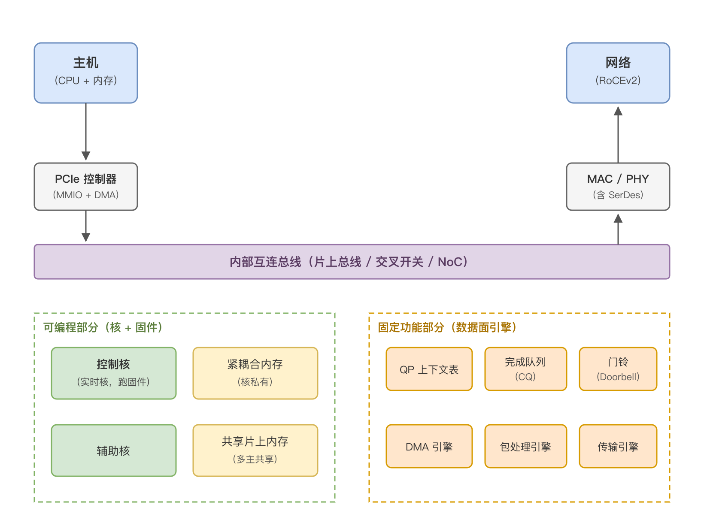
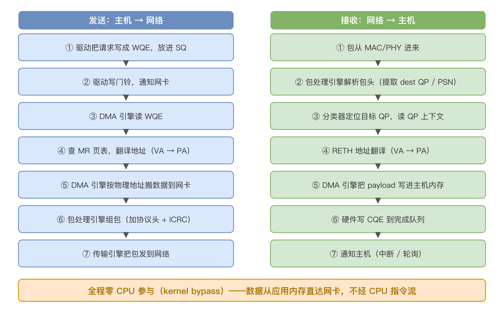
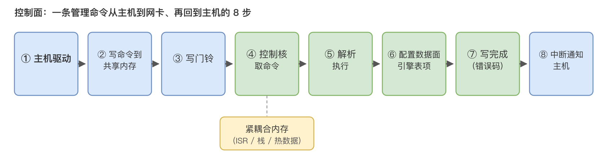
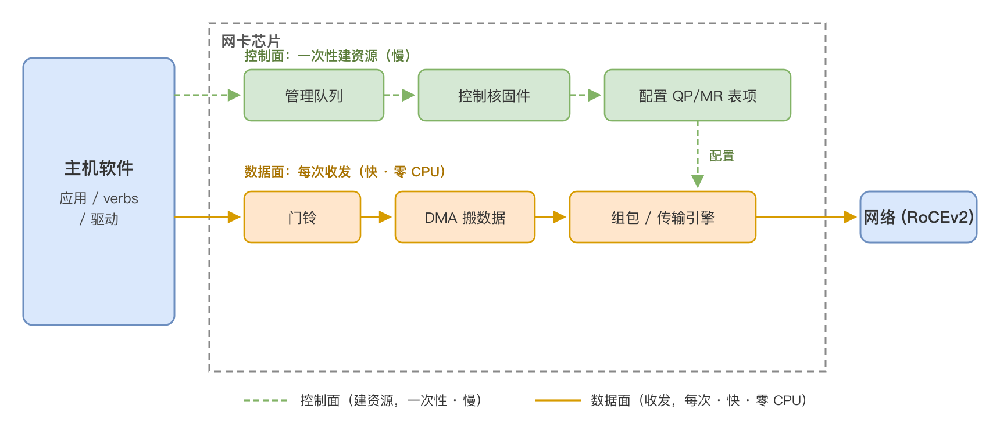

# RDMA 网卡内部架构：控制面与数据面的分工

> 前面几篇我们一直站在**主机侧**看 RDMA：PCIe 驱动那篇讲了主机怎么和网卡打交道，接下来的 verbs 内核调用栈会讲主机软件怎么发起操作。
>
> 这一篇换个视角——**钻进网卡芯片内部**，看那些 verbs 调用最终在网卡里是怎么被"接住"和"执行"的。读完你会明白三件事：网卡为什么要把工作拆成"控制面"和"数据面"两条通路、芯片上有哪些功能块、一条管理命令和一次数据收发分别在网卡内部怎么流转。
>
> 本文用通用概念命名，不绑定任何厂商的私有叫法。

## 1. 为什么网卡要分两条通路

RDMA 网卡（RNIC，RDMA Network Interface Card）夹在主机和网络之间，但对它来说，这两侧要干的活**性质完全不同**——一侧是极致的吞吐，一侧是灵活的配置。

```
主机 (CPU + 内存)
   │ PCIe
   ▼
┌──────────────────── 网卡芯片 ────────────────────┐
│                                                  │
│   控制面：控制核 + 固件   ──►  管理命令（低频、灵活） │
│   数据面：硬件引擎       ──►  数据收发（线速、直通）  │
│                                                  │
└──────────────────────────┬───────────────────────┘
                           │ 网络 (RoCEv2)
                           ▼
```

### 数据面的极致：为什么每包不能过 CPU

数据面要处理的，是网络上每一个进出的数据包。这个频率高到什么程度？拿 100Gbps 线速来算：

- 裸帧：100Gbps ÷ (64B × 8 bit) ≈ **195 MPPS**（兆包/秒）
- 若计入前导码 8B 和帧间隙 12B（即每帧 84B），真实线速 ≈ **148 MPPS**
- 单包处理预算 ≈ **5~7 纳秒**

而现代 CPU 一次中断响应（保存上下文、切到内核态、查设备）就要**微秒级**，与纳秒级预算差出三个数量级；更不用说协议栈拆包、查连接、数据拷贝带来的 cache miss 和上下文切换。所以"每个包都让 CPU 过一遍"这条路，在网卡要支撑的线速面前**根本走不通**。

结论很明确：数据收发必须是**硬件直通**——数据从应用内存直达网卡、再上网络，中间不经过 CPU 的指令流。

### 控制面的灵活：资源要能动态配置

但网卡又不能是纯硬件写死的。RDMA 的核心资源——QP（Queue Pair，队列对）、CQ（Completion Queue，完成队列）、MR（Memory Region，内存区域）——都是**运行时动态创建和销毁**的：

- 应用建立一条连接，就要在网卡上新建一个 QP，并把它迁到目标状态；
- 应用注册一块内存，网卡就要建立"虚拟地址 → 物理地址"的映射表；
- 端口状态、MTU、GID、路由、拥塞参数这些配置也要随时改。

这些操作**频率低、但要灵活可编程**，天生适合用软件（固件）来做，而不是硬编码成电路。

### 矛盾与答案

| 维度 | 数据面 | 控制面 |
|------|--------|--------|
| 干什么 | 收发每一个数据包 | 建 QP/CQ/MR、配置端口、查状态 |
| 频率 | 每包都走，纳秒级 | 低频，毫秒级足够 |
| 关键约束 | 吞吐、延迟、确定性 | 灵活性、可扩展 |
| 由谁做 | **固定功能硬件引擎** | **可编程核 + 固件** |

这就是网卡内部"双通路"分工的根本原因，也是全篇的主线：**专用硬件做重复的高频活（数据面直通），可编程核做灵活的低频活（控制面管理）**。两者各有擅长，各司其职。

## 2. 网卡芯片的硬件架构

把网卡芯片拆开看，它本质上是一颗 SoC（System on Chip，片上系统）：一颗芯片上集成了处理器核、片上内存、专用硬件引擎和对外接口，靠一条内部互连总线连在一起。



### 五大功能块

**① 处理器核（可编程部分）**

- **控制核**：网卡的"大脑"，跑固件，负责整个控制面。它处理主机下发的管理命令、维护 QP/CQ/MR 等资源状态、配置数据面引擎，必要时处理异常。
- **辅助核**：一颗或多颗次要的核，分担可以独立、异步完成的杂活——遥测统计、电源管理、慢路径包处理、看门狗等，把控制核从琐事里解放出来，保证实时性。

**② 片上内存（分两类，详见第 5 节）**

- **紧耦合内存**：核私有、单周期访问，放中断向量表、ISR、任务栈这类对延迟最敏感的东西。
- **共享片上内存**：多主共享，放管理队列缓冲、DMA 描述符环、核间 mailbox 这类需要跨单元读写的数据。

**③ 数据面硬件引擎（固定功能部分）**

网卡里真正"收发"这件事，是由一组**专用硬件引擎**完成的，而不是 CPU：

- **QP 上下文表**：存每个 QP 的完整状态——状态机、地址翻译入口、序列号（PSN）、对端信息等；
- **完成队列（CQ）**：硬件写完成记录（CQE）的地方；
- **门铃（Doorbell）**：主机或固件写它来通知硬件"有新的工作项"；
- **DMA 引擎**：直接读写主机内存，不经过 CPU；
- **包处理引擎**：组包、解析、分类——数据面的核心流水线；
- **传输引擎**：把数据送上网络，处理传输层的可靠性细节。

**④ 对外接口**

- **PCIe 控制器**：对主机，负责 MMIO 和 DMA（就是 PCIe 驱动那篇讲的那套）；
- **MAC/PHY**：对网络，负责把数据变成物理链路上的信号，含 SerDes。

**⑤ 内部互连总线**

把这些块连起来的"主干道"：控制核要配数据面引擎、DMA 引擎要读写共享内存、包处理引擎要把数据交给传输引擎——都走这条总线。

### 关键区分：可编程 vs 固定功能

芯片上的功能块，本质上分成两大类：

| | 可编程部分 | 固定功能部分 |
|---|-----------|-------------|
| 组成 | 控制核 + 辅助核 + 固件 | 数据面硬件引擎 |
| 特点 | 灵活、可改逻辑，但慢 | 快、线速，但只能干设计好的活 |
| 硬件类比 | 通用 CPU | ASIC 专用电路 |

**为什么控制面用可编程核？** 管理命令五花八门、还要随需求演进，只有软件才应付得了这种灵活性。

**为什么数据面用固定功能引擎？** 收发是高度重复、模式固定的流水线作业。专用电路可以**流水线化**——每个时钟周期都在处理不同的包（"取一个包，同时上一个包在解析、上上个包在发送"），从而做到线速吞吐；这是通用 CPU 靠"取指-译码-执行"逐条算所达不到的。

### 深度点：为什么控制核是"实时核"而不是"应用核"

控制核通常选**实时处理器核**（如 ARM Cortex-R 系列），而不是跑 Linux 的**应用核**（Cortex-A 系列）。差别在两个字：**确定性**。

- 实时核面向裸机/RTOS，中断响应延迟低且**可预测**——收到门铃后几个时钟周期内一定进中断处理；
- 应用核跑完整 OS，存在调度抖动、缺页、cache miss，延迟不可控。

控制面要的是"门铃一响就确定地处理"，所以用实时核 + 裸机/RTOS，而不是塞个 Linux 进去。这也顺带决定了第 5 节要讲的紧耦合内存选型。

### 深度点：时钟域与互连

- **时钟域**：数据面引擎跑在高速时钟（几百 MHz 到上 GHz），以满足线速；控制核往往跑在较低时钟（功耗更低）。两者之间靠异步 FIFO / 跨时钟域同步逻辑交换数据。
- **互连总线**：片内互连常见 AXI/AHB 这类总线协议，或更复杂的交叉开关（crossbar）/片上网络（NoC）。数据面内部的高带宽路径通常是**专用点对点数据通路**，不经共享总线，避免争用。

## 3. 数据面：一次收发在网卡内部怎么走

数据面是整张网卡吞吐的命脉。下面看一次发送和一次接收，数据包在芯片内部怎么流转。



### 先认识 WQE 和门铃

数据面的工作项是 **WQE（Work Queue Element，工作队列元素）**，它描述"发什么、发到哪、怎么发"。一个发送 WQE 通常包含：

- **opcode**：操作类型（RDMA Write / RDMA Read / Send 等）；
- **SGE 数组**：Scatter-Gather Element，每项是 `{本地地址, lkey, 长度}`，描述数据在内存里的散列位置；
- **flags**：inline、solicited event 等标志。

WQE 由软件写进主机内存里的发送队列（SQ），硬件用**门铃（Doorbell）**通知"有活干了"。

### 发送：完整流程

```
  1. 应用数据在主机内存里，驱动把请求写成 WQE，放进 SQ
  2. 驱动写「门铃」，通知网卡 SQ 里有新 WQE
  3. DMA 引擎从主机内存读出 WQE
  4. 地址翻译单元按 lkey 查 MR 页表，把虚拟地址翻译成物理地址
  5. DMA 引擎按物理地址从主机内存搬数据到网卡
  6. 包处理引擎组包：加 Eth/IP/UDP/BTH/RETH 头，算 ICRC
  7. 传输引擎把包发到网络
```

整个过程里，**CPU 一次都没参与数据搬运**——这就是 RDMA 的 kernel bypass：数据从应用内存直达网卡，再由硬件发出去。

### 接收：完整流程

```
  1. 包从 MAC/PHY 进来
  2. 包处理引擎解析包头（Eth → IP → UDP → BTH），提取 dest QP、opcode、PSN
  3. 分类器定位目标 QP，读 QP 上下文表
  4. 地址翻译单元把 RETH 里的虚拟地址翻译成物理地址
  5. DMA 引擎把 payload 写进主机内存（对应 QP 的接收缓冲）
  6. 硬件写一条 CQE 到完成队列（含长度、状态、opcode）
  7. 通知主机（中断，或主机轮询 CQ 时发现）
```

发送和接收是**对称**的：一个"从内存到网络"，一个"从网络到内存"，两端都是硬件在干活。

### 深度点：组包时硬件在 RoCEv2 头里填什么

组包这一步，硬件要自己填好 RoCEv2 的协议头（这部分 06 讲过格式，这里看"谁在填"）：

- **BTH（Base Transport Header）**：opcode（这次是什么操作）、PSN（当前包序列号，硬件从 QP 上下文里递增）、dest QP（对端队列号）；
- **RETH（RDMA Extended Transport Header）**：虚拟地址、RKey、长度——直接从 WQE 的 SGE 搬过来；
- **ICRC（Invariant CRC）**：对包的不变字段算 CRC，保证端到端完整性。

这些字段**全由硬件从 QP 上下文和 WQE 里取出来填充**，软件只负责把 WQE 准备好、敲一下门铃。

### 深度点：三个"硬件实现"点到为止

这三个话题——RoCEv2 包格式、拥塞控制——前面已经详细讲过，这里只点出它们在**硬件侧**长什么样：

- **包解析与分类**：包处理引擎里有个**解析器**，按字段逐字节匹配（先看 EtherType，再看 IP 头、UDP 头、BTH……），再交给**分类器**决定这个包属于哪个 QP、走哪条路径。纯组合逻辑，一拍一拍往下走，所以快。
- **重传**：可靠连接的重传由**硬件自动维护**——发出去的包没收到 ACK，硬件自己重发，不打扰 CPU。这就是为什么 RDMA 的可靠性不靠主机软件栈。乱序到达的包也在硬件里重组。
- **拥塞控制**：ECN 标记、速率调节这些也在硬件里做（拥塞控制那篇讲的 DCQCN，就是跑在网卡硬件 + 交换机上的），主机 CPU 无感。

## 4. 控制面：管理命令怎么走

数据面负责"收发"，控制面负责"把收发这件事准备好"。主机要建一个 QP、注册一块内存，就得给网卡下命令——这条命令走的通道，就是**管理队列**。



### 管理队列：主机到固件的命令通道

管理队列（业界也叫 Admin Queue / Command Queue，NVMe 里是同名同构的概念）是主机驱动和控制核固件之间的一条**命令通道**：

- 主机驱动把命令（"建一个 QP""注册这块 MR"）写成一条 entry，放进队列；
- 写门铃通知网卡；
- 控制核固件取出命令、执行、把结果写回；
- 网卡再通知主机"命令完成了"。

它和 QP/CQ 那套数据面队列是**两回事**：QP/CQ 装的是数据收发请求，管理队列装的是配置命令。

### 管理命令长什么样

一条管理命令的 entry 大致是 `{opcode, 参数...}`。opcode 对应 verbs 里的各种操作：

| 管理命令 opcode | 对应 verbs 调用 | 固件做的事 |
|----------------|----------------|-----------|
| CREATE_QP | `ibv_create_qp` | 在 QP 上下文表里分配并初始化一项 |
| MODIFY_QP | `ibv_modify_qp` | 改 QP 状态机、设对端地址 |
| REG_MR | `ibv_reg_mr` | 在地址翻译表里建 VA→PA 映射 |
| CREATE_CQ | `ibv_create_cq` | 分配 CQ，记录其位置 |

可以看到：**verbs 的每个资源操作，最终都翻译成一条管理命令，交给网卡固件去执行**。这就是控制面存在的意义——把软件侧的抽象 API，落到硬件侧的寄存器/表项配置上。

### 控制核固件：事件循环

控制核跑的是**裸机或 RTOS 固件**，主体是一个事件循环：

```
  loop:
    等门铃/中断
    从管理队列取一条命令
    解析 opcode
    执行：写数据面引擎的寄存器 / 表项
    把结果（成功/错误码）写回完成队列
    触发中断通知主机
```

因为命令频率低，这个循环哪怕每条花几百微秒也没关系；关键是**执行要正确、要能处理错误**。

### 一条命令的完整旅程（8 步）

```
  1. 主机驱动把命令写进共享片上内存里的队列
  2. 驱动写门铃，通知网卡
  3. 控制核收到通知，从队列取出命令
  4. 控制核解析命令（opcode + 参数）
  5. 控制核执行：写数据面引擎的寄存器/表项
  6. 控制核把执行结果（含错误码）写回完成队列
  7. 网卡触发中断/事件，通知主机
  8. 主机驱动读到完成，命令结束
```

### 深度点：为什么是"队列 + 门铃"，而不是直接写寄存器

直接写寄存器也能实现，但"队列 + 门铃"有两个关键好处：

- **批量**：驱动可以一口气放好几条命令进队列，再统一敲一次门铃，减少 PCIe 交互次数；
- **异步解耦**：主机不用等固件一条条处理完，命令在队列里排队，固件按自己的节奏取。

这套模式和 NVMe 的 Admin Submission/Completion Queue 是**同一个套路**——正因为是成熟通用的设计，很多网卡/存储控制器都这么干。

## 5. 片上内存怎么分层用

网卡芯片上有两种片上内存，用途泾渭分明。

```
紧耦合内存（核私有）         共享片上内存（多主共享）
  ├─ 中断向量表               ├─ 管理队列缓冲
  ├─ ISR 代码                 ├─ DMA 描述符环
  ├─ 任务栈                   ├─ 核间 mailbox
  └─ 热路径关键数据            └─ 数据面临时缓冲
```

| | 紧耦合内存 | 共享片上内存 |
|---|-----------|-------------|
| 归属 | 某个核**私有** | 多主**共享** |
| 位置 | 直连核，不经过总线 | 挂在内部互连总线上 |
| 延迟 | 单周期、确定 | 可变，受总线仲裁影响 |
| 容量 | 小（KB 级） | 较大（MB 级） |
| 放什么 | 中断向量、ISR、栈、热数据 | 管理队列、DMA 描述符、mailbox |

一句话：**实时关键代码进紧耦合内存，跨单元共享的数据进共享片上内存**。

### 深度点：为什么"确定性"这么重要

控制面要保证"门铃一响，几个周期内一定开始处理"。如果 ISR 代码放在要经过总线仲裁的共享内存里，访问延迟会随总线忙闲而**抖动**，最坏情况下中断响应时间不可控。把 ISR、栈、热数据塞进核私有的紧耦合内存，访问延迟就固定了——这是实时控制的地基。

### 深度点：缓存一致性

- **紧耦合内存**通常**不带 cache**，直连核、行为确定，这正是它延迟可预测的原因；
- **共享片上内存**被多个主（控制核、辅助核、DMA 引擎）访问，需要处理**一致性**问题——要么硬件保证，要么靠软件约定（比如 mailbox 用"写完整 + 标志位"的协议来同步）。

## 6. 两条通路怎么协同

控制面和数据面不是各干各的，它们要频繁配合。

### 数据面完成 → 通知谁

一次数据收发完成后，硬件写 CQE 到完成队列，然后有两种通知方式：

- **中断**：网卡触发中断（通常用 **MSI-X**，多个中断向量，可分别绑到不同 CPU），通知主机或控制核"有完成了"；
- **轮询**：主机/控制核主动去查 CQ 有没有新 CQE。

**取舍**：数据面通常用**轮询**——数据面吞吐高，中断一次的开销反而大，应用在用户态忙等 CQ 更划算；控制面用**中断**——命令频率低，来一条通知一条，省得空转。

### 深度点：事件队列与中断聚合

- **事件队列（EQ，Event Queue）**：有的实现里，完成事件先进 EQ，再由 EQ 触发中断，把"多个完成"和"中断"解耦；
- **中断聚合（interrupt coalescing）**：攒够一批 CQE 再触发一次中断，用"多一点延迟"换"少一点中断开销"，是高吞吐场景的常见优化。

### 控制核 ↔ 辅助核：核间通信

控制核和辅助核通过**共享片上内存里的 mailbox** 通信：一方把消息写进约定好的位置，另一方轮询或收中断来取。辅助核干的是可以独立、异步完成的活（遥测、电源、慢路径），不占控制核的实时处理时间。

### 辅助核分工举例

| 辅助核任务 | 说明 |
|-----------|------|
| 遥测统计 | 收包计数、错误计数、温度/功耗采集 |
| 电源管理 | 空闲时降频、关不用的模块 |
| 慢路径 | 数据面硬件处理不了的罕见/异常包 |
| 看门狗 | 盯着控制核，卡死就复位 |

### 双层通知机制

细看会发现通知是**两层**的：门铃（"有活"）+ 完成队列（"活干完了"）。门铃是主机/固件主动敲的，完成是硬件回填的，一来一回，把"请求"和"完成"解耦开。

## 7. 一次完整 RDMA 操作的全链路

把前面所有部件串起来，看一次完整的 RDMA 操作：



```
① 应用调用 verbs（如 ibv_post_send）
        │
② 控制面（一次性准备）：驱动经管理队列下发 CREATE_QP / REG_MR
        │     控制核固件执行，配好 QP 上下文、MR 页表
③ 应用发起数据操作：驱动写 WQE、敲门铃
        │
④ 网卡数据面：DMA 搬数据、组包、发出去（零 CPU）
        │
⑤ 对端网卡硬件收包、写 CQE
        │
⑥ 应用轮询 CQ，拿到完成，操作结束
```

注意第 ② 步和第 ③ 步的**时间尺度完全不同**：建 QP、注册 MR 是**一次性**的准备（毫秒级、走控制面），而第 ③~⑥ 步是**每次收发**都在发生（纳秒级、走数据面）。这就是为什么数据面必须快、控制面可以慢。

### 各篇在这里的位置

- **PCIe 驱动那篇**：在"主机 ↔ 网卡"这一环，主机怎么通过 PCIe 的 MMIO/DMA 跟网卡交互；
- **本文（网卡内部）**：在"网卡芯片内部"这一环，命令和数据在芯片里怎么走；
- **verbs 内核调用栈系列**：在"主机软件"这一环，应用从 `ibv_*` API 到驱动的完整路径。

三者拼起来，就是 RDMA 从"应用一行代码"到"网卡发出一个包"的完整图景：**软件（verbs + 驱动）负责把请求递到网卡门口，网卡内部的固件负责接住管理命令、硬件负责把数据直通到网络**。

## 总结

- RDMA 网卡内部本质是**双通路分工**：控制面（可编程核 + 固件）管配置，数据面（固定功能硬件引擎）管收发。
- 芯片是一颗 SoC：处理器核、片上内存、数据面引擎、对外接口，靠内部互连总线连起来；其中数据面引擎是可流水线化的专用电路，控制核是追求确定性的实时核。
- 数据面靠**硬件直通**做到线速零 CPU——WQE 描述工作、门铃通知、DMA 搬数据、硬件组包、CQE 回完成；控制面靠**管理队列 + 门铃**做到灵活异步。
- 片上内存分两层：**紧耦合内存**（核私有、确定性）放实时关键数据，**共享片上内存**（多主共享）放跨单元数据。
- 两条通路靠**中断/轮询 + 核间通信**协同，最终拼成一次完整的 RDMA 操作。
