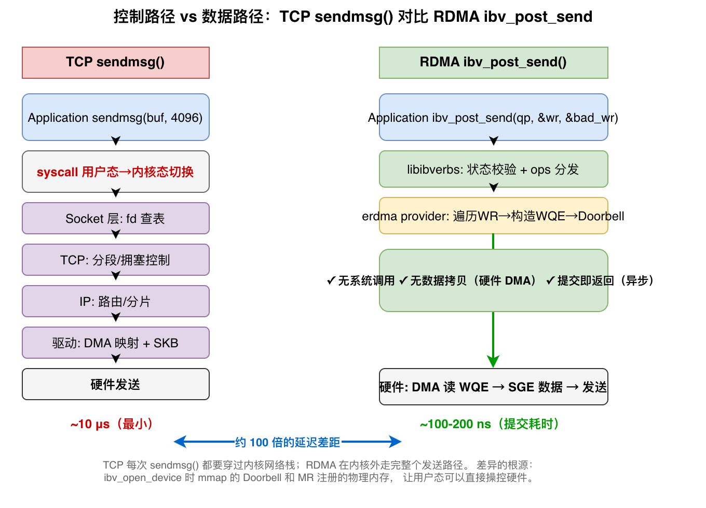

# ibv_post_send：RDMA 数据路径深度解析（以 erdma 网卡为例）

> 分析范围：应用程序 → rdma-core libibverbs → erdma provider → 硬件（无内核参与）
>
> 内核版本: linux-6.12.92 | rdma-core 对应内核头文件同步版本

---

## 1. 一个对比：ibv_post_send 凭什么比 TCP 快 100 倍

假设你在写一个分布式 KV 存储，需要把 4KB 的数据从 A 机器发到 B 机器。你有两个选择：

```
方案一: TCP 网络栈                      方案二: RDMA verbs
─────────────────────────────────      ─────────────────
sendmsg(buf, 4096)                       ibv_post_send(qp, &wr, &bad_wr)
    ↓                                        ↓
syscall (SYS_SENDMSG)                   无系统调用
用户态→内核态切换 (~100ns)              
    ↓                                        ↓
内核 socket 层: 查 fd 表                遍历 WR 链表 → 构造 WQE
    ↓                                        ↓
内核 TCP 层: 分段/滑动窗口/拥塞控制      写 DB Record (cacheable, ~ns)
    ↓                                        ↓
内核 IP 层: 路由/分片                   写 DB Register (MMIO, ~100ns)
    ↓                                        ↓
内核驱动: DMA 映射/SKB 分配             return 0 (提交完成，不等硬件)
    ↓                                        ↓
硬件发送                                 硬件 DMA 读 WQE→读数据→发送
    ↓                                        ↓
返回字节数                              后续 ibv_poll_cq 感知完成

典型延迟: ~10μs (最小值)                典型延迟: ~100-200ns (提交耗时)
```



**同样的数据发送操作，RDMA 路径的提交延迟比 TCP 栈快约 100 倍。** 而且 CPU 全程不参与数据搬运——硬件自己从用户内存 DMA 读取数据，打包成 RoCEv2 包发出。

这个差异不是"优化"出来的，而是**架构选择**的结果。本文通过拆解 `ibv_post_send` 的完整路径，回答三个核心问题：

1. 为什么不需要系统调用？
2. 为什么不需要拷贝数据？
3. 为什么不需要等待完成？

---

## 2. 控制路径 vs 数据路径

回顾前面文章分析的所有 verbs 操作：`ibv_alloc_pd`、`ibv_reg_mr`、`ibv_create_cq`、`ibv_create_qp`、`ibv_modify_qp`。它们有一个共同特征：

**每次调用都通过 `write()`/`ioctl()` 进入内核，内核处理完毕后返回。** 这是 **控制路径（control path）**——建立连接、分配资源，频率低（每秒几次到几十次），可以接受系统调用的开销。

`ibv_post_send` 完全不同。在一个高吞吐 RDMA 应用中，每秒可能调用它数百万次。如果每次都要 `write()` 进内核，CPU 时间会被系统调用吞没。所以 RDMA 的设计选择是：

**数据路径（data path）完全砍掉内核。** 应用程序在用户态直接操作硬件队列，通过 MMIO 寄存器通知硬件，硬件通过 DMA 直接读写用户内存。

```
控制路径（9-14 的 verbs）                      数据路径（ibv_post_send）
═══════════════════════════                  ══════════════════════════
Application                                   Application
    ↓ 函数调用                                     ↓ 函数调用
libibverbs ops 分发                            libibverbs ops 分发
    ↓ 函数调用                                     ↓ 函数调用
erdma provider                                 erdma provider
    ↓ write()/ioctl() ───── 进入内核 ────→      ↓ 直接操作 WQE + Doorbell
内核 uverbs 核心                                                     ║
    ↓                                                               ║ 内核边界
内核 erdma 驱动                                                     ║
    ↓                                                               ║
硬件                                        硬件 ←── DMA 读 WQE

延迟: ~数 μs                                   延迟: ~100-200ns
频率: 低频（连接建立/资源分配）                频率: 高频（每条消息都要调）
```

**决定性的差异发生在 `ibv_open_device` 的时候。** `ibv_open_device` 中三次 mmap 得到的 `ctx->sdb`（SQ Doorbell）、`ctx->rdb`（RQ Doorbell）、`ctx->cdb`（CQ Doorbell）映射到用户态，就是为这一刻准备的。`create_cq` / `create_qp` 时分配的用户态 CQ 队列缓冲和 Doorbell 记录，也是硬件直接读写的前提。

---

## 3. 关键数据结构

`ibv_post_send` 涉及 3 个核心结构，其他都是辅助。

### 3.1 输入：工作请求 — `struct ibv_send_wr`

```c
struct ibv_send_wr {
    uint64_t            wr_id;       // 用户定义的 ID，CQE 带回以匹配完成
    struct ibv_send_wr *next;        // 链表下一个 WR（支持批量提交）
    struct ibv_sge     *sg_list;     // SGE 数组（数据来源描述）
    int                 num_sge;     // SGE 数量
    enum ibv_wr_opcode  opcode;      // SEND / RDMA_WRITE / RDMA_READ 等
    int                 send_flags;  // SIGNALED / INLINE / SOLICITED
    union {
        __be32          imm_data;    // 立即数（SEND_WITH_IMM）
        uint32_t        rkey;        // 远端密钥（RDMA_WRITE）
    };
    union {
        struct { uint64_t remote_addr; uint32_t rkey; } rdma; // RDMA 远端地址
    } wr;
};
```

SGE（Scatter-Gather Element）描述数据来源：

```c
struct ibv_sge {
    uint64_t    addr;       // 本地数据缓冲区地址
    uint32_t    length;     // 数据长度
    uint32_t    lkey;       // 本地内存密钥（来自 ibv_reg_mr）
};
```

### 3.2 输出：WQE — `struct erdma_sqe`

erdma 的 WQE（Work Queue Entry）也叫 SQEBB（SQ Entry Byte Block），固定 **64 字节**，与 CPU Cache Line 对齐：

```
Byte 0 ─────────────────────────────────────────────────────── Byte 63
┌─────┬─────┬──────────┬──────────────────────────────────────────────────┐
│opcode│flags│ sqe_num  │   length (total bytes)                         │
│8 bits│8bits│ 8 bits   │   32 bits                                      │
├──────┴──────┴──────────┴────────────────────────────────────────────────┤
│ SGE[0..4] 数组 (5 × 16 bytes = 80 bytes)                                │
│ 每条 SGE: VA(8B) | lkey(4B) | length(4B)                              │
├─────────────────────────────────────────────────────────────────────────┤
│ imm_data_or_rkey (4B) │ rdma_va (8B) │ rkey (4B)  │ 预留               │
└─────────────────────────────────────────────────────────────────────────┘
```

- **SEND 操作**：使用 Header + SGE + imm_data，不需要 rdma_va/rkey
- **RDMA WRITE/READ**：额外填充 rdma_va + rkey 指定远端地址和密钥
- **INLINE 标志**：SGE 区域直接内嵌数据本身（而非指针），省去硬件一次 SGE 数据 DMA

> SQEBB 为什么是 64 字节？CPU 以 cache line 为粒度操作内存，64 字节确保 WQE 写入是原子的——写 cache line 的一半不会同时被另一个核读到一半的值。

### 3.3 载体：发送队列 — `struct erdma_sq`

```c
struct erdma_sq {
    void       *qbuf;       // WQE 环形队列（create_qp 时分配，页对齐）
    int         depth;      // SQ 深度（WQE 上限数）
    uint32_t    head;       // 生产者索引（用户态 post_send 写入 WQE 后递增）
    uint32_t    tail;       // 消费者索引（硬件 DMA 读取 WQE 后更新）
    uint32_t   *wr_tbl;     // WR ID 表（按 head 索引存储 wr_id，供 CQE 反查）
    spinlock_t  lock;       // 多线程保护
};
```

`head` 和 `tail` 构成环形队列的生产者-消费者模型。用户态是生产者（写 WQE，推进 head），硬件是消费者（DMA 读 WQE，推进 tail）。`head == tail` 时队列满，需要等硬件消费。

Doorbell Record 和 Doorbell Register 不属于 `erdma_sq`，但它们的工作方式和 SQ 紧密相关，在下面 Doorbell 部分详细讲。

---

## 4. 完整调用流程

### Step 1: 应用程序调用

```c
// 准备好数据和请求
struct ibv_sge sge = { .addr = (uint64_t)buf, .length = 4096, .lkey = mr->lkey };
struct ibv_send_wr wr = {
    .wr_id = 42, .opcode = IBV_WR_SEND, .send_flags = IBV_SEND_SIGNALED,
    .sg_list = &sge, .num_sge = 1,
};
struct ibv_send_wr *bad_wr;
ibv_post_send(qp, &wr, &bad_wr);
```

`wr->next` 可以为 NULL（单条）或指向下一条 WR（批量）。`bad_wr` 用于失败诊断。

---

### Step 2: libibverbs 入口 — QP 状态检查 + ops 分发

**文件**: `rdma-core/libibverbs/verbs.c`

```c
int ibv_post_send(struct ibv_qp *qp, struct ibv_send_wr *wr,
                  struct ibv_send_wr **bad_wr)
{
    // 只允许在 RTS 或 SQD 状态提交发送
    if (qp->state != IBV_QPS_RTS && qp->state != IBV_QPS_SQD)
        return ENOTSUP;

    return get_ops(qp->context)->post_send(qp, wr, bad_wr);
}
```

注意这里 **没有任何系统调用**。`get_ops()` 只是从 `verbs_context` 中提取函数指针表，然后直接调用 `erdma_post_send`。和控制路径的 `ibv_alloc_pd`（里面调 `write()`）对比一下就很清楚了。

---

### Step 3: erdma provider — `erdma_post_send()`

这是整个数据路径的核心。三步走：**遍历 → 构造 → 通知**。

**文件**: `rdma-core/providers/erdma/erdma_verbs.c`

```c
static int erdma_post_send(struct ibv_qp *ibqp, struct ibv_send_wr *wr,
                           struct ibv_send_wr **bad_wr)
{
    struct erdma_qp *qp = to_eqp(ibqp);
    struct erdma_sq *sq = &qp->sq;
    int sqe_num = 0;

    pthread_spin_lock(&sq->lock);

    // === 第一步：遍历 WR 链表，计算所需 WQE 数量 ===
    for (struct ibv_send_wr *w = wr; w; w = w->next) {
        int wqe_sqebb = 1;
        if (w->num_sge > ERDMA_WQE_MAX_SGE_NUM)
            wqe_sqebb += (w->num_sge - 1) / ERDMA_WQE_MAX_SGE_NUM + 1;
        sqe_num += wqe_sqebb;
    }

    // 检查 SQ 是否有足够空间
    if (sqe_num > erdma_sq_avail(sq)) {
        pthread_spin_unlock(&sq->lock);
        *bad_wr = wr;
        return ENOMEM;
    }

    // === 第二步：逐条构造 WQE 写入 SQ 队列 ===
    for (struct ibv_send_wr *w = wr; w; w = w->next) {
        struct erdma_sqe *sqe = erdma_sq_get_wqe(sq);  // 取下一个空闲 slot
        erdma_build_wqe(qp, w, sqe);                    // 填充 WQE
        erdma_sq_advance(sq);                            // 推进 head
    }

    // === 第三步：Doorbell 通知硬件 ===
    erdma_update_db_record(qp->db_records, sq->head);   // ① 写 DB Record
    mmio_write64(qp->sdb, qp->id | sq->head);            // ② 写 Doorbell 寄存器

    pthread_spin_unlock(&sq->lock);
    return 0;  // 提交完成，不等硬件
}
```

几个关键设计要点：

**两阶段遍历**。第一次遍历只算 WQE 总数，做空间检查（门控）。第二次才写入。这样避免了"写到一半发现空间不够需要回滚"的尴尬。

**批量提交**。`wr->next` 可以串联多条 WR，一次 `ibv_post_send` 提交它们全部，只在最后写一次 Doorbell。MMIO 写是最贵的操作（~100ns），摊薄到 N 条 WR 上就很划算。

**自旋锁而非互斥锁**。`sq->lock` 是 `pthread_spinlock_t`。post_send 的临界区很短（几十到几百 ns），自旋等待比挂起线程更高效。这也是数据路径的典型优化——用忙等换延迟。

---

### Step 4: WQE 构造 — `erdma_build_wqe()`

**文件**: `rdma-core/providers/erdma/erdma_verbs.c`

```c
static void erdma_build_wqe(struct erdma_qp *qp, struct ibv_send_wr *wr,
                             struct erdma_sqe *sqe)
{
    memset(sqe, 0, SQEBB_SIZE);   // 清零整个 WQE（避免硬件读到脏数据）

    // 设置 Header
    sqe->hdr = encode_hdr(wr->opcode, wr->send_flags, wr->num_sge);

    // SEND: 填充 SGE（本地地址 + lkey）
    for (int i = 0; i < wr->num_sge; i++) {
        sqe->sge[i].va     = wr->sg_list[i].addr;
        sqe->sge[i].lkey   = wr->sg_list[i].lkey;
        sqe->sge[i].length = wr->sg_list[i].length;
    }

    // RDMA WRITE/READ: 额外填充远端地址和 rkey
    if (is_rdma_op(wr->opcode)) {
        sqe->rdma_va = wr->wr.rdma.remote_addr;
        sqe->rkey    = wr->wr.rdma.rkey;
    }

    // INLINE: 数据直接内嵌到 WQE 中
    if (wr->send_flags & IBV_SEND_INLINE) {
        uint8_t *dst = inline_data_area(sqe);
        for (int i = 0; i < wr->num_sge; i++)
            memcpy(dst + offset, wr->sg_list[i].addr, wr->sg_list[i].length);
    }

    // 记录 wr_id（按 head 索引存储，CQE 反查用）
    sq->wr_tbl[sq->head & (sq->depth - 1)] = wr->wr_id;
}
```

**INLINE 的意义**：通常硬件需要两次 DMA——先读 WQE，再根据 WQE 里的 SGE 去读数据。INLINE 把数据直接放在 WQE 里，硬件一次 DMA 读 WQE 就拿到数据，省去第二次 DMA。对小消息（比如几十到几百字节的 RPC 请求）收益明显。

---

### Step 5: Doorbell 双层通知机制

这是整个过程中唯一一次 MMIO 操作，也是硬件被唤醒的唯一信号。

```
用户态内存（系统 DRAM，Cacheable）          MMIO 空间（BAR，Uncacheable）
┌──────────────────────────────┐            ┌───────────────────────────┐
│ DB Record（64 bytes）        │            │ DB Register（4 bytes）    │
│   head  = 0x05               │            │   encode(qp_id, head)     │
│   ↑ 步骤①: 普通内存写 (~ns)  │            │   ↑ 步骤②: MMIO 写       │
│   缓存友好的写操作            │            │   通过 PCIe TLP 到达硬件  │
└──────────┬───────────────────┘            └──────────┬────────────────┘
           │                                           │
           │                                           │ PCIe TLP 触发中断
           │                                    ┌──────▼──────────────┐
           └──────── DMA 回读 ─────────────────→│ 硬件 收到通知       │
                "head 到了 0x05，                  │ ③ DMA 读 DB Record│
                 我需要读哪几个 WQE"               │ ④ DMA 读 WQE      │
                                                  │ ⑤ DMA 读 SGE 数据 │
                                                  │ ⑥ 执行发送        │
                                                  └────────────────────┘
```

**为什么需要双层？**

- **DB Record 是 cacheable 内存写**，极快（几个 ns），但硬件无法感知 DRAM 中有新数据
- **DB Register 是 MMIO 写**，触发 PCIe TLP 到达硬件，硬件收到后**被唤醒**，然后通过 DMA 回读 DB Record 确认 head 位置

如果只有 DB Register，硬件需要频繁 MMIO read（~1μs）来轮询 head 值。加了 DB Record 后，硬件只在自己空闲时通过 DMA 读一次（DMA read 比 MMIO read 快得多）。

**为什么要写 DB Register？** DB Record 写只是更新了内存，硬件不会因为这个被通知。写 DB Register 等于"按门铃"—— "有新活了，来看看"。硬件被唤醒后从 DB Record 读 head 值，知道自己要处理到第几个 WQE。

---

## 5. 硬件侧处理

`erdma_post_send` 返回 0 时，WQE 已在 SQ 队列中，但硬件可能还没处理。接下来硬件异步执行：

```
① 收到 Doorbell 寄存器写 → 被唤醒
② DMA 读取 DB Record → 获知需要处理到 head=0x05
③ DMA 读取 SQ[old_tail .. 0x05] 的 WQE（链式 DMA）
④ 解析每个 WQE Header → 识别 opcode
⑤ 对 SEND: DMA 读取 SGE 指向的用户数据 → 构造 RoCEv2 包 → 发网线
   对 RDMA WRITE: 同上 + 写远端内存（需要远端 rkey）
   对 RDMA READ: 发送 READ 请求包到对端
⑥ 完成后（可选，取决于 SIGNALED 标志）:
   DMA 写入 CQE 到 CQ 环形缓冲（用户态轮询获取）
```

整个过程从步骤①到⑥，CPU 完全不参与。CPU 在做什么？可能在跑下一个 `ibv_post_send`，也可能在 `ibv_poll_cq` 轮询上一个请求的完成状态。

---

## 6. 三个"不"的答案

回到开篇的问题：

**为什么不需系统调用？** 因为所有硬件交互资源——WQE 队列、Doorbell 寄存器、CQE 队列——在 `ibv_open_device` / `ibv_create_qp` / `ibv_create_cq` 时已经 mmap 到用户态。数据路径不需要请求新资源，不需要改内核状态，直接操作这些映射好的内存即可。

**为什么不需拷贝数据？** 因为 `ibv_reg_mr` 已经把用户内存注册到了硬件（lock 物理页 + 建立 MTT 表 + 分配 STAG/lkey）。硬件拿到 lkey 后可以通过 DMA 直接访问用户内存物理页，不需要 CPU 做 `copy_from_user`。

**为什么不需等待完成？** 因为 RDMA 是异步模型。"提交"和"完成"是分离的——`ibv_post_send` 只负责把 WQE 放入 SQ 并通知硬件，完成由 `ibv_poll_cq` 独立感知。提交返回时硬件可能还没开始执行，但用户不必等。

---

## 7. 总结

`ibv_post_send` 的设计哲学是 **"把能提前做的都做了，剩下的走纯用户态快路径"**：

- mmap 映射、MR 注册、WQE 队列分配——这些控制路径的铺垫，最终服务于数据路径的一次 Doorbell 写
- 从应用调用到硬件唤醒，中间不经过任何一个内核函数

但这只是数据路径的一半。下一篇文章 `ibv_post_recv` 将看到接收侧的设计——为什么 RDMA 需要预投递 RQE，以及硬件如何把到达的数据 DMA 到正确的用户缓冲区。

### 完整调用链一览

| 步骤 | 文件/函数 | 核心动作 | 内核参与 |
|------|-----------|----------|----------|
| ① | 用户代码 | `ibv_post_send(qp, &wr, &bad_wr)` | — |
| ② | `rdma-core/libibverbs/verbs.c` | QP 状态校验 + `get_ops()->post_send()` | — |
| ③ | `rdma-core/providers/erdma/erdma_verbs.c` | 遍历 WR 链表，计算 SQEBB 数 | — |
| ④ | `rdma-core/providers/erdma/erdma_verbs.c` | `erdma_build_wqe()` 填充 WQE | — |
| ⑤ | `rdma-core/providers/erdma/erdma_verbs.c` | 写 DB Record → 写 Doorbell MMIO | — |
| ⑥ | 硬件 | DMA 读 DB Record → WQE → SGE 数据 → 发送 | — |

---

## 附录: 相关文件路径

| 组件 | 路径 |
|------|------|
| libibverbs 入口 | `rdma-core/libibverbs/verbs.c` |
| libibverbs WR/SGE 结构 | `rdma-core/libibverbs/verbs.h` |
| 用户态 erdma post_send | `rdma-core/providers/erdma/erdma_verbs.c` |
| 用户态 erdma QP/SQ 结构 | `rdma-core/providers/erdma/erdma_verbs.h` |
| erdma ABI 定义 | `rdma-core/kernel-headers/rdma/erdma-abi.h` |
