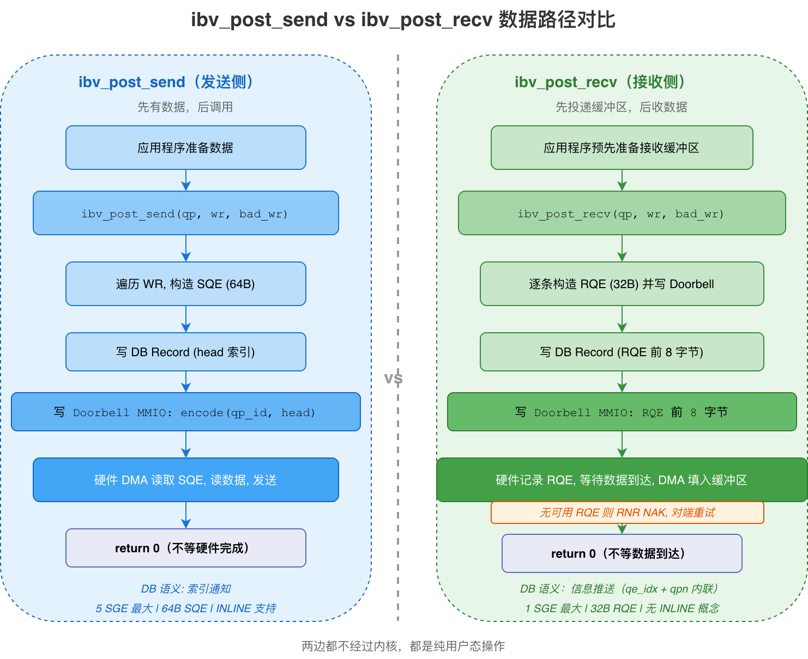

# ibv_post_recv：RDMA 接收侧数据路径深度解析（以 erdma 网卡为例）

> 分析范围：应用程序 → rdma-core libibverbs → erdma provider → 硬件（无内核参与）
>
> 内核版本: linux-6.12.92 | rdma-core 对应内核头文件同步版本

---

## 1. 一个对比：发送和接收为什么不对称

上一篇文章拆解了 `ibv_post_send`，展示了发送侧如何做到 100-200ns 的提交延迟。按直觉，发送和接收应该是对称的——发送方推数据，接收方收数据，大家都用类似的 API。

但 RDMA 的接收侧完全不同。看两个 API 的调用模式：

```
发送侧                                    接收侧
──────────────────────                  ──────────────────────
ibv_post_send(qp, &wr, &bad_wr)         ibv_post_recv(qp, &wr, &bad_wr)
  "我有一批数据要发出去"                   "我提前准备好一批缓冲区"
  先有数据，再调用 post_send              先调用 post_recv，数据到达时硬件自动写入
  提交 = 通知硬件"来拿活"                 提交 = 通知硬件"这里有坑位，数据来了往这填"

调用时机: 有数据要发时                     调用时机: 在数据到达之前
```



**发送是"我有数据给你"，接收是"我准备好接数据了"。** 这个区别不是 API 命名的文字游戏，而是 RDMA 硬件架构决定的。发送方知道什么时候有数据要发，但接收方不知道数据什么时候会到——所以**必须提前投递好缓冲区**让硬件填充，这就是"预投递"（pre-posted receive）的含义。

如果数据到达时没有预投递的 RQE（Receive Queue Entry），硬件会返回 **RNR NAK**（Receiver Not Ready），发送方收到后重试。这意味着接收侧的性能瓶颈通常不是 CPU 算力，而是**预投递缓冲区的深度**。

本文拆解 `ibv_post_recv` 的完整路径，回答三个问题：

1. 为什么接收侧需要提前预投递，而发送侧不需要？
2. RQE 和 SQE 在结构上有什么不同，为什么会有这些不同？
3. post_recv 的 Doorbell 机制和 post_send 有什么差异？

---

## 2. 控制路径 vs 数据路径（回顾）

和 `ibv_post_send` 一样，`ibv_post_recv` 也走纯用户态数据路径。回顾一下之前文章中的结论：

```
控制路径（ibv_alloc_pd / ibv_create_qp 等）      数据路径（ibv_post_send / ibv_post_recv）
══════════════════════════════════              ═══════════════════════════════
Application                                     Application
    ↓ 函数调用                                       ↓ 函数调用
libibverbs ops 分发                              libibverbs ops 分发
    ↓ 函数调用                                       ↓ 函数调用
erdma provider                                   erdma provider
    ↓ write()/ioctl() ─── 进入内核 ───→           ↓ 直接操作 RQE + Doorbell
内核 uverbs 核心                                                     ║
    ↓                                                               ║ 内核边界
内核 erdma 驱动                                                     ║
    ↓                                                               ║
硬件                                          硬件 ←── DMA 读 RQE

延迟: ~数 μs                                     延迟: ~几十 ns
```

`ibv_open_device` 时 mmap 的 RQ Doorbell (`ctx->rdb`) 和 RQ Doorbell Record，就是为 post_recv 准备的。`create_qp` 时分配的 RQ 环形队列缓冲也在用户态直接可写。

---

## 3. 关键数据结构

### 3.1 输入：接收工作请求 — `struct ibv_recv_wr`

```c
struct ibv_recv_wr {
    uint64_t            wr_id;       // 用户定义的 ID，CQE 带回以匹配完成
    struct ibv_recv_wr *next;        // 链表下一个 WR（支持批量提交）
    struct ibv_sge     *sg_list;     // SGE 数组（接收缓冲区描述）
    int                 num_sge;     // SGE 数量
};
```

和 `ibv_send_wr` 对比，recv WR 少了 `opcode`、`send_flags`、`imm_data`、`rdma` 等字段。原因很简单：**接收操作不需要指定操作类型**——硬件从到达的数据包中解析出操作码（SEND / RDMA WRITE / RDMA READ），接收侧只需要提供缓冲区让它往里写数据就行。

但这也意味着一个关键限制：**erdma 的 recv WR 只支持 1 个 SGE**。多 SGE 的 recv WR 会返回 `-EINVAL`。这是因为接收侧不知道到达的数据是什么操作类型、具体有多长，硬件收到数据后需要以 1 个连续缓冲区为单位进行匹配和填充——多 SGE 散列会大大增加硬件复杂度。

### 3.2 输出：RQE — `struct erdma_rqe`

erdma 的 RQE 固定 **32 字节**，正好是 SQE（64 字节）的一半：

```
Byte 0 ───────────────────────────────────────────── Byte 31
┌────────────┬───────────┬───────────────────────────────────┐
│   qe_idx   │  rsvd     │  qpn (QPN)                       │
│   16 bits  │  16 bits  │  32 bits                         │
├────────────┴───────────┼───────────────────────────────────┤
│   rsvd2                 │  rsvd3                           │
│   32 bits               │  32 bits                         │
├─────────────────────────┴───────────────────────────────────┤
│   to (Target Virtual Address, 64 bits)                      │
│   接收缓冲区的目标虚拟地址                                    │
├─────────────────────────┬───────────────────────────────────┤
│   length (32 bits)       │  stag / lkey (32 bits)           │
│   缓冲区长度              │  本地内存密钥                     │
└─────────────────────────┴───────────────────────────────────┘
```

RQE 比 SQE 小的原因：

- **不需要操作码/标志位**：接收操作由硬件处理，不需要指定操作类型
- **不需要远端地址/rkey**：接收侧不访问远端内存，只需要本地缓冲区地址
- **只有 1 个 SGE**：不需要支持多条 SGE 的数组

精简的结构意味着更小的 DMA 开销——硬件一次读 32 字节就可以获取全部信息。

### 3.3 载体：接收队列 — `struct erdma_queue`

```c
struct erdma_queue {
    void       *qbuf;       // RQE 环形队列（create_qp 时分配，页对齐）
    void       *db;         // Doorbell MMIO 地址 (mmap 映射)
    uint16_t    depth;      // RQ 深度（RQE 上限数，2 的幂）
    uint32_t    size;       // RQ 队列大小（字节）
    uint16_t    pi;         // 生产者索引（用户态 post_recv 写入 RQE 后递增）
    uint16_t    ci;         // 消费者索引（硬件 DMA 读取 RQE 后更新）
    uint64_t   *wr_tbl;     // WR ID 表（按 pi 索引存储 wr_id，供 CQE 反查）
    void       *db_record;  // Doorbell Record（指向 db_records 页中的第二个 8 字节）
};
```

`pi` 和 `ci` 构成生产者-消费者模型——但注意用户态是**生产者**（投递 RQE，推进 pi），硬件是**消费者**（数据到达时消耗 RQE 并推进 ci）。`pi == ci` 时队列满（没有可用的 RQE），到达的数据会触发 RNR NAK。

Doorbell Record 在 QP 创建时分配：`db_records[0]` 给 SQ，`db_records[1]` 给 RQ。两个队列共享同一页但独立操作。

---

## 4. 完整调用流程

### Step 1: 应用程序调用

```c
// 提前准备好接收缓冲区
struct ibv_sge sge = { .addr = (uint64_t)recv_buf, .length = 4096, .lkey = mr->lkey };
struct ibv_recv_wr wr = {
    .wr_id = 99, .sg_list = &sge, .num_sge = 1,
};
struct ibv_recv_wr *bad_wr;
ibv_post_recv(qp, &wr, &bad_wr);
```

注意调用时机：这段代码通常在连接建立后、数据收发前执行。如果需要接收 N 条消息，就提前投递 N 个 recv WR。每次 `ibv_poll_cq` 回收一个完成的接收 CQE 后，通常立即补投一个新的 recv WR 来维持水位。

---

### Step 2: libibverbs 入口 — 直接分发到底

**文件**: `rdma-core/libibverbs/verbs.h`

```c
static inline int ibv_post_recv(struct ibv_qp *qp, struct ibv_recv_wr *wr,
                                struct ibv_recv_wr **bad_wr)
{
    return qp->context->ops.post_recv(qp, wr, bad_wr);
}
```

和 `ibv_post_send` 不同，`ibv_post_recv` 甚至不做 QP 状态检查。这是因为：

1. **post_recv 可以在 INIT 状态就开始投递**——连接还没建立好就可以先把接收缓冲区准备好。实际上 `ibv_modify_qp` 转到 RTR 之前，预投递的 RQE 就在 RQ 中了
2. **post_send 必须等到 RTS**——需要发送时连接必须已建立，所以入口处会检查 QP 状态

这是 inline 函数，直接通过 ops 表分发到 erdma provider，全程在用户态。

---

### Step 3: erdma provider — `erdma_post_recv()`

**文件**: `rdma-core/providers/erdma/erdma_verbs.c`

```c
int erdma_post_recv(struct ibv_qp *base_qp, struct ibv_recv_wr *wr,
                    struct ibv_recv_wr **bad_wr)
{
    struct erdma_qp *qp = to_eqp(base_qp);
    int ret = 0;

    if (base_qp->state == IBV_QPS_ERR) {
        *bad_wr = wr;
        return -EIO;
    }

    pthread_spin_lock(&qp->rq_lock);

    while (wr) {
        ret = push_recv_wqe(qp, wr);
        if (ret) {
            *bad_wr = wr;
            break;
        }
        wr = wr->next;
    }

    pthread_spin_unlock(&qp->rq_lock);
    return ret;
}
```

结构上和 `erdma_post_send` 很相似，但有一个重要差异：**没有两阶段遍历**。post_recv 边遍历边写入——每次 `push_recv_wqe` 后立即写 Doorbell，而不是汇总到最后一个 Doorbell。

原因：接收侧 Doorbell 的内容是 RQE 本身的前 8 字节（而非简单的 head 索引），每次投递都需要把新 RQE 的信息推给硬件。这一点在后面 Doorbell 机制部分详述。

另外，锁是单独的 `qp->rq_lock`，和 SQ 的 `sq_lock` 分开。发送和接收可以并行提交到不同的队列，互不阻塞。

---

### Step 4: RQE 构造 — `push_recv_wqe()`

这是整个 post_recv 的核心：

```c
static int push_recv_wqe(struct erdma_qp *qp, struct ibv_recv_wr *wr)
{
    uint16_t rq_pi = qp->rq.pi;
    uint16_t idx = rq_pi & (qp->rq.depth - 1);
    struct erdma_rqe *rqe = (struct erdma_rqe *)qp->rq.qbuf + idx;

    // ① 队列满检查
    if ((uint16_t)(rq_pi - qp->rq.ci) == qp->rq.depth)
        return -ENOMEM;

    // ② 填充 qe_idx 和 qpn
    rqe->qe_idx = htole16(rq_pi + 1);
    rqe->qpn = htole32(qp->id);

    // ③ 记录 wr_id（按生产者索引反查用）
    qp->rq.wr_tbl[idx] = wr->wr_id;

    // ④ 填充 SGE 信息（只支持 0 或 1 个 SGE）
    if (wr->num_sge == 0) {
        rqe->length = 0;
    } else if (wr->num_sge == 1) {
        rqe->stag   = htole32(wr->sg_list[0].lkey);
        rqe->to     = htole64(wr->sg_list[0].addr);
        rqe->length = htole32(wr->sg_list[0].length);
    } else {
        return -EINVAL;  // 多 SGE 不支持
    }

    // ⑤ Doorbell：写 DB Record → 内存屏障 → 写 DB Register
    *(__le64 *)qp->rq.db_record = *(__le64 *)rqe;
    udma_to_device_barrier();
    mmio_write64_le(qp->rq.db, *(__le64 *)rqe);

    // ⑥ 推进生产者索引
    qp->rq.pi = rq_pi + 1;
    return 0;
}
```

几个要点：

**单 SGE 限制**。和 post_send 支持最多 5 个 SGE 不同，post_recv 只支持 0 或 1 个 SGE。这是 erdma 硬件的设计选择——接收侧硬件需要做包-SGE 匹配，多 SGE 会使匹配逻辑复杂度呈指数增长。

**qe_idx 的含义**。`qe_idx` 设置为 `rq_pi + 1`（1-indexed），是这条 RQE 在整个 QP 生命周期内的序号。硬件在处理完这条 RQE 后，把这个值写回 CQE，驱动通过它确认是哪条 RQE 完成了。

**内存屏障**。`udma_to_device_barrier()` 确保 DB Record 写入在 MMIO 之前对硬件可见。因为 DB Record 在 cacheable 内存中，而 MMIO 写走 PCIe uncacheable 路径——没有屏障的话，MMIO 写可能先于 DB Record 写到达硬件，硬件读到的是过时的 DB Record 内容。

---

### Step 5: Doorbell 机制 — 和 post_send 的关键差异

这是 post_send 和 post_recv 最重要的差异点。

```
post_send 的 Doorbell                     post_recv 的 Doorbell
──────────────────────                   ──────────────────────
写 DB Record: head 值                    写 DB Record: RQE 的前 8 字节
写 DB Register: encode(qp_id, head)      写 DB Register: RQE 的前 8 字节
硬件行为: 自己去读 WQE                   硬件行为: 直接从 DB Register 获取 qe_idx + qpn
```

```
用户态内存（系统 DRAM，Cacheable）          MMIO 空间（BAR，Uncacheable）
┌──────────────────────────────┐            ┌───────────────────────────┐
│ DB Record（8 bytes）         │            │ DB Register（8 bytes）    │
│   RQE 前 8 字节:             │            │   直接写入 RQE 前 8 字节  │
│   qe_idx | qpn               │            │   qe_idx | qpn           │
│   ↑ 步骤①: 普通内存写        │            │   ↑ 步骤②: MMIO 写       │
└──────────┬───────────────────┘            └──────────┬────────────────┘
           │                                           │
           │ 内存屏障                                   │ PCIe TLP
           │                                           │
           │                                    ┌──────▼──────────────────┐
           │                                    │ 硬件收到通知             │
           └──────── DMA 回读 ─────────────────→│ ③ 从 DB Register 已获取 │
                                                │    qe_idx + qpn         │
                                                │ ④ DMA 读完整 RQE       │
                                                │    (获取 to/length/stag)│
                                                │ ⑤ 数据到达时 DMA 写     │
                                                │    到目标缓冲区          │
                                                └─────────────────────────┘
```

**为什么 post_recv 写 RQE 内容到 DB Register，而 post_send 只写 head 索引？**

这是硬件设计的权衡：

- **post_send**：硬件需要读 WQE 才能知道 SGE 信息（数据在哪），所以 DB Register 只需要告诉硬件"有新的 WQE 了，从第 N 个开始读"。硬件醒来后自己 DMA 读 WQE 获取详细地址。
- **post_recv**：RQE 的关键信息（qe_idx 和 qpn）正好在前 8 字节，直接塞进 DB Register。硬件醒来时已经把"这条 RQE 属于哪个 QP"和"序号是多少"拿到手了，可以立刻开始匹配到达的数据包。完整的 RQE（含目标地址和长度）硬件通过后续 DMA 读取。

简单说：**post_send 的 DB 是"索引通知"，post_recv 的 DB 是"信息推送"**。后者把最关键的鉴权和定位信息内联到 MMIO 写中，进一步减少延迟。

---

## 5. 预投递模型详解

### 5.1 为什么必须预投递

RDMA 硬件收到数据包时，它需要立刻知道两个问题：

1. 这个包属于哪个 QP？（通过包头的 QPN 字段匹配）
2. 数据写到哪个用户缓冲区？（从该 QP 的 RQ 中取下一个可用的 RQE）

如果硬件查到 RQ 中没有 RQE，它不能"等一等"——硬件是流水线结构，不能为某个 QP 的某一帧阻塞整个数据路径。它只能发送 **RNR NAK**（Receiver Not Ready），告诉发送方"我没准备好，你重试"。

发送方收到 RNR NAK 后，按 QP 属性中配置的 `rnr_retry` 次数重试。重试也会消耗带宽和时延。所以 RDMA 应用的正确做法是：

- 连接建立后立即预投递一批 RQE
- 每次 `ibv_poll_cq` 回收完成时立即补投一个新的 RQE
- 水位保持：永远不让 RQ 变空

### 5.2 预投递数量

| 场景 | 建议 RQ 深度 | 原因 |
|------|-------------|------|
| 低吞吐 RPC（< 100 msg/s） | 16-32 | 请求频率低，少量缓冲即可 |
| 中吞吐流式传输（1K-10K msg/s） | 256-512 | 覆盖 poll/poll 间的消息到达 |
| 高吞吐（> 100K msg/s） | 1024+ | 减少 RNR，提升流水线效率 |
| 单边 RDMA WRITE（无接收） | 0 | 接收侧完全不需要 post_recv |

> 对于纯 RDMA WRITE 场景，接收侧可以不投递任何 RQE，因为 WRITE 的数据直接写到目标 MR 缓冲区，不消耗 RQE。只有 SEND 操作和 RDMA READ Response（由对端的 READ 触发）需要 RQE。

---

## 6. post_send vs post_recv 完整对比

| 维度 | `ibv_post_send` | `ibv_post_recv` |
|------|----------------|-----------------|
| 调用时机 | 有数据要发送时 | 数据到达之前（预投递） |
| WQE 大小 | 64 字节（SQE） | 32 字节（RQE） |
| 最大 SGE 数 | 5 | 1 |
| 操作码 | 用户指定（SEND/WRITE/READ...） | 无（硬件从包中解析） |
| QP 状态要求 | 必须 RTS 或 SQD | 仅排除 ERR 状态 |
| 锁 | `sq_lock` | `rq_lock` |
| Doorbell 语义 | 索引通知（head 位置） | 信息推送（RQE 前 8 字节） |
| 满队列返回 | `ENOMEM` | `ENOMEM` |
| INLINE 支持 | 是 | 不适用 |
| 多 SGE 支持 | 是（跨多个 WQE） | 否（仅 0 或 1 个 SGE） |
| 需要的先决条件 | SQ WQE 队列 + MR + QP RTS 状态 | RQ RQE 队列 + MR + QP 非 ERR 状态 |

---

## 7. 总结

`ibv_post_recv` 和 `ibv_post_send` 共享同一个数据路径哲学——纯用户态操作、无系统调用、Doorbell MMIO 通知硬件。但接收侧的独特需求造就了三个关键差异：

1. **预投递模型**。因为硬件不知道数据何时到达，接收缓冲区必须提前就位。应用程序在连接建立后、数据到达前就要投递 RQE。这和传统 socket 编程中的 `recv()` 语义完全不同——不是"等数据到了再读"，而是"先开好门，数据到了自己进"。

2. **更精简的 RQE**。32 字节对 64 字节，只支持 1 个 SGE。不需要操作码、不需要远端地址。这种精简不是因为功能少，而是因为接收侧的"单一职责"——提供缓冲区让硬件往里写，剩下的硬件自己处理。

3. **信息推送式 Doorbell**。post_send 写 DB 告诉硬件"来读新的 WQE"，硬件自己 DMA。post_recv 直接把 RQE 的关键字段（qe_idx + qpn）塞进 DB Register，让硬件醒来的瞬间就知道"这条 RQE 是谁的，序号是多少"。这是对接收侧低延迟需求的一个微架构优化。

---

## 附录: 相关文件路径

| 组件 | 路径 |
|------|------|
| libibverbs 入口 | `rdma-core/libibverbs/verbs.h` |
| libibverbs WR/SGE 结构 | `rdma-core/libibverbs/verbs.h` |
| 用户态 erdma post_recv | `rdma-core/providers/erdma/erdma_verbs.c` |
| push_recv_wqe 实现 | `rdma-core/providers/erdma/erdma_verbs.c` |
| 用户态 erdma QP/RQ 结构 | `rdma-core/providers/erdma/erdma_verbs.h` |
| erdma RQE 硬件结构 | `rdma-core/providers/erdma/erdma_hw.h` |
| 内核 erdma post_recv | `linux-6.12.92/drivers/infiniband/hw/erdma/erdma_qp.c` |
| erdma ABI 定义 | `rdma-core/kernel-headers/rdma/erdma-abi.h` |
