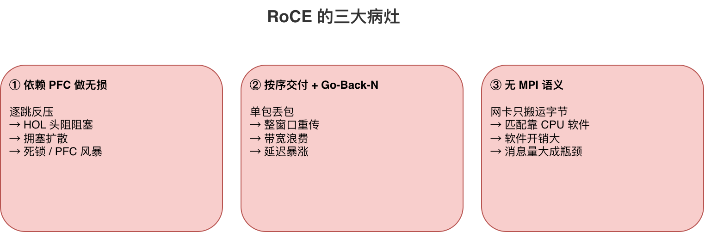

# UEC 深度解析:超以太网如何重塑 AI 集群网络

## 1. 问题:RoCE 在 AI 大集群里撑不住了

在「拥塞控制那篇」的结尾,我们留下了一个悬而未决的问题:**"无损"是否值得?** 或者说,PFC 带来的复杂度,是否已经超过了它解决的问题?

那篇文章是从"数据中心网络"的视角提问的。现在我们把镜头拉近到 AI 大模型训练集群——这个当前最饥渴的流量场景——会发现那个问题不再是一个可以慢慢斟酌的学术话题,而是一个必须立刻回答的工程问题。因为在大规模 AI 训练面前,RoCE 那套"无损以太网"的打法,已经开始系统性地拖后腿了。

### 1.1 AI 训练的流量,和传统数据中心不一样

传统数据中心的流量是"海量小流 + 少量大流",东一个 Web 请求、西一个数据库查询,平均带宽占用低,瓶颈往往在单条链路的突发。

AI 训练集群的流量完全是另一种生物。以分布式训练的核心操作为例——**梯度同步(AllReduce)**:

- **周期性通信风暴**:每个 step 结束时,成千上万个 GPU 要同时交换梯度。计算阶段网络几乎空转,通信阶段所有 GPU 一起往网络上砸数据。流量不是均匀的,是脉冲式的。
- **多对一 in-cast**:AllReduce 的汇聚阶段,多个 worker 同时把梯度发往同一个(或少数几个)目标,接收端瞬间被打爆。这是典型的 in-cast 拥塞。
- **微突发(micro-burst)**:即便平均带宽只有链路容量的 20%,在极短的时间窗内(微秒级),突发流量也可能顶满整条链路。

这三条叠加起来,意味着 AI 训练网络的拥塞是**常态而非例外**。而 RoCE 处理拥塞的方式,恰恰是它最脆弱的一环。

### 1.2 RoCE 的三大病灶

RoCE(以及它背后的 InfiniBand 传输语义)在传统 HPC 时代是够用的,但当它被推到 AI 训练这种极端流量场景时,三个先天缺陷被成倍放大。



**病灶一:依赖 PFC 做无损,但 PFC 会引发连锁灾难**

RoCE 的"无损"承诺,建立在 PFC(优先级流控)之上:接收方 buffer 快满时,发 PAUSE 帧让上游暂停发送。这个机制在「拥塞控制那篇」里已经拆解过,这里只回顾它的三个致命后果:

- **头阻阻塞(HOL blocking)**:一条流被暂停,同一优先级队列里其他无关的流也被一起堵住。
- **拥塞扩散**:PAUSE 是逐跳反压,拥塞点会像涟漪一样向上游扩散,一条拥塞链路拖垮一整片。
- **死锁与 PFC 风暴**:极端情况下,多个交换机互相 PAUSE,谁都不放行,网络锁死;或者 PAUSE 帧失控,风暴席卷全网。

在大集群里,这三个后果不是偶发,而是**拥塞一发生就跟着来**。AI 训练的 in-cast 恰好是 PFC 的"完美"触发条件。

**病灶二:按序交付 + Go-Back-N 重传,单包丢包拖垮整个窗口**

RoCE 传输层要求**按序交付**:接收方按序号顺序处理数据包。这意味着:

- 如果第 5 个包丢了,第 6、7、8... 个包就算已经正确到达,也只能在 buffer 里干等。
- 丢包触发的是 **Go-Back-N 重传**——不是只重传丢的那个包,而是从丢包处开始,把后续**整个窗口**的包全部重传一遍。

在 100G/200G 乃至 400G 的高速链路上,一个窗口可能装着几十上百个包。**丢一个包,重传一百个包**,带宽被白白浪费,延迟暴涨。这对延迟敏感的 AllReduce 是灾难性的——一次重传就可能让整个 step 的通信时间翻倍。

**病灶三:网卡只会"搬运"字节,不理解消息**

RoCE 的 verbs 语义本质是**搬运**:网卡负责把一块内存的字节搬到对端,至于这些字节是哪个 MPI 消息、该匹配到哪个接收 buffer,统统由上层 CPU 软件去操心。

在 MPI 场景里,这意味着每次接收都要做 **tag matching**:接收方要根据 (source, tag, communicator) 三元组,在已投递的消息里找到匹配的那条。这个匹配过程跑在 CPU 上,是要花时间、花 CPU 周期的。当消息量巨大、tag 数量庞大时,软件匹配就成了瓶颈。

---

三个病灶的共同根源在于:**RoCE 把 IB 传输语义"硬塞"进了以太网,却没有真正解决以太网"尽力而为"本质与 RDMA"无损可靠"诉求之间的矛盾。** 它靠 PFC 补无损、靠 Go-Back-N 补可靠,但这两个补丁,恰恰是 AI 场景里最要命的两个短板。

那么问题来了:有没有一种方案,能**从传输层开始重新设计**,而不是在 RoCE 上继续打补丁?

这就是 UEC 登场的原因。

### 1.3 还有一个隐藏的拦路虎:ECMP 单路径

在进入 UEC 之前,还值得点出一个经常被忽略、但在 AI 集群里很要命的问题:**RoCE 的多路径能力很弱。**

以太网数据中心网络通常用 **ECMP(等代价多路径)** 在源和目的之间提供多条物理路径。但 ECMP 的分流依据是**五元组 hash**(源 IP、目的 IP、源端口、目的端口、协议):

- 一条 RoCE 流(固定五元组)会被 hash 到**唯一一条**物理路径上。
- 这意味着:即使你的网络里从源到目的有 4 条等价路径,一条 RoCE 流也**只会用其中 1 条**,其余 3 条对它来说是"不存在的"。

结果就是:**单条流的带宽上限 = 单条路径的带宽**,而不是 4 条路径的总和。在 AI 训练这种"单流带宽需求巨大"的场景里,这直接限制了每张网卡能打满的速率,也让拥塞更容易发生——因为流量都被挤在同一条路径上了。

这个问题,同样要等 UEC 来回答(后面第 5 章会详细展开)。

## 2. UEC 是什么:联盟与目标

UEC 的全称是 **Ultra Ethernet Consortium(超以太网联盟)**。先说清楚一个常见的误解:UEC 不是一个"协议",而是一个**联盟 + 一套由它制定的开放规范栈**。它要解决的就是上面第 1 章列出的那一串问题。

### 2.1 为什么是 2023 年

UEC 成立于 2023 年。这个时间点不是巧合。

2022 年底 ChatGPT 引爆了大模型浪潮,AI 训练集群的规模从几百张卡迅速膨胀到几万张卡。这个时候,网络互连成了训练效率的决定性瓶颈之一(在「GPU 互联那篇」里我们算过,通信可以吃掉训练时间的 20-40%)。

而在这个最赚钱、增长最快的市场里,**高端互连几乎被 NVIDIA 一家垄断**——通过 InfiniBand。IB 性能好,但它是 NVIDIA 私有的封闭生态:芯片、交换机、网卡、软件栈全由 NVIDIA 掌控,价格高,而且深度绑定 NVIDIA GPU。

对于 AMD、Intel 这些 GPU 竞争者,以及 Meta、Microsoft 这些既不想被单一供应商锁死、又需要大规模 AI 集群的云厂商来说,他们迫切需要一个**开放的、基于标准以太网的替代方案**。RoCE 理论上就是这个替代方案,但正如第 1 章所说,RoCE 在 AI 场景下的表现不够好。

于是,2023 年 7 月,UEC 成立,目标只有一个:**基于标准以太网,造一个开放的、能对标甚至超越 InfiniBand 的高性能互连栈。**

### 2.2 谁在背后

UEC 由 **Linux Foundation** 托管(具体是旗下的 Joint Development Foundation),创始成员横跨芯片、网络设备、云厂商:

- **芯片/加速卡**:AMD、Intel、Broadcom
- **网络设备**:Arista、Cisco、HPE、Eviden
- **云厂商/超大用户**:Meta、Microsoft

注意这张名单里缺了谁:**没有 NVIDIA,也没有 Mellanox**。这几乎宣示了 UEC 的立场——它就是要做一个**不依赖 NVIDIA 的开放互连**。

### 2.3 UEC 要干什么:不是 RoCE 2.0,是重写传输层

这里有一个关键的认知需要校准:**UEC 不是"又一个 RoCE 改进版"。**

RoCE 的思路是"把 IB 传输语义搬到以太网上"——以太网只提供底层帧格式和 IP 路由,传输语义(RDMA、可靠、无损)沿用 IB 那一套,靠 PFC、Go-Back-N 这些补丁来凑。

UEC 的思路则激进得多:**既然以太网的物理层和链路层已经足够快、足够便宜、足够开放,那为什么不直接在这之上,为 AI 负载重新设计一个传输层?** 这个新的传输层,名字叫 **UET(Ultra Ethernet Transport)**。

换句话说:

| | 物理/链路层 | 传输层 | 语义 |
|---|---|---|---|
| **RoCE** | 以太网(借用) | IB 传输语义(搬过来 + 打补丁) | verbs 搬运语义 |
| **UEC** | 以太网(借用,加 LLR) | **全新设计 UET** | 可选的 MPI 语义下沉 |

UEC 保留的是以太网的**开放生态和规模经济**(物理层、交换机、布线都是现成的标准),重写的是**传输层的可靠性、拥塞控制、多路径**——也就是第 1 章里 RoCE 最要命的那几个短板。

这也回答了上一章的悬念:UEC 不是在 RoCE 上继续打补丁,而是**从传输层开始推倒重来**。具体怎么推倒、怎么重来,就是接下来几章要讲的。

从下一章开始,我们先俯瞰 UEC 的整个分层架构,再一层一层往下钻:链路层的 LLR、传输层的 packet spraying 和乱序交付、拥塞控制,最后是语义层。

## 3. UEC 分层架构总览

在钻进每一层的细节之前,先建立一张地图:UEC 的协议栈整体长什么样,它和 InfiniBand、RoCE 到底是什么关系。有了这张图,后面每一章都能在上面找到自己的位置。

### 3.1 四层结构

UEC 协议栈自上而下分四层,其中语义层是可选的:

```
┌──────────────────────────────────────────────┐
│  语义层 Semantic Layer(可选)                    │
│  MPI tag matching、集合通信语义下沉到网卡       │
├──────────────────────────────────────────────┤
│  传输层 Transport Layer = UET                  │
│  可靠传输、乱序交付、多路径、拥塞控制            │
├──────────────────────────────────────────────┤
│  链路层 Link Layer(带 LLR)                     │
│  链路级重传,把"丢包"变得廉价                    │
├──────────────────────────────────────────────┤
│  物理层 Physical Layer = IEEE 802.3            │
│  标准以太网 PHY,100G / 200G / 400G / 800G      │
└──────────────────────────────────────────────┘
```


四层各有分工:

- **物理层**:完全复用标准以太网(802.3)。这是 UEC"开放"的根基——交换机、光模块、布线、SerDes 全都是现成的商品化生态,不用像 IB 那样用私有 PHY。
- **链路层**:在标准以太网链路层之上,增加 **LLR(Link Layer Retry,链路级重传)**。这是 UEC 摆脱 PFC 的关键,第 4 章专门讲。
- **传输层**:全新的 **UET(Ultra Ethernet Transport)**。这是 UEC 的核心创新,负责可靠传输、多路径(packet spraying)、乱序交付、拥塞控制。第 5、6、7 章都在这一层。
- **语义层**:可选的一层,把 MPI 的 tag matching、集合通信等语义下沉到网卡硬件。第 8 章讲。

### 3.2 与 IB、RoCE 的层次对照

把 UEC 和 IB、RoCE 放在一起对比,差异一目了然:

| 关键层 | InfiniBand | RoCEv2 | UEC |
|---|---|---|---|
| 传输层 | IB Transport(私有,乱序/多路径/信用流控) | 复用 IB Transport(BTH),但补丁式实现 | **全新 UET** |
| 链路层 | IB Link(自带链路级流控与重传) | 标准 Ethernet,**靠 PFC 兜底** | 标准 Ethernet **+ LLR** |
| 物理层 | IB PHY(私有) | IEEE 802.3 | IEEE 802.3 |

这张表揭示了一个很有意思的事实:**IB 其实早就拥有 UEC 现在才做的那些东西**。

- IB 的传输层原生支持乱序交付、多路径、信用流控——这正是 UEC 的 UET 要做的事。
- IB 的链路层自带链路级流控和重传——这正是 UEC 的 LLR 要做的事。
- IB 的物理层是私有的、封闭的——这是 UEC 最想抛弃的部分。

所以可以这样一句话概括 UEC 的本质:

> **UEC 把 IB 多年积累的"无损、乱序、多路径"能力,用开放以太网重新实现了一遍。**

RoCE 的问题在于,它只把 IB 的**传输语义**搬到了以太网上,却把 IB 的**链路层能力**留在了原地——于是 RoCE 只能用 PFC 这个"以太网原生但很粗糙"的工具去补 IB 链路层本该做的事,补得漏洞百出。

UEC 的思路则是:传输层和链路层一起重做,让每一层用对的工具做对的事。

### 3.3 哪些是新增,哪些是复用

最后明确一下 UEC 各层相对以太网的"增量":

- **物理层**:零改动,直接复用 802.3。
- **链路层**:复用以太网 MAC 帧,但新增 LLR 子层做链路级重传。
- **传输层**:完全新写,不沿用 IB Transport,这是 UEC 最大的"重写"。
- **语义层**:全新,但作为可选层,与传输层解耦。

换句话说,UEC 的"重写"集中在传输层,"增强"在链路层,"复用"在物理层。接下来的第 4 章,我们先看链路层的 LLR——它是 UEC 摆脱 PFC 的钥匙。

## 4. 链路层:LLR 如何取代 PFC

UEC 要解决的第一个顽疾,就是 RoCE 对 PFC 的依赖。而它的答案,在链路层。

### 4.1 PFC 病灶回顾

PFC 的机制细节在「拥塞控制那篇」里已经拆解过,这里只回顾结论:

PFC 通过逐跳的 PAUSE 帧来防止 buffer 溢出,从而实现"无损"。但它的代价是:**头阻阻塞、拥塞扩散、死锁与 PFC 风暴**。这些代价的根源在于——PFC 把"拥塞控制"这件事,交给了逐跳的、局部的、粗暴的"停止"信号,而不是端到端的、全局的、精细的调度。

那么,为什么会有人愿意忍受 PFC 的这些问题?因为一个朴素的想法:**RoCE 传输层"丢不起包"。**

### 4.2 关键洞察:丢包为什么"丢不起"

RoCE 之所以要死保"无损",是因为它的传输层重传**太贵了**:

- RoCE 依赖**端到端**的重传:一个包在传输路径上丢了,要等到接收方发现序号缺了、或者发送方超时,才能触发重传。
- 这个"发现丢包 → 重传"的过程,延迟是**端到端 RTT 级别**(微秒到几十微秒)。
- 更糟的是,RoCE 的重传是 Go-Back-N:丢一个包,整个窗口重传。

所以在 RoCE 的世界观里,**任何一次丢包都是一场小灾难**,必须不惜一切代价(包括用 PFC 死保)来避免。PFC 的所有副作用,都是为了"绝不丢包"这个目标付的代价。

UEC 换了一个思路,直接釜底抽薪:**如果让丢包变得廉价,就不需要 PFC 了。**

### 4.3 LLR:让丢包变得廉价

LLR(Link Layer Retry)的核心思想很简单:**把重传从"端到端"搬到"相邻两跳"之间。**

```
端到端重传(RoCE):
  发送端 ──── 交换机 ──── 交换机 ──── 接收端
              (一个包丢了)
  接收端发现缺序号 → 通知发送端 → 发送端重传
  延迟 = 整个 RTT,重传 = 整个窗口(Go-Back-N)

链路级重传(LLR):
  发送端 ──┬── 交换机 ──── 交换机 ──┬── 接收端
           ↑                       ↑
        在这一跳内发现并重传    在这一跳内发现并重传
  延迟 = 单跳 RTT(纳秒级),重传 = 只重传坏的包
```


LLR 的工作方式:

- 在每一段物理链路的两端(网卡↔交换机、交换机↔交换机),对通过的包做 CRC 校验。
- 一旦发现坏包或丢包,**在相邻两跳之间立即重传**,不惊动发送端和接收端。
- 因为只跨一跳,重传延迟是**链路级 RTT**(纳秒级),远快于端到端重传。
- 而且链路级重传可以做到**精确定位到具体的坏包**,只重传它一个,不像 Go-Back-N 那样整窗口重传。

当重传变得又快又便宜时,"偶尔丢包"就不再是需要 PFC 去严防死守的灾难,而只是一个可以被快速修复的小插曲。

### 4.4 可靠性 vs 拥塞控制的解耦

LLR 带来的最深刻变化,是把两件被 RoCE 强行绑在一起的事**解耦**了:

| | RoCE | UEC |
|---|---|---|
| 可靠性(防丢包) | 靠 PFC 死保"不丢" | 靠 LLR 快速"重传" |
| 拥塞控制 | 靠 PFC 逐跳反压(被动) | 靠传输层主动调度(第 7 章) |

在 RoCE 里,"可靠性"和"拥塞控制"都压在 PFC 一个机制上,结果两件事都做不好:PFC 既不能真正优雅地控制拥塞(只会粗暴地"停"),又要为"不丢包"付出 HOL blocking、死锁的代价。

UEC 把它们分开:

- **可靠性**交给 LLR:链路层快速重传,保证最终不丢数据。
- **拥塞控制**交给传输层 UET:发送端主动调度(后面第 7 章讲),这才是真正优雅地解决拥塞的方式。

这样一来,PFC 就没有存在的必要了——**UEC 网络可以跑在"有损"以太网上**,通过 LLR 兜底丢包、通过传输层调度避免拥塞。

### 4.5 这并不激进:Swift 与 lossy RoCE 已经探过路

UEC 的"有损以太网 + 快速重传"思路,其实早有先行者。在「拥塞控制那篇」的"前沿方向"一节里,我们提到过 Google 的 **Swift** 方案:放弃 PFC,让 RoCE 跑在 lossy 网络上,用更快的重传机制处理丢包。Google 在生产环境验证过这条路的可行性。

UEC 的 LLR 可以说是把"lossy 网络 + 快速重传"这条思路,从"端到端软件重传"进一步下沉到了"链路级硬件重传"——重传更快、更透明。这不是天马行空的激进设想,而是被验证过的方向上的自然演进。

---

链路层的 LLR 解决了"丢包怎么办"的问题,但它不能解决"拥塞本身怎么办"。真正决定 UEC 性能上限的,是传输层 UET——从下一章开始,我们进入 UEC 最核心的部分:packet spraying 多路径,以及配套的乱序交付与选择性重传。
