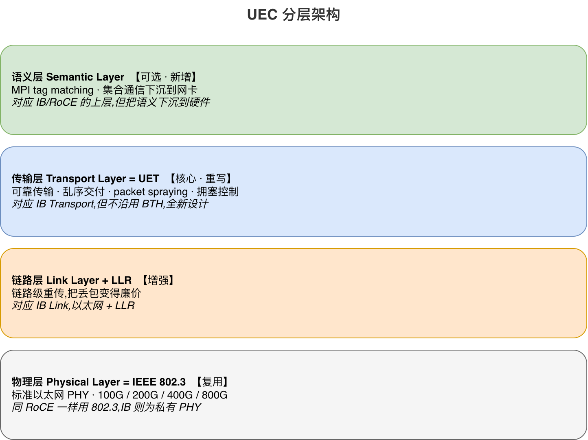
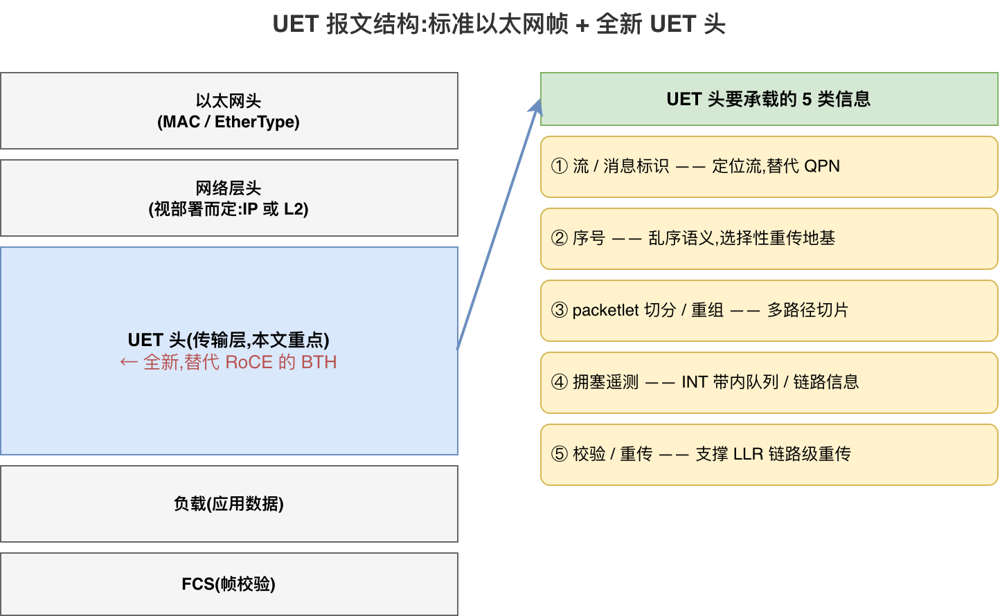
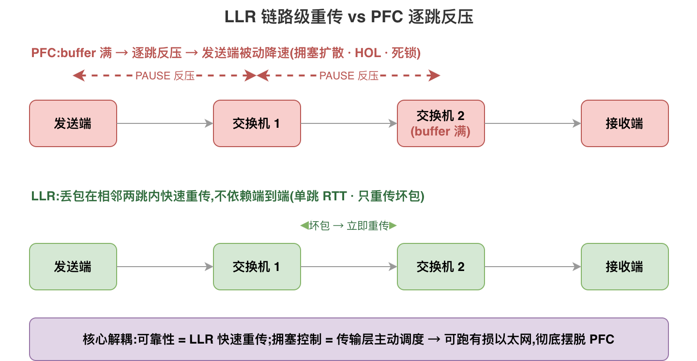
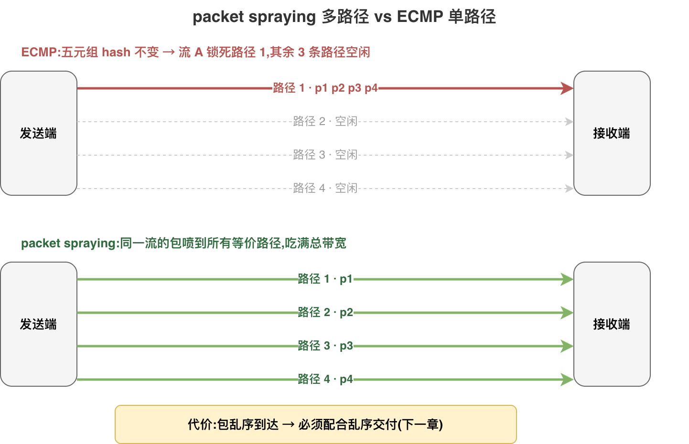
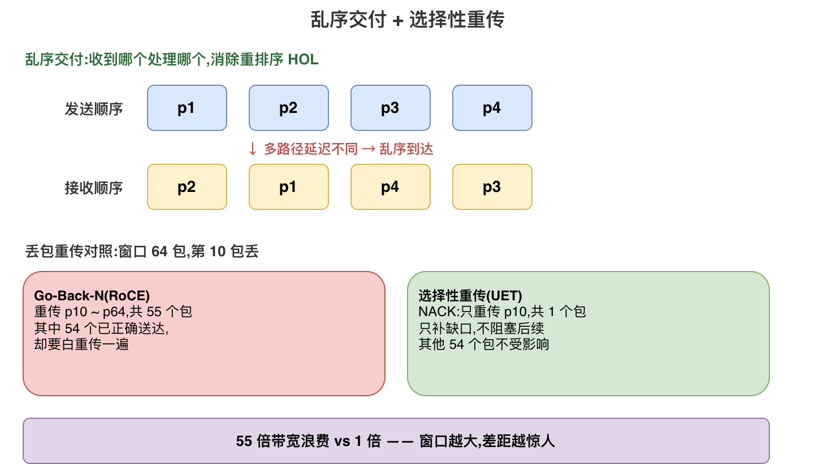
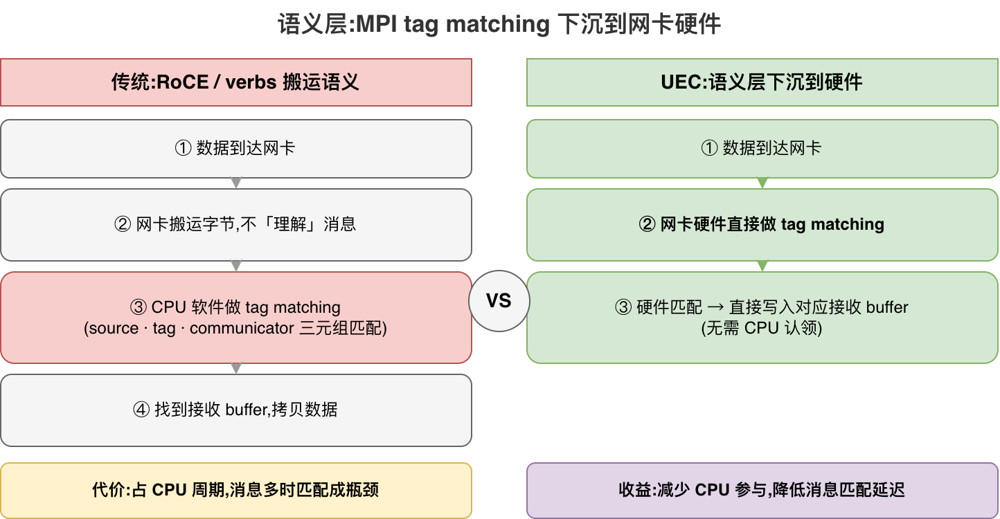

# UEC 深度解析:超以太网如何重塑 AI 集群网络

## 1. 问题:RoCE 在 AI 大集群里撑不住了

在「拥塞控制那篇」的结尾,我们留下了一个悬而未决的问题:**"无损"是否值得?** 或者说,PFC 带来的复杂度,是否已经超过了它解决的问题?

那篇文章是从"数据中心网络"的视角提问的。现在我们把镜头拉近到 AI 大模型训练集群——这个当前最饥渴的流量场景——会发现那个问题不再是一个可以慢慢斟酌的学术话题,而是一个必须立刻回答的工程问题。因为在大规模 AI 训练面前,RoCE 那套"无损以太网"的打法,已经开始系统性地拖后腿了。

### 1.1 AI 训练的流量,和传统数据中心不一样

传统数据中心的流量是"海量小流 + 少量大流",东一个 Web 请求、西一个数据库查询,平均带宽占用低,瓶颈往往在单条链路的突发。

AI 训练集群的流量完全是另一种生物。以分布式训练的核心操作为例——**梯度同步(AllReduce)**:

- **周期性通信风暴**:每个 step 结束时,成千上万个 GPU 要同时交换梯度。计算阶段网络几乎空转,通信阶段所有 GPU 一起往网络上砸数据。流量不是均匀的,是脉冲式的。
- **多对一 in-cast**:AllReduce 的汇聚阶段,多个 worker 同时把梯度发往同一个(或少数几个)目标,接收端瞬间被打爆。这是典型的 in-cast 拥塞。
- **微突发(micro-burst)**:即便平均带宽只有链路容量的 20%,在极短的时间窗内(微秒级),突发流量也可能顶满整条链路。

这三条叠加起来,意味着 AI 训练网络的拥塞是**常态而非例外**。而 RoCE 处理拥塞的方式,恰恰是它最脆弱的一环。

### 1.2 RoCE 的三大病灶

RoCE(以及它背后的 InfiniBand 传输语义)在传统 HPC 时代是够用的,但当它被推到 AI 训练这种极端流量场景时,三个先天缺陷被成倍放大。


**病灶一:依赖 PFC 做无损,但 PFC 会引发连锁灾难**

RoCE 的"无损"承诺,建立在 PFC(优先级流控)之上:接收方 buffer 快满时,发 PAUSE 帧让上游暂停发送。这个机制在「拥塞控制那篇」里已经拆解过,这里只回顾它的三个致命后果:

- **头阻阻塞(HOL blocking)**:一条流被暂停,同一优先级队列里其他无关的流也被一起堵住。
- **拥塞扩散**:PAUSE 是逐跳反压,拥塞点会像涟漪一样向上游扩散,一条拥塞链路拖垮一整片。
- **死锁与 PFC 风暴**:极端情况下,多个交换机互相 PAUSE,谁都不放行,网络锁死;或者 PAUSE 帧失控,风暴席卷全网。

在大集群里,这三个后果不是偶发,而是**拥塞一发生就跟着来**。AI 训练的 in-cast 恰好是 PFC 的"完美"触发条件。

**病灶二:按序交付 + Go-Back-N 重传,单包丢包拖垮整个窗口**

RoCE 传输层要求**按序交付**:接收方按序号顺序处理数据包。这意味着:

- 如果第 5 个包丢了,第 6、7、8... 个包就算已经正确到达,也只能在 buffer 里干等。
- 丢包触发的是 **Go-Back-N 重传**——不是只重传丢的那个包,而是从丢包处开始,把后续**整个窗口**的包全部重传一遍。

在 100G/200G 乃至 400G 的高速链路上,一个窗口可能装着几十上百个包。**丢一个包,重传一百个包**,带宽被白白浪费,延迟暴涨。这对延迟敏感的 AllReduce 是灾难性的——一次重传就可能让整个 step 的通信时间翻倍。

**病灶三:网卡只会"搬运"字节,不理解消息**

RoCE 的 verbs 语义本质是**搬运**:网卡负责把一块内存的字节搬到对端,至于这些字节是哪个 MPI 消息、该匹配到哪个接收 buffer,统统由上层 CPU 软件去操心。

在 MPI 场景里,这意味着每次接收都要做 **tag matching**:接收方要根据 (source, tag, communicator) 三元组,在已投递的消息里找到匹配的那条。这个匹配过程跑在 CPU 上,是要花时间、花 CPU 周期的。当消息量巨大、tag 数量庞大时,软件匹配就成了瓶颈。

---

三个病灶的共同根源在于:**RoCE 把 IB 传输语义"硬塞"进了以太网,却没有真正解决以太网"尽力而为"本质与 RDMA"无损可靠"诉求之间的矛盾。** 它靠 PFC 补无损、靠 Go-Back-N 补可靠,但这两个补丁,恰恰是 AI 场景里最要命的两个短板。

那么问题来了:有没有一种方案,能**从传输层开始重新设计**,而不是在 RoCE 上继续打补丁?

这就是 UEC 登场的原因。

### 1.3 还有一个隐藏的拦路虎:ECMP 单路径

在进入 UEC 之前,还值得点出一个经常被忽略、但在 AI 集群里很要命的问题:**RoCE 的多路径能力很弱。**

以太网数据中心网络通常用 **ECMP(等代价多路径)** 在源和目的之间提供多条物理路径。但 ECMP 的分流依据是**五元组 hash**(源 IP、目的 IP、源端口、目的端口、协议):

- 一条 RoCE 流(固定五元组)会被 hash 到**唯一一条**物理路径上。
- 这意味着:即使你的网络里从源到目的有 4 条等价路径,一条 RoCE 流也**只会用其中 1 条**,其余 3 条对它来说是"不存在的"。

结果就是:**单条流的带宽上限 = 单条路径的带宽**,而不是 4 条路径的总和。在 AI 训练这种"单流带宽需求巨大"的场景里,这直接限制了每张网卡能打满的速率,也让拥塞更容易发生——因为流量都被挤在同一条路径上了。

这个问题,同样要等 UEC 来回答(后面第 6 章会详细展开)。

## 2. UEC 是什么:联盟与目标

UEC 的全称是 **Ultra Ethernet Consortium(超以太网联盟)**。先说清楚一个常见的误解:UEC 不是一个"协议",而是一个**联盟 + 一套由它制定的开放规范栈**。它要解决的就是上面第 1 章列出的那一串问题。

### 2.1 为什么是 2023 年

UEC 成立于 2023 年。这个时间点不是巧合。

2022 年底 ChatGPT 引爆了大模型浪潮,AI 训练集群的规模从几百张卡迅速膨胀到几万张卡。这个时候,网络互连成了训练效率的决定性瓶颈之一(在「GPU 互联那篇」里我们算过,通信可以吃掉训练时间的 20-40%)。

而在这个最赚钱、增长最快的市场里,**高端互连几乎被 NVIDIA 一家垄断**——通过 InfiniBand。IB 性能好,但它是 NVIDIA 私有的封闭生态:芯片、交换机、网卡、软件栈全由 NVIDIA 掌控,价格高,而且深度绑定 NVIDIA GPU。

对于 AMD、Intel 这些 GPU 竞争者,以及 Meta、Microsoft 这些既不想被单一供应商锁死、又需要大规模 AI 集群的云厂商来说,他们迫切需要一个**开放的、基于标准以太网的替代方案**。RoCE 理论上就是这个替代方案,但正如第 1 章所说,RoCE 在 AI 场景下的表现不够好。

于是,2023 年 7 月,UEC 成立,目标只有一个:**基于标准以太网,造一个开放的、能对标甚至超越 InfiniBand 的高性能互连栈。**

### 2.2 谁在背后

UEC 由 **Linux Foundation** 托管(具体是旗下的 Joint Development Foundation),创始成员横跨芯片、网络设备、云厂商:

- **芯片/加速卡**:AMD、Intel、Broadcom
- **网络设备**:Arista、Cisco、HPE、Eviden
- **云厂商/超大用户**:Meta、Microsoft

注意这张名单里缺了谁:**没有 NVIDIA,也没有 Mellanox**。这几乎宣示了 UEC 成立之初的立场——它就是要做一个**不依赖 NVIDIA 的开放互连**。(有意思的是,NVIDIA 后来也加入了 UEC,这个转折放在第 11 章再谈。)

### 2.3 UEC 要干什么:不是 RoCE 2.0,是重写传输层

这里有一个关键的认知需要校准:**UEC 不是"又一个 RoCE 改进版"。**

RoCE 的思路是"把 IB 传输语义搬到以太网上"——以太网只提供底层帧格式和 IP 路由,传输语义(RDMA、可靠、无损)沿用 IB 那一套,靠 PFC、Go-Back-N 这些补丁来凑。

UEC 的思路则激进得多:**既然以太网的物理层和链路层已经足够快、足够便宜、足够开放,那为什么不直接在这之上,为 AI 负载重新设计一个传输层?** 这个新的传输层,名字叫 **UET(Ultra Ethernet Transport)**。

换句话说:

| | 物理/链路层 | 传输层 | 语义 |
|---|---|---|---|
| **RoCE** | 以太网(借用) | IB 传输语义(搬过来 + 打补丁) | verbs 搬运语义 |
| **UEC** | 以太网(借用,加 LLR) | **全新设计 UET** | 可选的 MPI 语义下沉 |

UEC 保留的是以太网的**开放生态和规模经济**(物理层、交换机、布线都是现成的标准),重写的是**传输层的可靠性、拥塞控制、多路径**——也就是第 1 章里 RoCE 最要命的那几个短板。

这也回答了上一章的悬念:UEC 不是在 RoCE 上继续打补丁,而是**从传输层开始推倒重来**。具体怎么推倒、怎么重来,就是接下来几章要讲的。

从下一章开始,我们先俯瞰 UEC 的整个分层架构,再一层一层往下钻:链路层的 LLR、传输层的 packet spraying 和乱序交付、拥塞控制,最后是语义层。

## 3. UEC 分层架构总览

在钻进每一层的细节之前,先建立一张地图:UEC 的协议栈整体长什么样,它和 InfiniBand、RoCE 到底是什么关系。有了这张图,后面每一章都能在上面找到自己的位置。

### 3.1 四层结构

UEC 协议栈自上而下分四层,其中语义层是可选的:

```
┌──────────────────────────────────────────────┐
│  语义层 Semantic Layer(可选)                    │
│  MPI tag matching、集合通信语义下沉到网卡       │
├──────────────────────────────────────────────┤
│  传输层 Transport Layer = UET                  │
│  可靠传输、乱序交付、多路径、拥塞控制            │
├──────────────────────────────────────────────┤
│  链路层 Link Layer(带 LLR)                     │
│  链路级重传,把"丢包"变得廉价                    │
├──────────────────────────────────────────────┤
│  物理层 Physical Layer = IEEE 802.3            │
│  标准以太网 PHY,100G / 200G / 400G / 800G      │
└──────────────────────────────────────────────┘
```



四层各有分工:

- **物理层**:完全复用标准以太网(802.3)。这是 UEC"开放"的根基——交换机、光模块、布线、SerDes 全都是现成的商品化生态,不用像 IB 那样用私有 PHY。
- **链路层**:在标准以太网链路层之上,增加 **LLR(Link Layer Retry,链路级重传)**。这是 UEC 摆脱 PFC 的关键,第 5 章专门讲。
- **传输层**:全新的 **UET(Ultra Ethernet Transport)**。这是 UEC 的核心创新,负责可靠传输、多路径(packet spraying)、乱序交付、拥塞控制。第 5、6、7 章都在这一层。
- **语义层**:可选的一层,把 MPI 的 tag matching、集合通信等语义下沉到网卡硬件。第 9 章讲。

### 3.2 与 IB、RoCE 的层次对照

把 UEC 和 IB、RoCE 放在一起对比,差异一目了然:

| 关键层 | InfiniBand | RoCEv2 | UEC |
|---|---|---|---|
| 传输层 | IB Transport(私有,乱序/多路径/信用流控) | 复用 IB Transport(BTH),但补丁式实现 | **全新 UET** |
| 链路层 | IB Link(自带链路级流控与重传) | 标准 Ethernet,**靠 PFC 兜底** | 标准 Ethernet **+ LLR** |
| 物理层 | IB PHY(私有) | IEEE 802.3 | IEEE 802.3 |

这张表揭示了一个很有意思的事实:**IB 其实早就拥有 UEC 现在才做的那些东西**。

- IB 的传输层原生支持乱序交付、多路径、信用流控——这正是 UEC 的 UET 要做的事。
- IB 的链路层自带链路级流控和重传——这正是 UEC 的 LLR 要做的事。
- IB 的物理层是私有的、封闭的——这是 UEC 最想抛弃的部分。

所以可以这样一句话概括 UEC 的本质:

> **UEC 把 IB 多年积累的"无损、乱序、多路径"能力,用开放以太网重新实现了一遍。**

RoCE 的问题在于,它只把 IB 的**传输语义**搬到了以太网上,却把 IB 的**链路层能力**留在了原地——于是 RoCE 只能用 PFC 这个"以太网原生但很粗糙"的工具去补 IB 链路层本该做的事,补得漏洞百出。

UEC 的思路则是:传输层和链路层一起重做,让每一层用对的工具做对的事。

### 3.3 哪些是新增,哪些是复用

最后明确一下 UEC 各层相对以太网的"增量":

- **物理层**:零改动,直接复用 802.3。
- **链路层**:复用以太网 MAC 帧,但新增 LLR 子层做链路级重传。
- **传输层**:完全新写,不沿用 IB Transport,这是 UEC 最大的"重写"。
- **语义层**:全新,但作为可选层,与传输层解耦。

换句话说,UEC 的"重写"集中在传输层,"增强"在链路层,"复用"在物理层。而在钻进这些机制之前,还有一件更基础的事要先讲清楚——UET 的报文到底长什么样。这就是下一章的内容。

## 4. UET 报文格式:包长什么样

在钻进 LLR、packet spraying、乱序交付这些机制之前,先回答一个更基础的问题:**UET 传输层的数据单元,长什么样。**



### 4.1 从以太网帧到 UET 包

UEC 跑在标准以太网上,所以 UET 的包最终封装在以太网帧里。层次关系大致是:

```
┌─────────────────────────────────────┐
│ 以太网头(MAC / EtherType)            │
├─────────────────────────────────────┤
│ 网络层头(视部署而定:IP 或 L2)         │
├─────────────────────────────────────┤
│ UET 头(传输层,本文重点)               │  ← 全新,替代 RoCE 的 BTH
├─────────────────────────────────────┤
│ 负载(应用数据)                        │
├─────────────────────────────────────┤
│ FCS(帧校验)                          │
└─────────────────────────────────────┘
```

对比「报文格式那篇」里的 RoCEv2:RoCEv2 是「以太网 + IP + UDP + BTH」四层封装,UET 的关键区别在传输层头部——不再沿用 IB 的 BTH(IB Transport Header),而是全新的 UET 头。

### 4.2 UET 头要支撑哪些机制

一个传输层头部不是随便设计的。设计它,本质是在回答一个问题:**"接收方拿到这个包,需要哪些信息才能正确处理它?"**

UET 要支撑的机制,决定了它的头部至少需要这几类信息(这里讲设计意图,不逐字段罗列规范):

1. **流 / 消息标识**:这个包属于哪条流、哪个消息。对应 RoCE 里靠 QPN(Queue Pair Number)来定位 QP。
2. **序号(sequence number)**:这是乱序交付和选择性重传的地基——接收方靠序号判断"缺了哪个包、该 NACK 哪个包"。RoCE 的 BTH 里也有类似的 PSN(Packet Sequence Number),但语义是"按序"的;UET 的序号是"乱序"语义。
3. **packetlet 切分 / 重组信息**:如果 packet spraying 用 packetlet 粒度(第 6 章详讲),一个大包被切成多个 packetlet 时,头部要记录"这是第几片、一共几片、怎么拼回去"。
4. **拥塞遥测字段**:承载 INT 等带内遥测信息,让交换机把队列深度、链路利用率写进包,供发送端做主动拥塞控制(第 8 章)。
5. **校验与重传相关**:支撑 LLR 链路级重传和端到端可靠性的字段。

这几类信息,几乎一一对应了后面几章要讲的机制——**报文格式是机制的"载体",机制是报文格式的"目的"**。

### 4.3 与 RoCE BTH 的对照

把 UET 头和 RoCE 的 BTH 放在一起对照,差异一目了然:

| 维度 | RoCE(BTH 等) | UET |
|---|---|---|
| 流定位 | QPN | 流 / 消息标识 |
| 序号 | PSN(按序语义) | 序号(乱序语义) |
| 交付 | 按序交付 | 乱序交付 |
| 重传 | Go-Back-N(ACK) | 选择性重传(NACK) |
| 多路径 | 无(五元组 hash 锁单路径) | packetlet 切分 / 重组 |
| 拥塞 | ECN(单比特) | 更丰富的遥测字段 |

这张表揭示了一个本质:**RoCE 的 BTH 是为「按序 + Go-Back-N + 单路径」这组老机制设计的;UET 头是为「乱序 + 选择性重传 + 多路径 + 主动拥塞控制」这组新机制设计的。** 头部字段的差异,根源在于传输层机制的差异。

### 4.4 为什么报文格式是"基础"

报文格式之所以值得在机制之前单独讲,是因为它把抽象的设计落到了每个包上:

- packet spraying 怎么切 packetlet、怎么重组,体现在第 3 类字段里;
- 乱序交付怎么靠序号判断缺口,体现在第 2 类字段里;
- 选择性重传怎么靠 NACK 精确请求,也建立在序号之上;
- 拥塞控制怎么拿到精确信号,体现在第 4 类字段里。

理解了报文格式,后面几章讲机制时,才不会觉得它们"悬在空中"——每个机制,最终都写在了 UET 头的那几个字段里。

---

现在,我们从最底层的链路层开始,一层层往下钻。第一站:LLR 如何取代 PFC。

## 5. 链路层:LLR 如何取代 PFC

UEC 要解决的第一个顽疾,就是 RoCE 对 PFC 的依赖。而它的答案,在链路层。

### 4.1 PFC 病灶回顾

PFC 的机制细节在「拥塞控制那篇」里已经拆解过,这里只回顾结论:

PFC 通过逐跳的 PAUSE 帧来防止 buffer 溢出,从而实现"无损"。但它的代价是:**头阻阻塞、拥塞扩散、死锁与 PFC 风暴**。这些代价的根源在于——PFC 把"拥塞控制"这件事,交给了逐跳的、局部的、粗暴的"停止"信号,而不是端到端的、全局的、精细的调度。

那么,为什么会有人愿意忍受 PFC 的这些问题?因为一个朴素的想法:**RoCE 传输层"丢不起包"。**

### 4.2 关键洞察:丢包为什么"丢不起"

RoCE 之所以要死保"无损",是因为它的传输层重传**太贵了**:

- RoCE 依赖**端到端**的重传:一个包在传输路径上丢了,要等到接收方发现序号缺了、或者发送方超时,才能触发重传。
- 这个"发现丢包 → 重传"的过程,延迟是**端到端 RTT 级别**(微秒到几十微秒)。
- 更糟的是,RoCE 的重传是 Go-Back-N:丢一个包,整个窗口重传。

所以在 RoCE 的世界观里,**任何一次丢包都是一场小灾难**,必须不惜一切代价(包括用 PFC 死保)来避免。PFC 的所有副作用,都是为了"绝不丢包"这个目标付的代价。

UEC 换了一个思路,直接釜底抽薪:**如果让丢包变得廉价,就不需要 PFC 了。**

### 4.3 LLR:让丢包变得廉价

LLR(Link Layer Retry)的核心思想很简单:**把重传从"端到端"搬到"相邻两跳"之间。**

```
端到端重传(RoCE):
  发送端 ──── 交换机 ──── 交换机 ──── 接收端
              (一个包丢了)
  接收端发现缺序号 → 通知发送端 → 发送端重传
  延迟 = 整个 RTT,重传 = 整个窗口(Go-Back-N)

链路级重传(LLR):
  发送端 ──┬── 交换机 ──── 交换机 ──┬── 接收端
           ↑                       ↑
        在这一跳内发现并重传    在这一跳内发现并重传
  延迟 = 单跳 RTT(纳秒级),重传 = 只重传坏的包
```



LLR 的工作方式:

- 在每一段物理链路的两端(网卡↔交换机、交换机↔交换机),对通过的包做 CRC 校验。
- 一旦发现坏包或丢包,**在相邻两跳之间立即重传**,不惊动发送端和接收端。
- 因为只跨一跳,重传延迟是**链路级 RTT**(纳秒级),远快于端到端重传。
- 而且链路级重传可以做到**精确定位到具体的坏包**,只重传它一个,不像 Go-Back-N 那样整窗口重传。

当重传变得又快又便宜时,"偶尔丢包"就不再是需要 PFC 去严防死守的灾难,而只是一个可以被快速修复的小插曲。

### 4.4 可靠性 vs 拥塞控制的解耦

LLR 带来的最深刻变化,是把两件被 RoCE 强行绑在一起的事**解耦**了:

| | RoCE | UEC |
|---|---|---|
| 可靠性(防丢包) | 靠 PFC 死保"不丢" | 靠 LLR 快速"重传" |
| 拥塞控制 | 靠 PFC 逐跳反压(被动) | 靠传输层主动调度(第 8 章) |

在 RoCE 里,"可靠性"和"拥塞控制"都压在 PFC 一个机制上,结果两件事都做不好:PFC 既不能真正优雅地控制拥塞(只会粗暴地"停"),又要为"不丢包"付出 HOL blocking、死锁的代价。

UEC 把它们分开:

- **可靠性**交给 LLR:链路层快速重传,保证最终不丢数据。
- **拥塞控制**交给传输层 UET:发送端主动调度(后面第 8 章讲),这才是真正优雅地解决拥塞的方式。

这样一来,PFC 就没有存在的必要了——**UEC 网络可以跑在"有损"以太网上**,通过 LLR 兜底丢包、通过传输层调度避免拥塞。

### 4.5 这并不激进:Swift 与 lossy RoCE 已经探过路

UEC 的"有损以太网 + 快速重传"思路,其实早有先行者。在「拥塞控制那篇」的"前沿方向"一节里,我们提到过 Google 的 **Swift** 方案:放弃 PFC,让 RoCE 跑在 lossy 网络上,用更快的重传机制处理丢包。Google 在生产环境验证过这条路的可行性。

UEC 的 LLR 可以说是把"lossy 网络 + 快速重传"这条思路,从"端到端软件重传"进一步下沉到了"链路级硬件重传"——重传更快、更透明。这不是天马行空的激进设想,而是被验证过的方向上的自然演进。

---

链路层的 LLR 解决了"丢包怎么办"的问题,但它不能解决"拥塞本身怎么办"。真正决定 UEC 性能上限的,是传输层 UET——从下一章开始,我们进入 UEC 最核心的部分:packet spraying 多路径,以及配套的乱序交付与选择性重传。

## 6. 传输层 UET:packet spraying 与多路径

UET 的第一个核心机制,是解决第 1 章埋下的那个"隐藏拦路虎":RoCE 被 ECMP 锁死在单路径上。

### 5.1 回顾:ECMP 为什么锁死单路径

数据中心网络用 **ECMP(等代价多路径)** 在源和目的之间提供多条物理路径。以太网交换机做 ECMP 时,依据的是**五元组 hash**——源 IP、目的 IP、源端口、目的端口、协议:

```
一条 RoCE 流(固定五元组)
        │
        ▼
  五元组 hash(值不变)
        │
        ▼
  唯一确定的一条物理路径  ←  其余 3 条路径对这条流"不存在"
```

因为一条 RoCE 流的五元组在整个传输期间是**不变的**,所以 hash 结果不变,这条流的所有包**永远走同一条路径**。哪怕源和目的之间有 4 条等价路径,一条流也只能用其中 1 条。

后果是:

- **单流带宽上限 = 单条路径带宽**,而不是 4 条路径的总和。
- 流量被挤在同一条路径上,更容易触发这条路径的拥塞,而其他 3 条路径可能正闲着。
- 对 AI 训练这种"单流带宽需求巨大"的场景,这是直接的天花板。

### 5.2 packet spraying:把包"喷"到所有路径

UET 的答案是 **packet spraying(包喷发)**:**同一条流的包,不再绑定到一条路径,而是轮流(或按负载)喷到所有等价路径上。**

```
ECMP(五元组 hash):
  流 A: p1 p2 p3 p4 ────────────► 路径 1(全部)
  流 B: p1 p2 p3 p4 ────────────► 路径 2(全部)
  每条流锁死一条路径

packet spraying:
  流 A: p1 ─► 路径 1
        p2 ─► 路径 2
        p3 ─► 路径 3
        p4 ─► 路径 4
  一条流的包分散到所有路径,吃满总带宽
```



spraying 带来三个直接好处:

1. **吃满总带宽**:单条流不再被单路径限速,可以利用所有等价路径的带宽之和。
2. **天然负载均衡**:包被均匀分散到各路径,不会出现"一条路径拥塞、其他路径空闲"的失衡。
3. **规避单路径拥塞**:即使某条路径发生拥塞,也只影响被喷到那条路径上的少数包,而不是整条流。

### 5.3 粒度:per-packet 还是 per-packetlet

spraying 的粒度是一个值得细看的设计选择:

- **per-packet(按包喷)**:以完整的包为单位,一个个喷到不同路径。这是最直观的方式。
- **per-packetlet(按微包喷)**:把一个较大的包切成更小的 **packetlet**,再把 packetlet 喷到不同路径。这样粒度更细,负载均衡更均匀,也能减少"大包长时间独占一条路径"造成的失衡。

UEC 规范里,packet spraying 是核心机制,粒度的选择(per-packet 还是更细的 packetlet)直接影响负载均衡的均匀程度和多路径收益的大小。细粒度的代价是更多的切分/重组开销,这是一笔需要在设计上权衡的账。

### 5.4 代价:包会乱序

spraying 有一个不可避免的代价:**不同路径的延迟不同**,包会乱序到达。

- 路径 1 可能 3 跳,路径 4 可能 5 跳;
- 路径 2 可能正好有空闲,路径 3 可能正在排队;

于是,发送方按顺序喷出去的 p1、p2、p3、p4,接收方收到的顺序可能是 p2、p1、p4、p3。

对 RoCE 这种**按序交付**的协议,乱序是灾难——第 2 章说过,RoCE 要求按序,乱序到达的包只能在 buffer 里干等前面的包。那样的话,spraying 多路径带来的收益,会全被"等前面的包"这个 HOL 吃掉。

所以,packet spraying **必须**配套一个能力:**乱序交付**。这正是 UET 的第二个核心机制,也是下一章的主角。

## 7. 传输层 UET:乱序交付 + 选择性重传

packet spraying 让包乱序到达成为常态,那么 UET 就必须改变"按序交付"这个 RoCE 沿袭自 IB 的老规矩。

### 6.1 乱序交付:收到哪个处理哪个

UET 的传输层是**乱序交付(out-of-order delivery)**的:接收方**不要求包按序到达**,收到哪个包就处理哪个包,处理完立即上送上层。

```
按序交付(RoCE):
  收到 p2,但 p1 没到 → p2 在 buffer 干等 → HOL blocking

乱序交付(UET):
  收到 p2 → 立即处理、立即上送
  收到 p1 → 立即处理、立即上送
  不管顺序,来了就处理
```

这彻底消除了第 1 章说的"HOL blocking"——不是因为 PFC(那是拥塞层的头阻),而是因为"等待前面的包"造成的**重排序头阻**。乱序交付让多路径带来的乱序不再是问题,反而成了常态。

### 6.2 选择性重传:丢哪个重传哪个

乱序交付解决了"乱序"的问题,但还有"丢包"的问题。UET 的重传方式,也从 RoCE 的 Go-Back-N 换成了**选择性重传(selective retransmission)**:

- 接收方发现缺了某个包(比如序号跳过了 p3),就发一个 **NACK** 明确告诉发送方:"我要 p3,别的不要。"
- 发送方收到 NACK,只重传 p3 这一个包。

对比 RoCE 的 Go-Back-N(丢一个包,从丢包处把后续整个窗口全部重传),选择性重传只重传真正丢的那一个包。



### 6.3 量化对比:丢一个包,代价差多少

用一个具体算例感受一下差距。假设传输窗口是 **64 个包**,其中第 10 个包丢了:

| | Go-Back-N(RoCE) | 选择性重传(UET) |
|---|---|---|
| 重传范围 | 第 10 ~ 64 包,共 55 个 | 只第 10 包,共 1 个 |
| 其中"白重传"的包 | 第 11~64 已经正确收到,却要再传一遍,54 个 | 0 个 |
| 重传带宽浪费 | 55 倍 | 1 倍 |
| 对乱序交付的破坏 | 按序重传,阻塞后续 | 只补缺口,不阻塞 |

**丢一个包,Go-Back-N 要浪费 55 倍的带宽重传一堆已经成功送达的包;选择性重传只补那一个缺口。** 在高速链路上,窗口越大,这个差距越惊人。

而且注意,选择性重传和乱序交付是**配套**的:正因为接收方是乱序交付的,它才能"只缺 p3、其他都收到了"地精确汇报;正因为发送方只补缺口,才不会因为一次重传又破坏乱序交付的节奏。

### 6.4 为什么 spraying 和乱序交付必须成对出现

到这里,可以看清 UET 这几个机制是**环环相扣的一整套**,缺一不可:

```
packet spraying(多路径)
      │ 代价:包乱序到达
      ▼
乱序交付(收到即处理,消除重排序 HOL)
      │ 代价:无法用按序的 Go-Back-N 重传
      ▼
选择性重传(NACK 只补丢的包)
      │ 结果:多路径收益保住 + 重传代价最小
      ▼
线速、低延迟、吃满总带宽
```

如果只做 spraying 不做乱序交付,多路径收益会被按序等待吃掉;如果只做乱序交付不做选择性重传,丢包还是会触发昂贵的整窗口重传。**这是一套为"多路径 + 低延迟"整体设计的传输层**,不是几个孤立特性的拼凑。

### 6.5 乱序交付的代价:对上层的要求

乱序交付也不是免费的。它把"顺序"这件事的责任,从传输层上移了:

- 传输层不再保证按序,那么需要按序的上层(比如需要完整消息的应用)就得自己处理重组。
- 这就引出了 UEC 的可选**语义层**——它可以帮上层处理消息重组、tag matching 这些事(第 9 章讲)。

换句话说,UET 用"传输层允许乱序"换来了多路径和低重传代价,而"把乱序重新拼回有序"的收尾工作,交给了上层(应用或语义层)。这是一次明确的**职责再分配**:传输层专注"快",语义层专注"对"。

---

packet spraying 和乱序交付解决的是"怎么把数据更快地搬过去"。但还有一个更根本的问题没解决:**拥塞本身**。多路径分散了流量,但并不能消灭拥塞——当所有路径都忙起来时,还是需要一套机制来主动控制发送速率。这就是 UEC 的拥塞控制,下一章的主角。

## 8. UEC 拥塞控制:从被动反压到主动调度

### 7.1 RoCE 的困境:被动反压,事后补救

RoCE 的拥塞控制,本质是**被动的、事后的、逐跳的**:

- 交换机 buffer 快满时,PFC 才发 PAUSE 帧反压。
- 但这个"快满"的信号到达发送端时,拥塞**已经发生**了,而且已经沿着反压链路向上游扩散了一路。
- PFC 的"控制"手段只有一种:**停止**。它不能精细地让发送端"降速 30%",只能粗暴地"暂停一会儿"。

这就是为什么 PFC 永远治不好拥塞——它是在拥塞已经发生后,用"堵"的方式去补救,而不是在拥塞发生前,用"调"的方式去预防。

### 7.2 UEC 的思路:发送端主动调度

UEC 的拥塞控制,把主动权交还给**发送端**:

- 发送端根据网络反馈的拥塞信号,**主动、提前**地调整发送速率。
- 不靠交换机"停止",而是发送端自己"慢一点"。
- 这是**端到端**的、**全局**的、**精细**的控制,而非逐跳的、局部的、粗暴的停止。

```
RoCE:交换机 buffer 满 → PAUSE 反压 → 发送端被动暂停(已扩散)
UEC:发送端监测拥塞信号 → 提前降速 → 拥塞还没起来就被摁住
```

### 7.3 拥塞信号从哪来

主动调度的前提,是发送端能拿到足够好的拥塞信号。UEC 的拥塞信号来源,和「拥塞控制那篇」"前沿方向"里提到的 HPCC / INT 思路一脉相承:

- **带内遥测(INT,In-band Network Telemetry)**:交换机把当前队列深度、链路利用率等信息**写进经过的包里**,接收方收到后把这些信息反馈给发送端。发送端拿到的是"精确的队列长度",而不是 ECN 那种"拥塞了/没拥塞"的单比特信号。
- **显式通知**:类似 ECN,但携带更丰富的拥塞程度信息。

有了精确的信号,发送端就能像 HPCC 设想的那样,直接算出目标速率并调整,而不是像 DCQCN 那样靠单比特信号 + 滤波去"猜"拥塞程度。

> 这里呼应一个关键区别:RoCE/DCQCN 得到的是"拥塞了"这种模糊信号,UEC 追求的是"队列深度 = X"这种精确信号。信号越精确,调度越及时、越不激进。

### 7.4 为什么这能根治死锁与风暴

第 5 章说 LLR 让 PFC 变得不必要,这里可以补上另一半逻辑:

- **没有 PFC,就没有 PAUSE 帧** → 没有"互相 PAUSE 谁都不放行"的死锁,也没有 PAUSE 帧失控的 PFC 风暴。
- **主动调度取代被动反压** → 拥塞在发生前就被发送端主动摁住,而不是发生后靠"停止"硬扛。

死锁和 PFC 风暴,本质是 PFC 这个"逐跳停止"机制在极端情况下的失控。UEC 用 LLR 拿掉了 PFC 存在的必要性,用主动调度替代了 PFC 的拥塞控制职能——**PFC 整个机制,在 UEC 里彻底消失了。**

---

到这里,传输层 UET 的三块拼图(多路径、乱序交付、主动拥塞控制)就齐了。但 UEC 还有一层,它不是解决"怎么搬得快",而是解决"怎么搬得省事"——语义层。

## 9. 语义层:MPI tag matching 下沉

语义层是 UEC 的可选层,也是它和 RoCE 拉开差距的"软件侧"设计。这一章点到为止,不展开细节。

### 8.1 verbs 的局限:网卡只搬运,不"理解"

RoCE/IB 的 verbs 语义,本质是**搬运**:网卡负责把一块内存的字节搬到对端,至于这些字节是哪个 MPI 消息、该匹配到哪个接收 buffer,统统由上层 CPU 软件操心。

以 MPI 接收为例,当数据到达时,接收方 CPU 要执行 **tag matching**:根据 (source, tag, communicator) 三元组,在已经投递的接收请求里找到匹配的那条。这个过程:

- 跑在 CPU 上,要占 CPU 周期;
- 消息量大、tag 数量多时,匹配本身就成瓶颈;
- 网卡明明在硬件里"看到"了数据,却还是要等 CPU 来"认领"。

### 8.2 语义下沉:让网卡"理解"消息

UEC 的语义层,把这类语义**下沉到网卡硬件**:

- 网卡硬件直接做 MPI tag matching:数据到达时,硬件根据 tag 找到对应的接收 buffer,直接写入,不再等 CPU 认领。
- 集合通信(AllReduce 等)的某些操作,也可以在网络/网卡层面加速(这一思路和「GPU 互联那篇」里 NVSwitch 的硬件归约、IB 的 SHARP 同源)。



### 8.3 对 AI 训练的意义

对 AllReduce / NCCL 这类负载,语义下沉的价值在于:

- **减少 CPU 参与**:消息匹配不再占 CPU,CPU 腾出来做更有用的事(比如重叠计算)。
- **降低消息匹配延迟**:硬件匹配比软件匹配快,缩短通信关键路径。

在"通信吃掉训练时间 20-40%"的背景下,这些看似边际的优化,积累起来就是可观的训练加速。

### 8.4 可选层,与传输层解耦

需要强调:语义层是**可选**的,而且与传输层解耦。

- 不部署语义层,UEC 传输层照样工作,只是上层要自己处理消息重组和匹配(第 7 章提过,乱序交付把"拼回有序"的责任上移了)。
- 部署语义层,就能把这部分责任交给硬件。

这种"核心传输层必选、增值语义层可选"的分层,让 UEC 既能服务最通用的传输需求,又能为 MPI/AI 负载提供深度优化,而不把它们强绑在一起。

---

至此,UEC 的四层——物理(复用)、链路(LLR)、传输(UET)、语义(可选)——全部讲完。在收尾之前,我们把 UEC 和它的两个对手 RoCE、IB 放在一起,做一次系统性的三方对比。

## 10. RoCE / IB / UEC 三方对比

前面各章是分开讲每一层,这一章把三者放在一张表里,一眼看清 UEC 到底"改了什么、学了什么"。

### 9.1 总对比表

| 维度 | InfiniBand | RoCEv2 | UEC |
|---|---|---|---|
| 流控 | 信用流控(精细) | PFC(逐跳"停止") | 无 PFC,发送端主动调度 |
| 链路可靠性 | 链路级重传 | 无(靠 PFC 死保不丢) | LLR 链路级重传 |
| 丢包重传 | 选择性重传 | Go-Back-N(整窗口) | 选择性重传(NACK) |
| 交付顺序 | 原生乱序交付 | 按序交付 | 乱序交付 |
| 多路径 | 原生多路径 | ECMP 锁死单路径 | packet spraying |
| 拥塞控制 | 端到端信用流控 | PFC + DCQCN | 主动调度(精确信号) |
| 语义支持 | verbs / MPI 成熟 | verbs 搬运语义 | 可选语义层下沉 |
| 物理层 | 私有 PHY | IEEE 802.3 | IEEE 802.3 |
| 开放性 | 封闭(NVIDIA 掌控) | 开放(但传输层陈旧) | 开放 + 全新传输层 |
| 生态成熟度 | 成熟 | 成熟 | 新兴,演进中 |

### 9.2 UEC 学自 IB,又保留以太网

这张表里,每一行其实都在讲同一件事:**UEC 在"学 IB",在"抛弃 RoCE 的补丁",在"保留以太网"。**

- **学自 IB 的**:乱序交付、选择性重传、多路径、链路级可靠性、精细的拥塞控制——这些都是 IB 早已验证过的能力,只是 IB 用私有硬件实现,UEC 用开放标准重新实现。
- **抛弃 RoCE 补丁的**:PFC、Go-Back-N、按序交付——这些是 RoCE 为了"把 IB 语义塞进以太网"打的补丁,UEC 全部不要了。
- **保留以太网的**:物理层 802.3、交换机生态、光模块、布线——这是开放、便宜、规模化的根基,UEC 全盘接收。

### 9.3 一句话定位

如果要用一句话概括三者的关系:

> **RoCE 是"把 IB 搬到以太网上的权宜之计";UEC 是"用开放以太网认真重做一遍 IB 该做的事"。**

RoCE 证明了"以太网能跑 RDMA",但它的补丁式设计在 AI 场景下捉襟见肘;UEC 承认 IB 的设计是对的,只是不该被封闭在私有生态里。所以 UEC 不是 RoCE 的下一代,而是**IB 的开放版**。

## 11. 现状与展望

讲完了"UEC 是什么、怎么工作",最后落到一个现实问题:**这东西现在能用了吗?**

### 10.1 时间线:从成立到 1.0

UEC 的推进速度,在标准组织里算相当快:

- **2023 年 7 月**:UEC 成立,创始成员 9 家。
- **2024 年底**:成员规模迅速膨胀,据联盟披露已超过 **100 家成员公司、1500 多名参与者**。值得注意的是,NVIDIA 也在这一阶段加入了 UEC——虽然它同时仍在主导 InfiniBand 生态,这一举动被普遍解读为"防御性"的参与:既要守住 IB 的高端市场,又不想在开放标准里缺席。
- **2025 年 6 月 12 日**:**UEC 1.0 规范正式发布**。这是一个完整的、基于以太网的通信协议栈,覆盖 NIC、交换机、光模块、线缆等全套组件。

### 10.2 生态与落地:规范发布 ≠ 现网替换

1.0 规范的发布是一个里程碑,但要清醒地看到:**规范成熟,不等于现网立即替换。**

- 已经有厂商在跟进落地。AMD 推出了号称首款 UEC 兼容的网卡,交换机侧的 Arista、Cisco 等也在推进支持。
- 但整体仍处于"早期落地"阶段:芯片、交换机、软件栈需要逐层就位,大规模生产部署还需时间。
- 对读者来说,现阶段 UEC 更像一个"确定性很高的方向",而不是一个"今天就能全线替换 RoCE/IB"的成熟方案。

### 10.3 与 IB 的竞争格局

UEC 与 InfiniBand 的竞争,本质是"开放生态 vs 封闭一体化"的竞争:

- **IB 的优势**:成熟、性能经过超大规模验证、软件栈完备;劣势是封闭、贵、绑定 NVIDIA。
- **UEC 的优势**:开放、基于现成以太网生态、多供应商、成本更低;劣势是年轻、生态仍在建设。
- **业界的判断**:不少声音看好以太网在 AI 后端网络的长期胜出。Arista 的 CEO 就公开表示,以太网是 AI 网络的"最终赢家",因为超大规模厂商更偏爱多供应商竞争和通用硬件平台。但也有观点认为,短期内 IB 在最高端场景仍会保持性能优势。

一个耐人寻味的信号是 NVIDIA 自己的态度:它一边继续力推 IB,一边也加入了 UEC。这恰恰说明,UEC 代表的方向,连它的最大对手都不敢完全押注否定。

### 10.4 读者该怎么看 UEC

最后给一个务实的结论,分三种读者:

- **如果你在做 AI 集群的选型**:把 UEC 纳入视野,但不必急于现在切换。关注 1.0 之后的芯片/交换机落地进展,它在成本敏感、规模大、追求多供应商的集群里最有吸引力。
- **如果你在做 RDMA/网络研发**:UEC 是理解"下一代以太网传输层"的最好教材——LLR、packet spraying、乱序交付、选择性重传、主动拥塞控制,这一整套设计代表了业界对 RoCE 遗留问题的系统性反思,值得吃透。
- **如果你只是关注技术趋势**:记住一句话就够了——**UEC 想做的事,是让开放的以太网,真正具备挑战 InfiniBand 的能力。**

---

UEC 的故事,是一个关于"开放与封闭、补丁与重写"的故事。RoCE 用补丁让以太网跑起了 RDMA,UEC 则用重写让以太网真正为 AI 做好了准备。至于它最终能否取代 IB 成为 AI 集群的新底座,时间会给出答案——但无论如何,它提出的那套传输层设计,已经为下一代网络画出了清晰的路线图。

---

## 附录

### A1. 术语表

| 缩写 | 全称 | 中文 |
|------|------|------|
| UEC | Ultra Ethernet Consortium | 超以太网联盟 |
| UET | Ultra Ethernet Transport | 超以太网传输层 |
| LLR | Link Layer Retry | 链路级重传 |
| PFC | Priority Flow Control | 优先级流控 |
| BTH | IB Transport Header | IB 传输头 |
| ECMP | Equal-Cost Multi-Path | 等代价多路径 |
| HOL | Head-of-Line blocking | 头阻阻塞 |
| NACK | Negative Acknowledgment | 否定确认(请求重传) |
| PSN | Packet Sequence Number | 包序号 |
| QPN | Queue Pair Number | 队列对编号 |
| packetlet | — | 微包(packet spraying 的切分单元) |
| MPI | Message Passing Interface | 消息传递接口 |
| RDMA | Remote Direct Memory Access | 远程直接内存访问 |
| RoCE | RDMA over Converged Ethernet | 融合以太网上的 RDMA |
| IB | InfiniBand | 无限带宽 |
| INT | In-band Network Telemetry | 带内网络遥测 |
| HPCC | High Precision Congestion Control | 高精度拥塞控制 |
| DCQCN | Data Center Quantized Congestion Notification | 数据中心量化拥塞通知 |
| packet spraying | — | 包喷发(多路径负载均衡) |
| selective retransmission | — | 选择性重传(丢哪个重传哪个) |
| in-cast | — | 多对一汇聚流量 |

### A2. 参考文献

1. Ultra Ethernet Consortium 官网及 UEC 1.0 规范:https://ultraethernet.org/
2. "Ultra Ethernet Consortium Announces the Release of UEC Specification 1.0",TechPowerUp,2025-06-12
3. "Ultra Ethernet Has Arrived: One Network to Rule Them All?",HPCwire,2025-09-09
4. "AMD rolls out first Ultra Ethernet-compliant NIC",Network World
5. "Arista's Ullal: Ethernet is the 'eventual winner' for AI networking",Fierce Network
6. Y. Zhu et al.,"Congestion Control for Large-Scale RDMA Deployments",SIGCOMM 2015(DCQCN)
7. Y. Li et al.,"HPCC: High Precision Congestion Control",SIGCOMM 2019
8. Google Swift(见「拥塞控制那篇」参考文献)

### A3. 配图清单

- `../images/20-uec-roce-pain.png` — RoCE 三大痛点示意(HOL blocking / Go-Back-N / 无语义)
- `../images/20-uec-stack-arch.png` — UEC 分层架构 + IB/RoCE 对照
- `../images/20-uec-packet-format.png` — UET 报文结构(以太网封装 + UET 头)
- `../images/20-uec-llr-vs-pfc.png` — LLR 链路级重传 vs PFC 反压对照
- `../images/20-uec-packet-spraying.png` — packet spraying 多路径 vs ECMP 单路径
- `../images/20-uec-out-of-order.png` — 乱序交付 + 选择性重传时序
- `../images/20-uec-mpi-tag-matching.png` — 语义层 MPI tag matching 下沉示意
