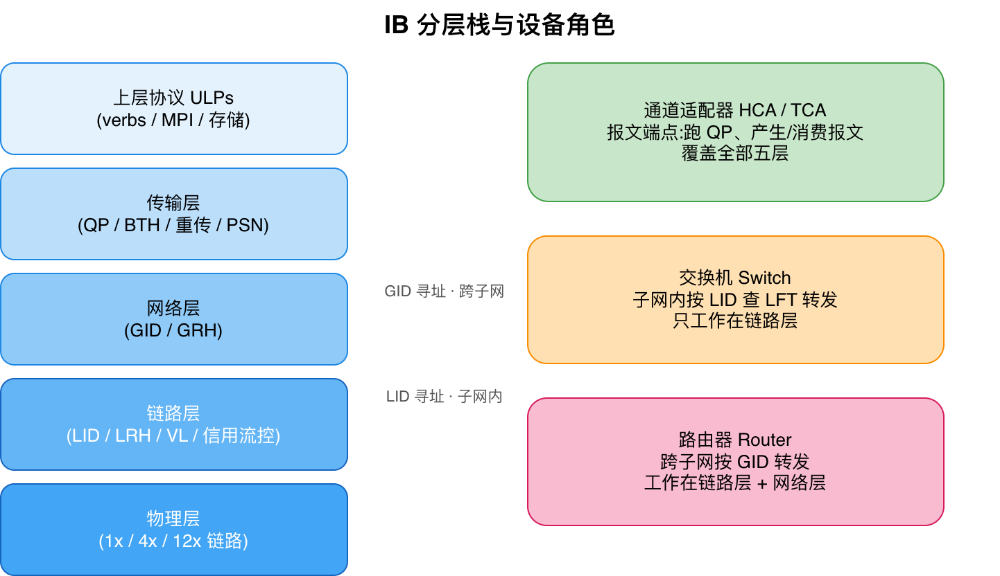

# IB 协议深度解析:子网如何组建、发现并转发报文

> 从 LID 到 SM:原生 InfiniBand 如何作为一个独立协议栈工作

---

## 1. IB 协议背景与定位

### 为什么还要单独讲 IB

在「报文格式那篇」里,我们讲过 RoCEv2——它的本质是「把 IB 的传输层搬到以太网 + UDP/IP 之上」,让 RDMA 能跑在标准以太网上。那篇文章反复提到一个前提:**RoCE 复用了 IB 的传输层**。

但「复用传输层」这句话,恰恰掩盖了一个更重要的事实:原生 InfiniBand 远不止一个传输层。它有自己完整的五层协议栈、有自己的链路层寻址(LID)、还有一套以太网世界里根本不存在的「子网管理」机制(SM)。这三样东西,才是 IB 作为高性能互连最核心、也最难理解的部分。

所以本文回到 IB 原生本身,讲清三件事:

1. **报文长什么样**——IB 的报文格式,重点是 RoCE 那篇没展开的链路层头(LRH)和管理报文(MAD);
2. **子网怎么组建**——子网管理器(SM)如何发现拓扑、分配 LID、下发转发表;
3. **报文怎么转发**——交换机如何靠一张线性转发表把报文送到目的地。

> 读完本文,你会理解一个关键点:**RoCE 是把 IB 的「传输」搬到了以太网上,却把 IB 的「管理」(SM)和「链路层」(LRH/LID)留在了原地。** 而后者,正是 IB 能做无损、确定性、可管理的根本原因。

### IB 的五层协议栈

InfiniBand 规范(IBTA)把协议栈分成五层,从上到下:

| 层 | 名称 | 职责 | 关键内容 |
|----|------|------|---------|
| 5 | 上层协议 ULPs | 应用如何用 RDMA | verbs API、MPI、SCSI、存储 |
| 4 | 传输层 | 端到端可靠交付 | QP、BTH、RC/UC/UD、重传、PSN |
| 3 | 网络层 | 跨子网路由 | GID、GRH |
| 2 | 链路层 | 子网内寻址与转发 | LID、LRH、VL、信用流控、交换机 |
| 1 | 物理层 | 电气/信号 | 1x/4x/12x 链路、SerDes、线缆 |

对照 RoCE 的分层,差异一目了然:

- **RoCE**:物理层 + 链路层直接用**以太网**,网络层用 **IP**,只是把「传输层」这一层换成了 IB 的传输层(所以叫「RDMA over Converged Ethernet」)。
- **原生 IB**:物理层、链路层、网络层全部是 **IB 私有**的。链路层不是以太网帧而是 LRH,寻址不是 MAC/IP 而是 LID。

这一层差别,决定了后面所有的不同:IB 的链路层是「专门为高性能互连设计」的,它从第一天起就内置了信用流控(无损)、虚拟通道 VL(隔离)、以及一个可管理的 LID 寻址空间——这些都是以太网原生没有、要靠 PFC 之类「补丁」去补的东西。

### 三种设备角色

一个 IB 子网里有四类设备,分三个角色:

| 角色 | 设备 | 作用 |
|------|------|------|
| **通道适配器 CA** | HCA(主机侧)/ TCA(目标侧) | 报文的源头和终点,跑 QP、产生/消费报文 |
| **交换机 Switch** | IB 交换机 | 子网内按 LID 转发报文,不做路由计算 |
| **路由器 Router** | IB 路由器 | 跨子网转发,根据 GID 决定下一跳 |

注意一个和以太网的重大区别:**IB 交换机不跑任何分布式路由协议**。它没有 OSPF/BGP,不交换路由信息,也不做最短路径计算。它的转发表是**由 SM 算好之后下发**的——交换机只是个「查表转发」的执行者。

这个「集中式管理」的思路,是 IB 和以太网在哲学上的根本分野:

- 以太网:交换机各自为政,分布式收敛,网络「自组织」;
- IB:SM 一人说了算,全局算好再下发,网络「被组织」。

### IB vs RoCEv2 差异总览

| 维度 | 原生 IB | RoCEv2 |
|------|---------|--------|
| 链路层 | 私有 LRH | 以太网帧 |
| 寻址 | LID(16bit,子网内) | MAC + IP |
| 跨子网 | GID(128bit)+ GRH | IP 路由 |
| 管理 | SM/SA/SMA 统一管理 | 无(靠人工/上层) |
| 无损 | 信用流控(链路层内置) | PFC(逐跳反压) |
| 路由 | SM 集中计算下发 | 分布式路由协议 |
| 硬件 | IB HCA + IB 交换机 | RDMA 网卡 + 以太网交换机 |

### 子网:理解 IB 的最小单元

要理解后面所有内容,先要建立「子网(Subnet)」这个概念。

**一个 IB 子网,就是一个由 SM 管辖、由 LID 寻址的自治域。** 它由若干 CA、交换机、可选的路由器组成。子网内部,所有寻址都用 16 位的 **LID(Local Identifier,本地标识)**;只有要跨出这个子网时,才需要用到 128 位的 **GID(Global Identifier,全局标识)** 和 GRH。

这里有个反直觉的点值得强调:

- **LID 不是硬件烧录的**。它不是 MAC 地址那种「出厂就固定」的地址,而是 **SM 在子网组建时动态分配**的。交换机、CA 的每一个端口,在被 SM 发现后,才会拿到自己的 LID。
- 这也是为什么 IB 必须有个 SM:没有 SM,子网里的设备连地址都没有,更谈不上转发。

这个「LID 由 SM 动态分配」的机制,把 IB 和以太网彻底区分开,也是第 3 章「子网发现」要讲的起点。

### 为什么 IB 需要独立的链路层和 SM

总结一下,IB 之所以要「另起炉灶」搞一套私有链路层 + 集中式 SM,根子是它的设计目标:为 HPC/AI 提供**确定性、无损、可管理**的互连。

- **确定性**:LID 转发表由 SM 全局算好,转发路径确定、可预测,不随网络抖动;
- **无损**:链路层内置信用流控,不用依赖上层的重传去「事后补救」;
- **可管理**:SM 掌握全子网拓扑,能做全局调度、故障隔离、QoS 配置。

代价则是:**它脱离了以太网的生态**,需要专用硬件、专用管理软件,门槛更高。这也是为什么 RoCE/UEC 会想尽办法在以太网上「复刻」IB 的这些能力——理解 IB,也就理解了这些后来者的来路。

---

