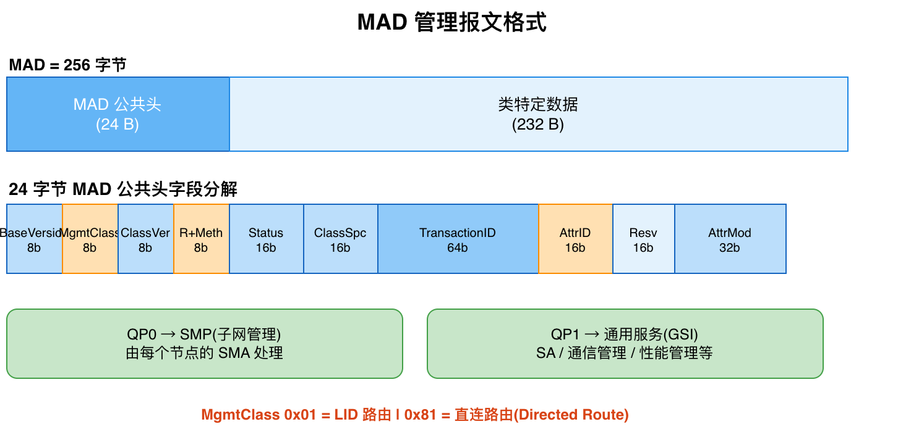
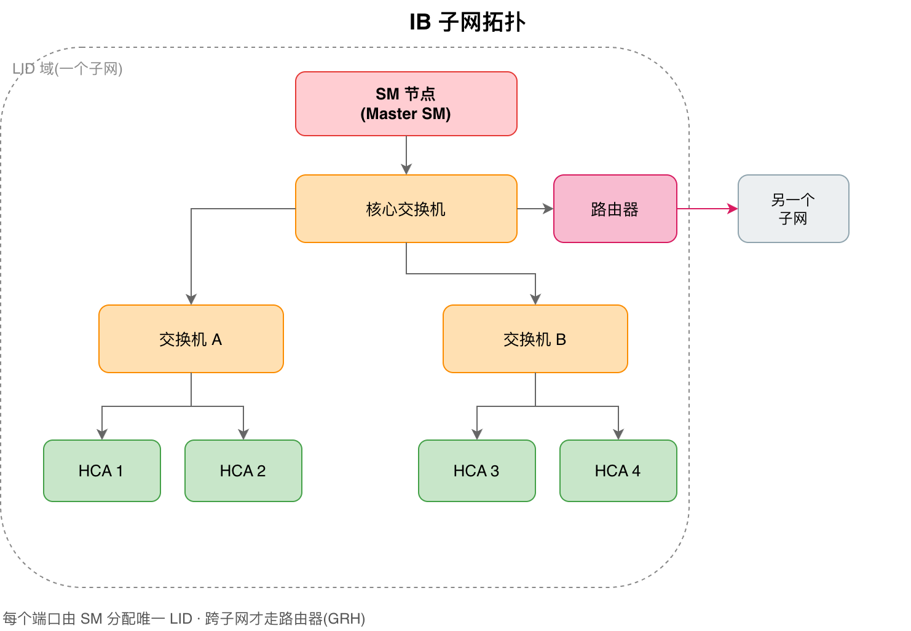
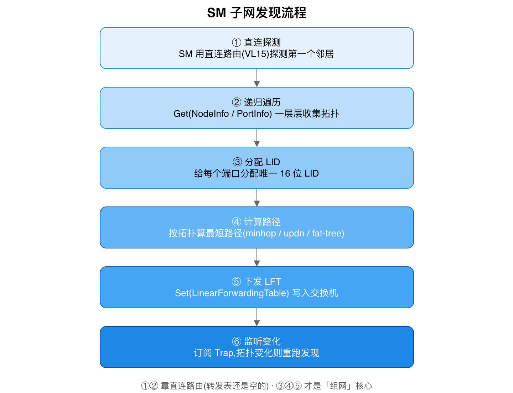
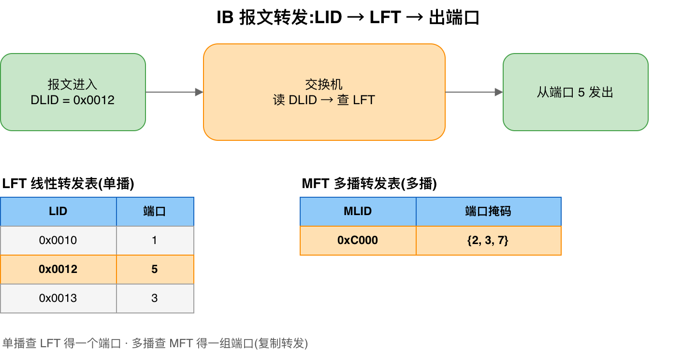
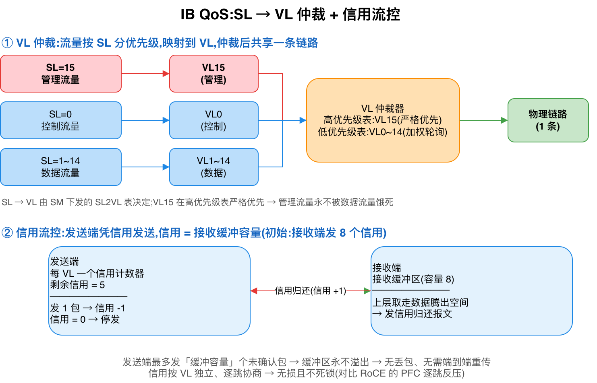
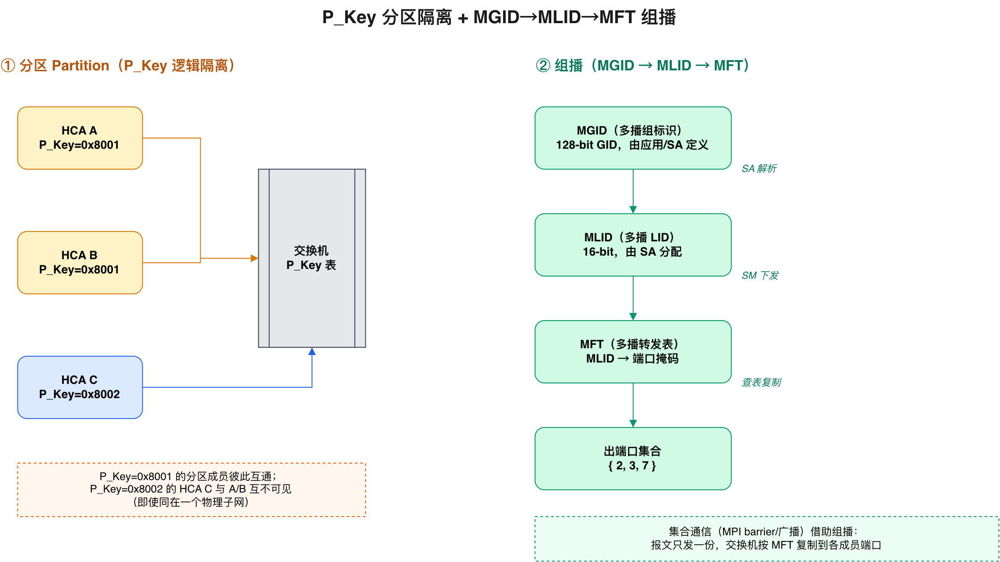

# IB 协议深度解析:子网如何组建、发现并转发报文

> 从 LID 到 SM:原生 InfiniBand 如何作为一个独立协议栈工作

---

## 1. IB 协议背景与定位

### 为什么还要单独讲 IB

在「报文格式那篇」里,我们讲过 RoCEv2——它的本质是「把 IB 的传输层搬到以太网 + UDP/IP 之上」,让 RDMA 能跑在标准以太网上。那篇文章反复提到一个前提:**RoCE 复用了 IB 的传输层**。

但「复用传输层」这句话,恰恰掩盖了一个更重要的事实:原生 InfiniBand 远不止一个传输层。它有自己完整的五层协议栈、有自己的链路层寻址(LID)、还有一套以太网世界里根本不存在的「子网管理」机制(SM)。这三样东西,才是 IB 作为高性能互连最核心、也最难理解的部分。

所以本文回到 IB 原生本身,讲清三件事:

1. **报文长什么样**——IB 的报文格式,重点是 RoCE 那篇没展开的链路层头(LRH)和管理报文(MAD);
2. **子网怎么组建**——子网管理器(SM)如何发现拓扑、分配 LID、下发转发表;
3. **报文怎么转发**——交换机如何靠一张线性转发表把报文送到目的地。

> 读完本文,你会理解一个关键点:**RoCE 是把 IB 的「传输」搬到了以太网上,却把 IB 的「管理」(SM)和「链路层」(LRH/LID)留在了原地。** 而后者,正是 IB 能做无损、确定性、可管理的根本原因。

### IB 的五层协议栈

InfiniBand 规范(IBTA)把协议栈分成五层,从上到下:

| 层 | 名称 | 职责 | 关键内容 |
|----|------|------|---------|
| 5 | 上层协议 ULPs | 应用如何用 RDMA | verbs API、MPI、SCSI、存储 |
| 4 | 传输层 | 端到端可靠交付 | QP、BTH、RC/UC/UD、重传、PSN |
| 3 | 网络层 | 跨子网路由 | GID、GRH |
| 2 | 链路层 | 子网内寻址与转发 | LID、LRH、VL、信用流控、交换机 |
| 1 | 物理层 | 电气/信号 | 1x/4x/12x 链路、SerDes、线缆 |

对照 RoCE 的分层,差异一目了然:

- **RoCE**:物理层 + 链路层直接用**以太网**,网络层用 **IP**,只是把「传输层」这一层换成了 IB 的传输层(所以叫「RDMA over Converged Ethernet」)。
- **原生 IB**:物理层、链路层、网络层全部是 **IB 私有**的。链路层不是以太网帧而是 LRH,寻址不是 MAC/IP 而是 LID。

这一层差别,决定了后面所有的不同:IB 的链路层是「专门为高性能互连设计」的,它从第一天起就内置了信用流控(无损)、虚拟通道 VL(隔离)、以及一个可管理的 LID 寻址空间——这些都是以太网原生没有、要靠 PFC 之类「补丁」去补的东西。

### 三种设备角色

一个 IB 子网里有四类设备,分三个角色:

| 角色 | 设备 | 作用 |
|------|------|------|
| **通道适配器 CA** | HCA(主机侧)/ TCA(目标侧) | 报文的源头和终点,跑 QP、产生/消费报文 |
| **交换机 Switch** | IB 交换机 | 子网内按 LID 转发报文,不做路由计算 |
| **路由器 Router** | IB 路由器 | 跨子网转发,根据 GID 决定下一跳 |

注意一个和以太网的重大区别:**IB 交换机不跑任何分布式路由协议**。它没有 OSPF/BGP,不交换路由信息,也不做最短路径计算。它的转发表是**由 SM 算好之后下发**的——交换机只是个「查表转发」的执行者。

这个「集中式管理」的思路,是 IB 和以太网在哲学上的根本分野:

- 以太网:交换机各自为政,分布式收敛,网络「自组织」;
- IB:SM 一人说了算,全局算好再下发,网络「被组织」。

### IB vs RoCEv2 差异总览

| 维度 | 原生 IB | RoCEv2 |
|------|---------|--------|
| 链路层 | 私有 LRH | 以太网帧 |
| 寻址 | LID(16bit,子网内) | MAC + IP |
| 跨子网 | GID(128bit)+ GRH | IP 路由 |
| 管理 | SM/SA/SMA 统一管理 | 无(靠人工/上层) |
| 无损 | 信用流控(链路层内置) | PFC(逐跳反压) |
| 路由 | SM 集中计算下发 | 分布式路由协议 |
| 硬件 | IB HCA + IB 交换机 | RDMA 网卡 + 以太网交换机 |

### 子网:理解 IB 的最小单元

要理解后面所有内容,先要建立「子网(Subnet)」这个概念。

**一个 IB 子网,就是一个由 SM 管辖、由 LID 寻址的自治域。** 它由若干 CA、交换机、可选的路由器组成。子网内部,所有寻址都用 16 位的 **LID(Local Identifier,本地标识)**;只有要跨出这个子网时,才需要用到 128 位的 **GID(Global Identifier,全局标识)** 和 GRH。

这里有个反直觉的点值得强调:

- **LID 不是硬件烧录的**。它不是 MAC 地址那种「出厂就固定」的地址,而是 **SM 在子网组建时动态分配**的。交换机、CA 的每一个端口,在被 SM 发现后,才会拿到自己的 LID。
- 这也是为什么 IB 必须有个 SM:没有 SM,子网里的设备连地址都没有,更谈不上转发。

这个「LID 由 SM 动态分配」的机制,把 IB 和以太网彻底区分开,也是第 3 章「子网发现」要讲的起点。

### 为什么 IB 需要独立的链路层和 SM

总结一下,IB 之所以要「另起炉灶」搞一套私有链路层 + 集中式 SM,根子是它的设计目标:为 HPC/AI 提供**确定性、无损、可管理**的互连。

- **确定性**:LID 转发表由 SM 全局算好,转发路径确定、可预测,不随网络抖动;
- **无损**:链路层内置信用流控,不用依赖上层的重传去「事后补救」;
- **可管理**:SM 掌握全子网拓扑,能做全局调度、故障隔离、QoS 配置。

代价则是:**它脱离了以太网的生态**,需要专用硬件、专用管理软件,门槛更高。这也是为什么 RoCE/UEC 会想尽办法在以太网上「复刻」IB 的这些能力——理解 IB,也就理解了这些后来者的来路。


---

## 2. IB 报文格式

IB 报文分两大类:**数据报文**(搬运业务数据)和**管理报文 MAD**(搬运管理信息)。两者走不同的 QP、结构也不同,但共用同一个链路层头 LRH。本章先拆数据报文,再拆管理报文。

### 2.1 数据报文

#### 整体结构

```
+----------+-----------+----------+----------+---------+--------+--------+
|   LRH    |    GRH    |    BTH   |  扩展头   | Payload |  ICRC  |  VCRC  |
|  (8 B)   | (40 B,可选)|  (12 B) |  (可选)   |         |  (4 B) |  (2 B) |
+----------+-----------+----------+----------+---------+--------+--------+
```

- **LRH(链路层头)**:每个 IB 报文都有,8 字节,负责子网内的逐跳转发;
- **GRH(全局路由头)**:跨子网时才加,40 字节;
- **BTH(基本传输头)**:传输层头,12 字节,标识 QP、操作类型;
- **扩展头**:按需附加(RETH / AETH / IMMETH 等);
- **ICRC / VCRC**:两个 CRC,分别校验不变字段和变字段。

#### LRH:链路层头(重点)

LRH 是 IB 报文最独特的部分,也是 RoCE 报文里没有的东西(以太网那边是 MAC 头)。它只有 8 字节,字段如下:

| 字段 | 位宽 | 说明 |
|------|------|------|
| VL | 4 bit | 虚拟通道号,决定报文走哪条 VL(第 5 章细讲) |
| LVer | 4 bit | 链路版本 |
| SL | 4 bit | 服务级别,交换机据此查 SL2VL 表决定出口 VL |
| Reserved | 2 bit | 保留(扩展 LRH 里用作 LID 扩展标志) |
| LNH | 2 bit | 下一头类型:2 = BTH(子网内),3 = GRH(跨子网) |
| DLID | 16 bit | 目的 LID,决定交换机往哪个端口转发 |
| Reserved | 5 bit | 保留 |
| PktLen | 11 bit | 报文总长,以 4 字节字为单位 |
| SLID | 16 bit | 源 LID |

关键点有两个:

1. **只有 LID,没有 MAC/IP。** LRH 里的地址就是 16 位的 DLID / SLID。它们不是硬件烧录的,而是 SM 在子网组建时动态分配的(第 3 章)。
2. **LNH 决定「下一层是啥」。** 子网内报文 LNH = 2,后面直接跟 BTH;要跨子网时 LNH = 3,后面先跟 GRH(GRH 里的 NextHeader 再指向 BTH)。

#### GRH:全局路由头(跨子网时)

40 字节,IPv6 结构,和 IPv6 头几乎一一对应,最关键的是 16 字节的 **SGID** 和 16 字节的 **DGID**(全局标识,128 位)。

在「报文格式那篇」讲过,GID 由网卡端口的 GID 表提供。原生 IB 逻辑一样:子网内只靠 LID 就够,一旦要出子网,就得用 GID 找到目标「在哪一个子网」,再由路由器接力(第 4 章)。

#### BTH 与扩展头(简要回顾)

BTH 是传输层头,12 字节,包含 Opcode(操作类型)、P_Key、DestQP(目的 QP 号)、PSN(包序号)等。这些字段 RoCE 和原生 IB **完全一致**——这正是「RoCE 复用 IB 传输层」的体现。逐字段含义见「报文格式那篇」,这里不重复。

扩展头(Extended Transport Header)按需附加:RETH(远程内存,含虚拟地址 / 长度 / R_Key)、AETH(应答)、IMMETH(立即数)等,同样见前文。

#### ICRC 与 VCRC

IB 报文带两个 CRC:

- **ICRC(Invariant CRC,4 字节)**:校验从 BTH 到 Payload 这些「传输过程中不变」的字段(交换机转发不会改它们);
- **VCRC(Variant CRC,2 字节)**:校验 LRH 这类「每跳都可能变」的字段(比如 VL、SL 可能被交换机改写)。

之所以拆两个:交换机转发时要改 LRH,如果只用一个 CRC,每个交换机都得重算整个报文的 CRC;拆开后,交换机只需更新 VCRC,ICRC 原样保留,硬件转发更快。

### 2.2 管理报文 MAD / SMP

数据报文搬运业务数据,而 IB 的「子网组建、配置、监控」这些管理动作,靠另一类专门的报文——**MAD(Management Datagram,管理报文)**。

#### MAD 是什么

MAD 是一个 **256 字节**的固定长度报文,走 **UD(不可靠数据报)** 队列。它不是业务数据,而是「管理命令」的载体:SM 用它查询节点信息、下发转发表,网卡用它上报事件。

MAD 走两个专用 QP:

| QP | 用途 |
|----|------|
| **QP0** | 子网管理(SMP),由每个节点的 SMA(子网管理代理)处理 |
| **QP1** | 通用服务接口(GSI),跑 SA、通信管理、性能管理等其他 MAD |

QP0 之所以单列,是因为它承载的子网管理报文(SMP)是整个子网能不能组起来的关键。

#### 24 字节公共头

所有 MAD 都有一个 24 字节的公共头,后面跟 232 字节的类特定数据:

| 字段 | 位宽 | 说明 |
|------|------|------|
| BaseVersion | 8 bit | 版本,固定为 1 |
| MgmtClass | 8 bit | 管理类,决定这个 MAD 交给哪个代理处理 |
| ClassVersion | 8 bit | 类的版本 |
| R + Method | 1 + 7 bit | R 位区分请求/响应;Method 是操作类型 |
| Status | 16 bit | 状态码(响应报文里才有意义) |
| ClassSpecific | 16 bit | 类特定(子网管理类专用) |
| TransactionID | 64 bit | 事务 ID,请求和响应靠它配对 |
| AttributeID | 16 bit | 属性 ID,决定操作的是哪个对象 |
| Reserved | 16 bit | 保留 |
| AttributeModifier | 32 bit | 属性修饰符,进一步限定属性 |

#### Method:做什么操作

Method 决定这是「读」还是「写」,常见值:

| Method | 含义 |
|--------|------|
| Get / GetResp | 读一个属性 / 读的响应 |
| Set / SetResp | 写一个属性 / 写的响应 |
| Trap / TrapRepress | 事件上报 / 抑制上报 |
| Report / ReportResp | 主动报告 / 报告的响应 |

R 位是 Method 的最高位:请求是 0,响应是 1(所以 Get 是 0x01,GetResp 是 0x81)。SM 发给节点一个 Get(NodeInfo),节点回的 GetResp 里带同一个 TransactionID,SM 就知道「这条响应对应我哪条请求」。

#### MgmtClass:交给谁处理

MgmtClass 决定 MAD 路由到哪个代理:

| MgmtClass | 含义 |
|-----------|------|
| 0x01 | 子网管理(Subnet Management),LID 路由,交给 SMA |
| 0x81 | 子网管理(Subnet Management),**直连路由** |
| 0x03 | 子网管理(Subnet Administration),交给 SA |
| 0x04 | 性能管理(Performance Management) |
| 0x06 | 设备管理(Device Management) |
| 0x07 | 通信管理(Communication Management) |

注意 **0x01 和 0x81 的区别**:它们都是子网管理类,差别只在「怎么路由」。0x01 走 LID 路由(靠转发表),0x81 走直连路由(靠报文里显式的端口路径)。这个区别是第 3 章「子网发现」的关键。

#### AttributeID:操作哪个对象

AttributeID 决定操作的是哪个属性。几个和本文强相关的:

| AttributeID | 含义 |
|-------------|------|
| 0x0011 | NodeInfo(节点信息) |
| 0x0012 | SwitchInfo(交换机信息) |
| 0x0015 | PortInfo(端口信息) |
| 0x0019 | LinearForwardingTable(线性转发表,即 LFT) |
| 0x001B | MulticastForwardingTable(多播转发表,即 MFT) |

看到 LFT(0x0019)和 MFT(0x001B)了吗?第 4 章要讲的「报文转发」,转发表就是 SM 通过 Set(LinearForwardingTable)这条 MAD 一条条下发到交换机的。

#### 两类 SMP 路由:LID 路由 vs 直连路由

最后把这个关键区别讲透。SM 发的子网管理报文(SMP)有两种路由方式:

1. **LID 路由**:DLID 写目标 LID,交换机按转发表正常转发。这要求转发表已经建好、LID 已经分配。
2. **直连路由(Directed Route)**:报文里显式带一条「端口路径」(Initial Path,一串出端口号),每经过一个交换机就按路径里的下一个端口号转发,不依赖转发表。

直连路由在**拓扑还没发现、LID 还没分配**时是唯一能用的方式——因为这时转发表是空的。SM 正是靠直连路由的 SMP,一跳一跳地把整个子网摸清楚。这就是下一章的主题。




---

## 3. 子网管理 SM:子网发现逻辑

第 2 章留了一个问题:LRH 里的 DLID/SLID 是「SM 分配的」,转发表是「SM 下发的」。那 SM 到底是怎么在「什么都没有」的情况下,把一个子网从零组建起来的?这就是本章的核心——**子网发现(Subnet Discovery)**。

### 3.1 SM 是谁:子网的「管理员」

**SM(Subnet Manager,子网管理器)** 是 IB 子网内唯一的权威,它不是一个独立设备,而是运行在某个节点上的一个软件实体(可以跑在交换机上,也可以跑在 HCA 所在的服务器上,OpenSM 就是最常见的开源实现)。

它垄断四件事:

1. **拓扑发现**:摸清整个子网谁连着谁;
2. **LID 分配**:给每个端口发一个 16 位 LID;
3. **路径计算**:算出任意两点之间的转发路径;
4. **转发表下发**:把算好的路径写成 LFT,下发到每台交换机。

一句话:**交换机只负责「查表转发」,SM 负责「算表和下表」。** 这和以太网「每台交换机自己算路由」是彻底相反的设计。

### 3.2 三个角色:SM / SMA / SA

IB 的「管理」不是 SM 一个人的独角戏,还有两个配合角色:

| 角色 | 全称 | 在哪 | 干什么 |
|------|------|------|--------|
| **SM** | Subnet Manager | 某个节点上 | 主动发起发现、算路径、下表 |
| **SMA** | Subnet Management Agent | **每个节点都有** | 被动响应 SM 的查询,执行 SM 的命令 |
| **SA** | Subnet Administrator | 依附 SM | 提供路径解析、服务定位等高层服务 |

关键理解:**SMA 存在于每一个 IB 设备里**(每个 HCA、每个交换机都有)。SM 想查询某个节点,就是通过 QP0 发一条 SMP 给那个节点的 SMA,SMA 再回复。所以 SM 不是「上帝视角」,它必须**一台一台地问**,靠这些 SMA 的回复拼出全貌。

### 3.3 子网发现:从零摸清拓扑

#### 鸡生蛋问题:转发表是空的

子网刚上电时,状态是这样的:

- 所有端口都**没有 LID**;
- 所有交换机的**转发表都是空的**;
- 但 SM 又必须通过交换机才能访问到远处的节点。

这就是「鸡生蛋」:SM 要下发转发表,得先能「够到」那些交换机;可够到它们,又需要转发表已经存在。

IB 的解法,就是第 2 章结尾提到的 **直连路由(Directed Route)+ VL15**:

- **直连路由**:报文里显式带一串「出端口号」(Initial Path),不查转发表,逐跳按端口号走;
- **VL15**:管理虚拟通道,优先级最高、永远不被数据流量阻塞,而且**不需要信用流控的初始化**就能用。

有了这两样,SM 就能在「转发表为空」的前提下,逐跳探测每一个端口。

#### 直连路由是怎么逐跳走的

一条直连路由的 SMP 里,除了公共头,还有几个专用字段:

| 字段 | 含义 |
|------|------|
| Initial Path | 出端口号数组,SM 指定「从哪个端口出去」 |
| Return Path | 返回路径,沿途交换机把「从哪个端口进来」记下来 |
| Hop Pointer | 指针,指到当前走到第几跳 |
| DrDLID / DrSLID | 直连路由的目的/源 LID(发现阶段用 permissive LID 0xFFFF) |

流程是这样的:

1. SM 从自己的端口发出 SMP,Initial Path 里写好了每一跳的出端口;
2. 每经过一个交换机,它的 SMI(管理接口)做三件事:把**入端口**记进 Return Path、Hop Pointer 加一、按 Initial Path 里**下一个出端口**转发;
3. 报文到达目标节点的 SMA,SMA 处理完,把 D 位置成「返回」,沿 **Return Path** 原路送回;
4. SM 收到响应,就知道了这条路径上有哪些节点、它们连着谁。

#### 发现的六步

把整个发现过程串起来,就是六步:

1. **直连探测**:SM 从自身端口出发,发直连路由的 Get(NodeInfo),摸清第一个邻居;
2. **递归遍历**:拿到邻居的 NodeInfo / PortInfo 后,继续向它的每个端口发探测,一层层递归,直到把所有节点和端口都问遍;
3. **分配 LID**:SM 给每个端口分配唯一的 16 位 LID;
4. **计算路径**:根据收集到的拓扑,算任意两点间的最短路径(路由算法见下);
5. **下发 LFT**:用 LID 路由的 Set(LinearForwardingTable),把算好的路径写进每台交换机的转发表;
6. **监听变化**:SM 订阅 Trap 事件,一旦拓扑变化(拔线、加设备),就重跑发现和计算。

到这,子网才算「组好了」:每个端口有 LID,每台交换机有转发表,数据报文可以正常转发。

### 3.4 主备 SM:谁说了算

SM 这么重要,挂了怎么办?所以 IB 允许**多个 SM 共存**,用优先级选举出**主 SM(Master)**,其余是**备 SM(Standby)**。

- 每个 SM 广播自己的优先级(priority),优先级最高的当选 Master;
- Master 负责实际管理子网,Standby 只被动监听、随时准备接管;
- 一旦 Master 挂掉(没按时发心跳),优先级最高的 Standby 立即接管,重跑发现、重新下发转发表。

这套「主备 + 优先级」机制,保证了子网管理的高可用,也是 IB 在 HPC 场景比以太网更「可控」的一个体现。

### 3.5 深度:LID 怎么分,路径怎么算

最后两个进阶点,决定了一个大型子网「好不好用」。

**LID 分配策略**:SM 可以按发现顺序连续分(简单),也可以「稀疏分」(比如按拓扑区域预留一段),后者在子网频繁增删设备时能减少重编号。这个选择影响子网稳定性,是 OpenSM 的可配置项。

**路由算法**:算「任意两点最短路径」有不同策略,OpenSM 里常见:

| 算法 | 思路 | 适用 |
|------|------|------|
| minhop | 每对节点走跳数最少的路径 | 任意拓扑 |
| updn | 先把拓扑看成一棵树,只允许「先上后下」 | 防止环路、适合 fat-tree |
| fat-tree | 针对 fat-tree 拓扑做负载均衡 | 大型 HPC 集群 |

这解释了为什么 IB 子网能做到「路径确定、可预测」:因为所有路径都是 SM 用一个明确算法**全局算出来**的,而不是每台交换机各自收敛出来的。





---

## 4. 报文如何转发

第 3 章讲清了 SM 怎么「组网」,这一章讲「组好之后,报文怎么在网络里走」。核心就一句话:**交换机查一张表,把报文从对应端口丢出去。**

### 4.1 子网内转发:查一张线性转发表

数据报文进到交换机,转发决策极其简单,三步:

1. 读 LRH 里的 **DLID**(目的 LID);
2. 用 DLID 作为下标,查 **LFT(Linear Forwarding Table,线性转发表)**;
3. 拿到出端口号,把报文从这个端口转发出去。

```
报文进交换机 → 读 DLID=0x0012 → 查 LFT[0x0012] → 得到「端口 5」 → 从端口 5 发出
```

**LFT 的本质是一张「LID → 端口」的查找表。** LID 是 16 位,所以这张表最多有 65536 项,每项存一个端口号。查表是 O(1) 的硬件操作——没有最长前缀匹配、没有路由协议收敛、没有转发表的动态更新。这就是 IB 转发「快且确定」的原因。

报文在网络里**逐跳**转发:每一跳的交换机都做同样的「读 DLID → 查 LFT → 出端口」,直到到达目的 CA。

### 4.2 多播转发:MFT

单播走 LFT,多播走另一张表——**MFT(Multicast Forwarding Table,多播转发表)**。

多播报文的目的地址不是普通 LID,而是一个 **MLID(多播 LID)**。交换机查 MFT[MLID],拿到的不是一个端口,而是一个**端口掩码(一组端口)**,然后把报文复制到这些端口同时发出。

```
报文进交换机 → 读 DLID=MLID → 查 MFT[MLID] → 得到「端口 {2,3,7}」 → 复制并发往 2/3/7
```

多播在集合通信里很有用(第 6 章细讲):比如 MPI 的 barrier、广播,用多播能省掉大量逐点发送。

### 4.3 跨子网:路由器 + GRH

到目前为止讲的全是**子网内**转发,靠 LID。但如果目标在**另一个子网**呢?

子网内 LID 只在本地有意义,出了子网就失效。这时需要:

1. 报文带上 **GRH**(第 2 章讲的全局路由头),里面是 128 位的 **DGID**;
2. 报文先被送到**路由器**(路由器在子网内有自己的 LID,按 LID 可达);
3. 路由器根据 DGID,决定把报文转发到哪个子网、哪一跳。

所以 IB 的跨子网模型是:**子网内走 LID(快、简单),跨子网才用 GID/GRH(慢、复杂)**。绝大多数 HPC/AI 集群都在一个子网内,根本用不到 GID 和路由器——这也是为什么前面说「LID 是主角,GID 是配角」。

### 4.4 与 RoCE 的根本对照

把 IB 的转发和 RoCE(以太网)放一起,差异是哲学级的:

| | IB | RoCE(以太网) |
|--|----|-------------|
| 转发表谁算 | SM 集中算好、统一下发 | 每台交换机分布式收敛(OSPF/BGP/ECMP) |
| 转发决策 | 读 DLID → 查 LFT,O(1) | 查路由表、最长前缀匹配 |
| 路径确定性 | 全局确定、可预测 | 受协议收敛、ECMP hash 影响 |
| 多路径 | LMC 给端口配多个 LID | ECMP 按五元组 hash |

关键区别在**「谁来算路径」**:IB 是「一人算好、众人执行」,以太网是「各自为政、分布式收敛」。前者确定性强、故障可控,但依赖 SM 这个中心;后者灵活、自愈,但路径不可控、难调优。

### 4.5 深度:多路径怎么做(LMC)

既然转发是「读 DLID 查表」,那一个端口想走多条路径怎么办?答案是 **LMC(LID Mask Control)**。

LMC 让一个物理端口拥有**多个 LID**。SM 给同一个端口分配几个 LID,每个 LID 对应一条不同的路径(靠 SM 下发不同的 LFT 条目实现)。这样,上层只要换一个 DLID,报文就走另一条路,实现了简单的多路径。

这也呼应了第 3 章的路由算法:SM 在算路径时,可以主动为负载重的链路分配多个 LID、把流量摊到不同路径上。整个转发平面始终是「查表」这一种简单动作,多路径、负载均衡全在 SM 的「算表」阶段完成。



---

## 5. QoS:VL / SL / 信用流控

第 4 章讲「怎么走」,这一章讲「怎么保证走得快、不丢、不互相干扰」。IB 的 QoS 有两个支柱:**VL(虚拟通道)** 做隔离, **信用流控** 做无损。

### 5.1 VL:一条物理链路上的多条「虚拟通道」

物理上,两个端口之间只有一条链路;但逻辑上,IB 把它切成多条 **VL(Virtual Lane,虚拟通道)**。

- 一条链路最多支持 **16 条 VL**:VL0 ~ VL14 是数据通道,VL15 是**管理通道**(前面 SM 的 SMP 就走这条);
- 每条 VL 有**独立的接收缓冲和信用计数**,彼此隔离;
- 一条 VL 拥塞了,**不会阻塞其他 VL** 的流量。

这解决了一个经典问题:如果管理报文和业务数据挤在同一条队列里,数据一拥塞,管理报文就发不出去,SM 都失联了。把管理单独放 VL15,优先级最高,永远能通。

### 5.2 SL 到 VL 的映射

报文怎么决定走哪条 VL?靠 LRH 里的 **SL(Service Level,服务级别)** 字段(4 位,0~15)。

交换机根据 SL 查一张 **SL2VL 表**(由 SM 下发),把 SL 映射到出口 VL:

```
报文 SL=3 → 查 SL2VL 表 → 得到出口 VL=5 → 从 VL5 发出
```

所以 SL 是「报文的优先级标签」,VL 是「实际的物理通道」,中间靠 SM 配好的映射表连接。这个映射让 SM 能灵活地「把哪些流量分到哪条通道」。

### 5.3 VL 仲裁:多条 VL 抢一条链路

一个端口要发报文时,可能多条 VL 都有报文在排队,谁先发?靠 **VL 仲裁器(Arbiter)**。

仲裁用两张表:

- **高优先级表(High Priority Table)**:严格按优先级,高优先级的 VL 先发;
- **低优先级表(Low Priority Table)**:在低优先级 VL 之间做加权轮询(WRR),每个 VL 一个权重。

这套机制保证:高优先级流量(管理、控制)不被饿死,低优先级流量之间又能公平分配带宽。

### 5.4 信用流控:IB 无损的关键

现在讲本章的重点——**信用流控(Credit-Based Flow Control)**。这是 IB 能做到「无损」的根本,也是它和以太网(PFC)最本质的区别。

**核心思想:发送端只有在「确定对方有缓冲」时才发,永远不让接收端缓冲溢出。**

具体机制:

1. 链路两端协商时,各自**公布每条 VL 的接收缓冲大小**;
2. 发送端为每条 VL 维护一个**信用计数**,初始等于对方的缓冲大小;
3. 每发一个包,对应 VL 的信用减一;
4. 接收端处理完一批包、腾出缓冲后,发一个**流控报文**把信用「还」给发送端;
5. 信用用完,发送端就**停发**——注意是停这一条 VL,不影响其他 VL。

因为「信用用完就停」,接收端的缓冲**永远不会溢出**,所以**不会丢包**。上层(传输层)因此可以大胆假设网络无损,把重传逻辑大幅简化。

### 5.5 与 RoCE 的 PFC 对照

RoCE 在以太网上要模仿这种「无损」,靠的是 **PFC(优先级流控)**,但两者有本质差别:

| | IB 信用流控 | RoCE PFC |
|--|------------|----------|
| 设计 | 链路层**原生内置** | 以太网的**事后补丁** |
| 粒度 | 按 VL(最多 16 条) | 按优先级(最多 8 条) |
| 反压方式 | 信用用尽自然停发 | 缓冲快满时发 pause 帧逐跳反压 |
| 副作用 | 无(逐跳协商,按 VL 独立) | PFC 风暴、HOL blocking、死锁风险 |

关键洞察:**信用流控是「发送前就协商好配额」,PFC 是「快溢出了才喊停」。** 前者是预防,后者是补救——补救往往已经晚了(拥塞已经扩散)。这也是「拥塞控制那篇」里 RoCE 各种顽疾的根源之一,而 IB 从第一天就避免了。

### 5.6 深度:为什么信用流控「无损但不死锁」

信用流控能无损,直觉上「停发」似乎会导致死锁,但 IB 不会,原因是:

1. **信用按 VL 独立**:一条 VL 的信用耗尽,只停这一条 VL,其他 VL 照常,不会「全线停摆」;
2. **逐跳协商**:信用只在**相邻两跳**之间协商,不跨多跳,不会出现「A 等 B、B 等 C、C 等 A」的环形等待;
3. **管理通道独立**:VL15 不走这套信用逻辑(或单独保证),管理流量永远能通,SM 不会失联。

这三点,恰好是 PFC 的死结所在(PFC 优先级少、逐跳反压会级联、没有独立管理通道),所以 IB 的「无损」比 RoCE 的「无损」要干净得多。



---

## 6. 分区 Partition 与组播

前五章讲完了「一个子网怎么组建、转发、保证 QoS」。这一章补两条支线:**分区(Partition)** 做隔离,**组播(Multicast)** 做一对多。

### 6.1 分区:用 P_Key 划出逻辑隔离

一个物理 IB 子网里,可能有多个租户/业务,彼此不想看到对方。分区(Partition)就是干这个的。

分区靠 **P_Key(Partition Key,16 位)** 实现:

- SM 给每个分区分配一个 P_Key;
- 每个端口属于一个或多个分区,持有对应的 P_Key;
- 报文在传输层头(BTH)里携带 P_Key;
- 接收端**校验报文的 P_Key 是否在自己的分区表里**,不在就丢弃。

分区有两种成员级别:

- **全成员(Full Member)**:可以和其他全成员通信;
- **受限成员(Limited Member)**:只能和全成员通信,不能和同为受限成员的节点通信(常用于「客户只能访问服务器,客户之间隔离」的场景)。

### 6.2 P_Key 与 Q_Key 的分工

两个「Key」容易混,一句话区分:

- **P_Key**:管「**能不能进这个分区**」——是网络层面的隔离;
- **Q_Key**:管「**能不能用这个队列**」——是 UD QP 的访问控制(32 位,发 UD 报文时校验)。

P_Key 在 BTH 里,跟着报文走;Q_Key 在报文的 Q_Key 字段里,收端用它决定「这个报文有没有资格投递到目标 UD QP」。两者配合,实现了「分区隔离 + 队列访问控制」两级防护。

### 6.3 组播:从 MGID 到 MLID 再到 MFT

第 4 章提过,多播靠 MFT 转发表。这里把多播的「名字怎么变成转发表」补全。

组播要解决一个问题:应用层怎么「点名」一个组?IB 用三层名字:

1. **MGID(Multicast GID,128 位)**:应用层用的组标识(全局唯一,类似 IPv6 多播地址);
2. **MLID(Multicast LID,16 位)**:子网内的组标识,由 **SA** 分配;
3. **MFT(Multicast Forwarding Table)**:交换机里 MLID → 端口掩码的转发表。

流程:**应用拿 MGID 向 SA 申请加入组 → SA 分配 MLID,并把成员信息交给 SM → SM 更新各交换机的 MFT → 发多播时,报文用 MLID,交换机查 MFT 复制转发。**

### 6.4 组播在集合通信里的价值

组播不是炫技,它直接服务于 HPC/AI 的**集合通信**:

- **广播 / barrier**:用组播,一条报文沿多播树复制,替代「逐点发 N-1 次」;
- 尤其在大规模集群,树形多播能把 O(N) 的点对点开销降到 O(log N) 的树形开销。

这呼应「GPU 互联那篇」里讲的 ring / tree 算法:NCCL 在 IB 上做 AllReduce 时,可以借助 IB 原生多播来加速部分集合操作。



---

