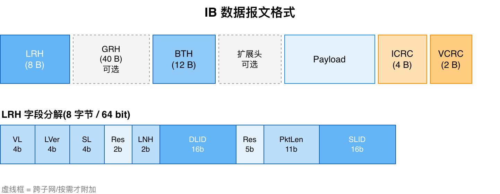

# IB 协议深度解析:子网如何组建、发现并转发报文

> 从 LID 到 SM:原生 InfiniBand 如何作为一个独立协议栈工作

---

## 1. IB 协议背景与定位

### 为什么还要单独讲 IB

在「报文格式那篇」里,我们讲过 RoCEv2——它的本质是「把 IB 的传输层搬到以太网 + UDP/IP 之上」,让 RDMA 能跑在标准以太网上。那篇文章反复提到一个前提:**RoCE 复用了 IB 的传输层**。

但「复用传输层」这句话,恰恰掩盖了一个更重要的事实:原生 InfiniBand 远不止一个传输层。它有自己完整的五层协议栈、有自己的链路层寻址(LID)、还有一套以太网世界里根本不存在的「子网管理」机制(SM)。这三样东西,才是 IB 作为高性能互连最核心、也最难理解的部分。

所以本文回到 IB 原生本身,讲清三件事:

1. **报文长什么样**——IB 的报文格式,重点是 RoCE 那篇没展开的链路层头(LRH)和管理报文(MAD);
2. **子网怎么组建**——子网管理器(SM)如何发现拓扑、分配 LID、下发转发表;
3. **报文怎么转发**——交换机如何靠一张线性转发表把报文送到目的地。

> 读完本文,你会理解一个关键点:**RoCE 是把 IB 的「传输」搬到了以太网上,却把 IB 的「管理」(SM)和「链路层」(LRH/LID)留在了原地。** 而后者,正是 IB 能做无损、确定性、可管理的根本原因。

### IB 的五层协议栈

InfiniBand 规范(IBTA)把协议栈分成五层,从上到下:

| 层 | 名称 | 职责 | 关键内容 |
|----|------|------|---------|
| 5 | 上层协议 ULPs | 应用如何用 RDMA | verbs API、MPI、SCSI、存储 |
| 4 | 传输层 | 端到端可靠交付 | QP、BTH、RC/UC/UD、重传、PSN |
| 3 | 网络层 | 跨子网路由 | GID、GRH |
| 2 | 链路层 | 子网内寻址与转发 | LID、LRH、VL、信用流控、交换机 |
| 1 | 物理层 | 电气/信号 | 1x/4x/12x 链路、SerDes、线缆 |

对照 RoCE 的分层,差异一目了然:

- **RoCE**:物理层 + 链路层直接用**以太网**,网络层用 **IP**,只是把「传输层」这一层换成了 IB 的传输层(所以叫「RDMA over Converged Ethernet」)。
- **原生 IB**:物理层、链路层、网络层全部是 **IB 私有**的。链路层不是以太网帧而是 LRH,寻址不是 MAC/IP 而是 LID。

这一层差别,决定了后面所有的不同:IB 的链路层是「专门为高性能互连设计」的,它从第一天起就内置了信用流控(无损)、虚拟通道 VL(隔离)、以及一个可管理的 LID 寻址空间——这些都是以太网原生没有、要靠 PFC 之类「补丁」去补的东西。

### 三种设备角色

一个 IB 子网里有四类设备,分三个角色:

| 角色 | 设备 | 作用 |
|------|------|------|
| **通道适配器 CA** | HCA(主机侧)/ TCA(目标侧) | 报文的源头和终点,跑 QP、产生/消费报文 |
| **交换机 Switch** | IB 交换机 | 子网内按 LID 转发报文,不做路由计算 |
| **路由器 Router** | IB 路由器 | 跨子网转发,根据 GID 决定下一跳 |

注意一个和以太网的重大区别:**IB 交换机不跑任何分布式路由协议**。它没有 OSPF/BGP,不交换路由信息,也不做最短路径计算。它的转发表是**由 SM 算好之后下发**的——交换机只是个「查表转发」的执行者。

这个「集中式管理」的思路,是 IB 和以太网在哲学上的根本分野:

- 以太网:交换机各自为政,分布式收敛,网络「自组织」;
- IB:SM 一人说了算,全局算好再下发,网络「被组织」。

### IB vs RoCEv2 差异总览

| 维度 | 原生 IB | RoCEv2 |
|------|---------|--------|
| 链路层 | 私有 LRH | 以太网帧 |
| 寻址 | LID(16bit,子网内) | MAC + IP |
| 跨子网 | GID(128bit)+ GRH | IP 路由 |
| 管理 | SM/SA/SMA 统一管理 | 无(靠人工/上层) |
| 无损 | 信用流控(链路层内置) | PFC(逐跳反压) |
| 路由 | SM 集中计算下发 | 分布式路由协议 |
| 硬件 | IB HCA + IB 交换机 | RDMA 网卡 + 以太网交换机 |

### 子网:理解 IB 的最小单元

要理解后面所有内容,先要建立「子网(Subnet)」这个概念。

**一个 IB 子网,就是一个由 SM 管辖、由 LID 寻址的自治域。** 它由若干 CA、交换机、可选的路由器组成。子网内部,所有寻址都用 16 位的 **LID(Local Identifier,本地标识)**;只有要跨出这个子网时,才需要用到 128 位的 **GID(Global Identifier,全局标识)** 和 GRH。

这里有个反直觉的点值得强调:

- **LID 不是硬件烧录的**。它不是 MAC 地址那种「出厂就固定」的地址,而是 **SM 在子网组建时动态分配**的。交换机、CA 的每一个端口,在被 SM 发现后,才会拿到自己的 LID。
- 这也是为什么 IB 必须有个 SM:没有 SM,子网里的设备连地址都没有,更谈不上转发。

这个「LID 由 SM 动态分配」的机制,把 IB 和以太网彻底区分开,也是第 3 章「子网发现」要讲的起点。

### 为什么 IB 需要独立的链路层和 SM

总结一下,IB 之所以要「另起炉灶」搞一套私有链路层 + 集中式 SM,根子是它的设计目标:为 HPC/AI 提供**确定性、无损、可管理**的互连。

- **确定性**:LID 转发表由 SM 全局算好,转发路径确定、可预测,不随网络抖动;
- **无损**:链路层内置信用流控,不用依赖上层的重传去「事后补救」;
- **可管理**:SM 掌握全子网拓扑,能做全局调度、故障隔离、QoS 配置。

代价则是:**它脱离了以太网的生态**,需要专用硬件、专用管理软件,门槛更高。这也是为什么 RoCE/UEC 会想尽办法在以太网上「复刻」IB 的这些能力——理解 IB,也就理解了这些后来者的来路。


---

## 2. IB 报文格式

IB 报文分两大类:**数据报文**(搬运业务数据)和**管理报文 MAD**(搬运管理信息)。两者走不同的 QP、结构也不同,但共用同一个链路层头 LRH。本章先拆数据报文,再拆管理报文。

### 2.1 数据报文

#### 整体结构

```
+----------+-----------+----------+----------+---------+--------+--------+
|   LRH    |    GRH    |    BTH   |  扩展头   | Payload |  ICRC  |  VCRC  |
|  (8 B)   | (40 B,可选)|  (12 B) |  (可选)   |         |  (4 B) |  (2 B) |
+----------+-----------+----------+----------+---------+--------+--------+
```

- **LRH(链路层头)**:每个 IB 报文都有,8 字节,负责子网内的逐跳转发;
- **GRH(全局路由头)**:跨子网时才加,40 字节;
- **BTH(基本传输头)**:传输层头,12 字节,标识 QP、操作类型;
- **扩展头**:按需附加(RETH / AETH / IMMETH 等);
- **ICRC / VCRC**:两个 CRC,分别校验不变字段和变字段。

#### LRH:链路层头(重点)

LRH 是 IB 报文最独特的部分,也是 RoCE 报文里没有的东西(以太网那边是 MAC 头)。它只有 8 字节,字段如下:

| 字段 | 位宽 | 说明 |
|------|------|------|
| VL | 4 bit | 虚拟通道号,决定报文走哪条 VL(第 5 章细讲) |
| LVer | 4 bit | 链路版本 |
| SL | 4 bit | 服务级别,交换机据此查 SL2VL 表决定出口 VL |
| Reserved | 2 bit | 保留(扩展 LRH 里用作 LID 扩展标志) |
| LNH | 2 bit | 下一头类型:2 = BTH(子网内),3 = GRH(跨子网) |
| DLID | 16 bit | 目的 LID,决定交换机往哪个端口转发 |
| Reserved | 5 bit | 保留 |
| PktLen | 11 bit | 报文总长,以 4 字节字为单位 |
| SLID | 16 bit | 源 LID |

关键点有两个:

1. **只有 LID,没有 MAC/IP。** LRH 里的地址就是 16 位的 DLID / SLID。它们不是硬件烧录的,而是 SM 在子网组建时动态分配的(第 3 章)。
2. **LNH 决定「下一层是啥」。** 子网内报文 LNH = 2,后面直接跟 BTH;要跨子网时 LNH = 3,后面先跟 GRH(GRH 里的 NextHeader 再指向 BTH)。

#### GRH:全局路由头(跨子网时)

40 字节,IPv6 结构,和 IPv6 头几乎一一对应,最关键的是 16 字节的 **SGID** 和 16 字节的 **DGID**(全局标识,128 位)。

在「报文格式那篇」讲过,GID 由网卡端口的 GID 表提供。原生 IB 逻辑一样:子网内只靠 LID 就够,一旦要出子网,就得用 GID 找到目标「在哪一个子网」,再由路由器接力(第 4 章)。

#### BTH 与扩展头(简要回顾)

BTH 是传输层头,12 字节,包含 Opcode(操作类型)、P_Key、DestQP(目的 QP 号)、PSN(包序号)等。这些字段 RoCE 和原生 IB **完全一致**——这正是「RoCE 复用 IB 传输层」的体现。逐字段含义见「报文格式那篇」,这里不重复。

扩展头(Extended Transport Header)按需附加:RETH(远程内存,含虚拟地址 / 长度 / R_Key)、AETH(应答)、IMMETH(立即数)等,同样见前文。

#### ICRC 与 VCRC

IB 报文带两个 CRC:

- **ICRC(Invariant CRC,4 字节)**:校验从 BTH 到 Payload 这些「传输过程中不变」的字段(交换机转发不会改它们);
- **VCRC(Variant CRC,2 字节)**:校验 LRH 这类「每跳都可能变」的字段(比如 VL、SL 可能被交换机改写)。

之所以拆两个:交换机转发时要改 LRH,如果只用一个 CRC,每个交换机都得重算整个报文的 CRC;拆开后,交换机只需更新 VCRC,ICRC 原样保留,硬件转发更快。

### 2.2 管理报文 MAD / SMP

数据报文搬运业务数据,而 IB 的「子网组建、配置、监控」这些管理动作,靠另一类专门的报文——**MAD(Management Datagram,管理报文)**。

#### MAD 是什么

MAD 是一个 **256 字节**的固定长度报文,走 **UD(不可靠数据报)** 队列。它不是业务数据,而是「管理命令」的载体:SM 用它查询节点信息、下发转发表,网卡用它上报事件。

MAD 走两个专用 QP:

| QP | 用途 |
|----|------|
| **QP0** | 子网管理(SMP),由每个节点的 SMA(子网管理代理)处理 |
| **QP1** | 通用服务接口(GSI),跑 SA、通信管理、性能管理等其他 MAD |

QP0 之所以单列,是因为它承载的子网管理报文(SMP)是整个子网能不能组起来的关键。

#### 24 字节公共头

所有 MAD 都有一个 24 字节的公共头,后面跟 232 字节的类特定数据:

| 字段 | 位宽 | 说明 |
|------|------|------|
| BaseVersion | 8 bit | 版本,固定为 1 |
| MgmtClass | 8 bit | 管理类,决定这个 MAD 交给哪个代理处理 |
| ClassVersion | 8 bit | 类的版本 |
| R + Method | 1 + 7 bit | R 位区分请求/响应;Method 是操作类型 |
| Status | 16 bit | 状态码(响应报文里才有意义) |
| ClassSpecific | 16 bit | 类特定(子网管理类专用) |
| TransactionID | 64 bit | 事务 ID,请求和响应靠它配对 |
| AttributeID | 16 bit | 属性 ID,决定操作的是哪个对象 |
| Reserved | 16 bit | 保留 |
| AttributeModifier | 32 bit | 属性修饰符,进一步限定属性 |

#### Method:做什么操作

Method 决定这是「读」还是「写」,常见值:

| Method | 含义 |
|--------|------|
| Get / GetResp | 读一个属性 / 读的响应 |
| Set / SetResp | 写一个属性 / 写的响应 |
| Trap / TrapRepress | 事件上报 / 抑制上报 |
| Report / ReportResp | 主动报告 / 报告的响应 |

R 位是 Method 的最高位:请求是 0,响应是 1(所以 Get 是 0x01,GetResp 是 0x81)。SM 发给节点一个 Get(NodeInfo),节点回的 GetResp 里带同一个 TransactionID,SM 就知道「这条响应对应我哪条请求」。

#### MgmtClass:交给谁处理

MgmtClass 决定 MAD 路由到哪个代理:

| MgmtClass | 含义 |
|-----------|------|
| 0x01 | 子网管理(Subnet Management),LID 路由,交给 SMA |
| 0x81 | 子网管理(Subnet Management),**直连路由** |
| 0x03 | 子网管理(Subnet Administration),交给 SA |
| 0x04 | 性能管理(Performance Management) |
| 0x06 | 设备管理(Device Management) |
| 0x07 | 通信管理(Communication Management) |

注意 **0x01 和 0x81 的区别**:它们都是子网管理类,差别只在「怎么路由」。0x01 走 LID 路由(靠转发表),0x81 走直连路由(靠报文里显式的端口路径)。这个区别是第 3 章「子网发现」的关键。

#### AttributeID:操作哪个对象

AttributeID 决定操作的是哪个属性。几个和本文强相关的:

| AttributeID | 含义 |
|-------------|------|
| 0x0011 | NodeInfo(节点信息) |
| 0x0012 | SwitchInfo(交换机信息) |
| 0x0015 | PortInfo(端口信息) |
| 0x0019 | LinearForwardingTable(线性转发表,即 LFT) |
| 0x001B | MulticastForwardingTable(多播转发表,即 MFT) |

看到 LFT(0x0019)和 MFT(0x001B)了吗?第 4 章要讲的「报文转发」,转发表就是 SM 通过 Set(LinearForwardingTable)这条 MAD 一条条下发到交换机的。

#### 两类 SMP 路由:LID 路由 vs 直连路由

最后把这个关键区别讲透。SM 发的子网管理报文(SMP)有两种路由方式:

1. **LID 路由**:DLID 写目标 LID,交换机按转发表正常转发。这要求转发表已经建好、LID 已经分配。
2. **直连路由(Directed Route)**:报文里显式带一条「端口路径」(Initial Path,一串出端口号),每经过一个交换机就按路径里的下一个端口号转发,不依赖转发表。

直连路由在**拓扑还没发现、LID 还没分配**时是唯一能用的方式——因为这时转发表是空的。SM 正是靠直连路由的 SMP,一跳一跳地把整个子网摸清楚。这就是下一章的主题。




---

