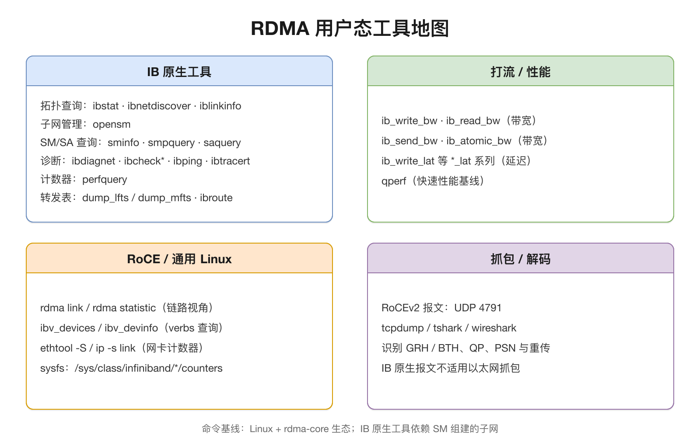

# RDMA 用户态工具地图：从子网发现到打流抓包

> 覆盖状态查询、子网管理、性能压测与报文分析的 RDMA 用户态工具箱

---

前文已介绍 RoCEv2 报文格式、PFC/ECN/DCQCN 拥塞控制、IB 子网组建与 verbs 调用栈。进入实际部署与排障阶段后，问题往往更为具体：设备是否被识别、端口是否激活、带宽是否达标、计数器有无异常。本文按类别梳理常用的用户态工具，目标不是替代 man page，而是说明每类工具的适用场景、典型用法与输出解读。

## 1. 工具全景与安装来源



RDMA 用户态工具按来源可归于若干软件包。不同发行版的包名略有差异，但归属关系基本稳定：

| 包/来源 | 提供什么 | 代表工具 |
|---------|----------|----------|
| `rdma-core` / `ibverbs-utils` | verbs 基础查询 | `ibv_devices`、`ibv_devinfo` |
| `infiniband-diags` | IB 原生查询与诊断 | `ibstat`、`ibnetdiscover`、`iblinkinfo`、`ibping`、`ibtracert`、`perfquery`、`sminfo`、`smpquery`、`saquery` |
| `opensm` | IB 子网管理器本体 | `opensm` |
| `ibutils2`（或厂商 OFED） | IB 子网体检 | `ibdiagnet` |
| `perftest` | RDMA 带宽/延迟打流 | `ib_write_bw`、`ib_read_bw`、`ib_send_bw`、`ib_atomic_bw`、对应 `*_lat` |
| `qperf` | 轻量 RDMA/网络性能测试 | `qperf` |
| `tcpdump` / `wireshark` | 以太网抓包与解码 | `tcpdump`、`tshark`、`wireshark` |
| `ethtool` / `iproute2` | 网卡与链路通用观测 | `ethtool -S`、`ip -s link`、`rdma link`、`rdma statistic` |

本文默认命令基线为 Linux + `rdma-core` 生态。依赖真实 IB 子网、SM 或物理 RDMA 网卡的示例将单独标注。

## 2. 设备、端口与拓扑查询工具

本节解决最基础的可见性问题：本机是否存在 RDMA 设备、端口状态如何、设备在子网中的身份。以下工具卡片按从通用到 IB 原生的顺序排列。

### rdma link / rdma statistic

- 解决什么问题：在 RoCE/通用 RDMA 视角查看设备、端口状态与统计。
- 来自哪个包：`iproute2`（`rdma` 子命令）。
- 常用命令：

```bash
rdma link show
rdma statistic show
```

- 输出重点看什么：设备名、端口 index、state、physical_state、netdev；统计项是否随流量增长。
- 常见坑：`rdma` 是通用 RDMA 视角，不等同于 IB 子网视图；如需查看 LID/SM 信息仍需使用 IB 原生工具。

### rdma resource

- 解决什么问题：列出 verbs 层的资源对象（PD、MR、CQ、QP、CM_ID 等），用于排查资源泄漏与连接状态。
- 来自哪个包：`iproute2`（`rdma` 子命令）。
- 常用命令：

```bash
rdma resource show
rdma resource show qp
rdma resource show cm_id
```

- 输出重点看什么：各类对象的数量与关键字段（QP 状态、CQ 关联的 QPN、MR 的 key 与大小）；数量是否随运行持续增长。
- 常见坑：展示的是内核态可见的 RDMA 资源，纯用户态 verbs 对象需应用侧自行导出；旧内核可能不支持该子命令。

### ibv_devices / ibv_devinfo

- 解决什么问题：确认 verbs 层能枚举到哪些 RDMA 设备，以及设备能力。
- 来自哪个包：`ibverbs-utils`（Debian/Ubuntu）或 `rdma-core` 相关包。
- 常用命令：

```bash
ibv_devices
ibv_devinfo -v
```

- 输出重点看什么：hca_id、node GUID、port state、active_mtu、max_qp、max_cq 等设备能力。
- 常见坑：内核驱动可识别设备并不代表 verbs 用户态接口可用；容器、权限、udev 配置均可能影响枚举。

### ibstat

- 解决什么问题：快速查看 IB CA 端口状态。
- 来自哪个包：通常来自 `infiniband-diags`。
- 常用命令：

```bash
ibstat
ibstat <ca> <port>
```

- 输出重点看什么：`State: Active`、`Physical state: LinkUp`、rate、Base lid、SM lid、Port GUID。
- 常见坑：RoCE 设备上也可能有 `ibstat` 输出，但其 LID/SM 语义与原生 IB 不同，不宜套用原生 IB 的子网逻辑。

### ibnetdiscover / iblinkinfo

- 解决什么问题：发现 IB 子网拓扑，或以更紧凑的形式输出链路信息。
- 来自哪个包：通常来自 `infiniband-diags`。
- 常用命令：

```bash
ibnetdiscover
iblinkinfo
```

- 输出重点看什么：switch/CA GUID、端口连接关系、速率/宽度。
- 常见坑：依赖 SM 已完成子网组建；大型子网的输出较长，建议配合 `grep` 定位 GUID 或端口。

## 3. IB 子网管理工具

设备可见之后，需要进一步了解子网管理面：当前子网由哪个 SM 管理、其运行状态如何、可以从其查询哪些信息。以下三张卡片分别回答这三个问题。

### opensm

- 解决什么问题：IB 子网的中心管理器，负责发现拓扑、分配 LID、计算并下发转发表。
- 来自哪个包：`opensm`。
- 常用命令：

```bash
opensm -g <port_guid> -f /var/log/opensm.log
ps aux | grep opensm
```

- 输出重点看什么：日志中是否完成 subnet discovery；是否有 master SM 竞选；是否报错无法绑定端口。
- 常见坑：同一子网只能有一个 master SM；部署多个 SM 时需要理解 priority/standby 机制。RoCE 不存在这一组件，纯 RoCE 环境中无需查找 SM。

### sminfo

- 解决什么问题：快速确认当前子网的 SM 标识与运行状态。
- 来自哪个包：`infiniband-diags`。
- 常用命令：

```bash
sminfo
```

- 输出重点看什么：`sm lid`、`sm guid`、`activity count`、`priority`、`state 3 SMINFO_MASTER`。
- 常见坑：`sminfo` 失败的常见原因包括子网无 SM、权限不足或端口指定错误。

### smpquery / saquery

- 解决什么问题：用 SMP/SA 查询子网管理对象，例如 node、port、P_Key、PathRecord。
- 来自哪个包：`infiniband-diags`。
- 常用命令：

```bash
smpquery nodeinfo <lid>
smpquery portinfo <lid> <port>
smpquery pkeys <lid> <port>
saquery -N
saquery -p
```

- 输出重点看什么：node/port 属性、P_Key 成员关系、PathRecord 关键字段。
- 常见坑：SA 更接近目录服务语义，需理解 P_Key/PathRecord 等概念才能有效使用 `saquery`。

## 4. IB 诊断工具

SM 完成子网组建后，关注重点转向运行质量：链路是否健康、节点间是否连通、交换机转发表内容是否符合预期。诊断工具可按“整体体检—单点抽查—深入分析”的层次使用。

### ibdiagnet

- 解决什么问题：IB 子网级体检，汇总拓扑、链路质量、异常端口。
- 来自哪个包：`ibutils2`（或厂商 OFED 包）。
- 常用命令：

```bash
ibdiagnet
ibdiagnet -lw <width> -ls <speed>
ibdiagnet -o <output_dir>
```

- 输出重点看什么：发现的 switch/CA 数量、链路 speed/width 是否符合预期、Symbol Error/BER 相关告警。
- 常见坑：在大规模子网上执行有一定开销；仅扫描部分端口时需明确范围，避免误判。

### ibcheck* / ibping / ibtracert

- 解决什么问题：快速做健康检查、节点连通性检查和路径追踪。
- 来自哪个包：通常来自 `infiniband-diags`。
- 常用命令：

```bash
ibchecknet
ibcheckerrors
ibping <lid>
ibtracert <src_lid> <dst_lid>
```

- 输出重点看什么：`ibcheckerrors` 中的 error counter；`ibtracert` 逐跳端口路径。
- 常见坑：`ibping` 要求对端先以 server 模式运行（`ibping -S`）；LID 由 SM 动态分配，子网重建后旧 LID 可能失效。

### perfquery / dump_lfts / dump_mfts

- 解决什么问题：查询端口性能计数器，导出交换机线性/组播转发表。
- 来自哪个包：通常来自 `infiniband-diags`。
- 常用命令：

```bash
perfquery <lid> <port>
perfquery -R <lid> <port>
dump_lfts
dump_mfts
ibroute <switch_lid>
```

- 输出重点看什么：PortXmitData/PortRcvData、PortXmitDiscards、SymbolErrorCounter；`ibroute` 输出单台交换机 LID 到 egress port 的映射。
- 常见坑：`perfquery -R` 会清零计数器；生产环境执行前需确认允许清零。

## 5. 性能打流工具

链路状态正常不代表性能达标。打流工具用于压测带宽上限并精确测量延迟，用量化数据回答链路的吞吐能力与稳定性。

### perftest：带宽打流

- 解决什么问题：验证 RDMA Write/Read/Send/Atomic 路径的带宽和消息率。
- 来自哪个包：`perftest`。
- 常用命令：

```bash
ib_write_bw -d <device> -p <port> -s <msg_size> -n <iters> -F --report_gbits
ib_read_bw  -d <device> -p <port> -s <msg_size> -n <iters> -F --report_gbits
ib_send_bw  -d <device> -p <port> -s <msg_size> -n <iters> -F --report_gbits
ib_atomic_bw -d <device> -p <port> -s <msg_size> -n <iters> -F
```

- 输出重点看什么：`BW average[Gb/s]`、`MsgRate[Mpps]`、是否有 `completed with error`、两端是否都正常退出。
- 常见坑：perftest 是双端工具——一端先运行同一条命令作为 server，另一端在命令末尾追加对端 IP/主机名作为 client；RoCE 环境通常还需 `-x <gid_index>`（或 `-R` 走 rdma_cm）才能建立连接；`-F` 用于忽略 CPU 频率告警。小包通过不代表大包达标；MTU、GID index、RoCE 版本、PFC/ECN 配置均会影响结果。

### perftest：延迟打流

- 解决什么问题：测量 RDMA 操作延迟，尤其是 Write/Read/Atomic 的 round-trip。
- 来自哪个包：`perftest`。
- 常用命令：

```bash
ib_write_lat -d <device> -p <port> -s <msg_size> -n <iters> -F
ib_read_lat  -d <device> -p <port> -s <msg_size> -n <iters> -F
ib_send_lat  -d <device> -p <port> -s <msg_size> -n <iters> -F
```

- 输出重点看什么：median/average latency、尾部延迟、是否有异常抖动。
- 常见坑：双端要求与带宽测试相同（server/client、RoCE 下 `-x`/`-R`）。延迟测试对 CPU 亲和性、中断、频率更为敏感；不应只关注平均延迟。

### qperf

- 解决什么问题：以轻量方式测量 RDMA 或 TCP/UDP 性能基线。
- 来自哪个包：`qperf`。
- 常用命令：

```bash
qperf -v <server_ip> rc_bw rc_lat
qperf -v <server_ip> uc_bw uc_lat
```

- 输出重点看什么：bw/lat 结果是否稳定；连接建立是否成功。
- 常见坑：需先在服务端直接运行 `qperf`（不带参数）等待连接，再由客户端发起测试；`qperf` 适用于快速对照，不能替代 perftest 的细参数验证。

## 6. RoCE 与通用 Linux 网络工具

RoCE 运行于以太网之上，排障时除 RDMA 工具外还需通用网络视角：链路协商是否正确、丢包发生在何处、报文格式是否符合预期。以下卡片补充这一视角。

### ethtool / ip -s link

- 解决什么问题：查看 RoCE 网卡链路状态、协商速率、丢包/暂停帧/错误计数。
- 来自哪个包：`ethtool`、`iproute2`。
- 常用命令：

```bash
ethtool <ifname>
ethtool -S <ifname>
ip -s link show dev <ifname>
```

- 输出重点看什么：Speed、Duplex、Link detected；`rx_pause`、`tx_pause`、discard/error/drop 相关计数是否增长。
- 常见坑：不同网卡的 `-S` 计数器命名差异较大；不应仅凭名称推断含义，需结合厂商文档确认。

### rdma statistic / sysfs counters

- 解决什么问题：从 RDMA 子系统视角看计数器，补充 `ethtool -S`（`rdma statistic` 的基础用法见第 2 节卡片）。
- 来自哪个包：`iproute2`（`rdma` 子命令），以及内核 sysfs。
- 常用命令：

```bash
rdma statistic show
ls /sys/class/infiniband/<device>/ports/<port>/counters
cat /sys/class/infiniband/<device>/ports/<port>/counters/*
```

- 输出重点看什么：xmit/rcv data/packets、error/discard 类计数。
- 常见坑：需内核启用并绑定计数器（`rdma statistic mode`），部分内核默认无数据输出；sysfs 计数器的单位可能是“包”也可能是“字节”，需根据名称与文档确认。

### tcpdump / tshark / wireshark

- 解决什么问题：捕获 RoCEv2 报文，确认 BTH/GRH、QP、PSN 与重传迹象。
- 来自哪个包：`tcpdump`、`wireshark`。
- 常用命令：

```bash
tcpdump -i <ifname> udp port 4791 -nn -vv -w roce.pcap
tshark -i <ifname> -f "udp port 4791" -w roce.pcap
tshark -r roce.pcap -Y 'udp.port == 4791' -V
```

- 输出重点看什么：UDP 4791 是否出现；Wireshark/tshark 是否解出 RoCE/IB BTH；PSN 是否连续。
- 常见坑：抓包位置不当将无法捕获目标流量；交换机镜像、网卡 offload、加密/隧道均会影响解码。IB 原生报文不是以太网帧，不适用上述抓包方法。

## 7. 工具汇总表

| 工具 | 类别 | 安装包 | 常用命令 | 关键输出 | 适用场景 |
|------|------|--------|----------|----------|----------|
| `rdma link` | RoCE/通用 | `iproute2` | `rdma link show` | link 状态、physical_state、netdev | 确认 RDMA 链路视角 |
| `rdma statistic` | RoCE/通用 | `iproute2` | `rdma statistic show` | RDMA 计数器 | RDMA 子系统统计 |
| `rdma resource` | RoCE/通用 | `iproute2` | `rdma resource show` | PD/MR/CQ/QP/CM_ID 对象 | 排查资源与连接状态 |
| `ibv_devinfo` | RoCE/通用 | `ibverbs-utils` | `ibv_devinfo -v` | port state、MTU、设备能力 | 确认 verbs 可用性 |
| `ibstat` | IB 原生 | `infiniband-diags` | `ibstat` | State、rate、Base lid、SM lid | 快速看 CA 端口 |
| `ibnetdiscover` | IB 原生 | `infiniband-diags` | `ibnetdiscover` | GUID、连接关系 | 拓扑发现 |
| `iblinkinfo` | IB 原生 | `infiniband-diags` | `iblinkinfo` | 链路状态、速率/宽度 | 快速看链路 |
| `opensm` | IB 子网管理 | `opensm` | `opensm -g <guid>` | discovery、master 状态 | 组建/维护 IB 子网 |
| `sminfo` | IB 子网管理 | `infiniband-diags` | `sminfo` | sm lid、state SMINFO_MASTER | 确认 SM 状态 |
| `smpquery` / `saquery` | IB 子网管理 | `infiniband-diags` | `smpquery nodeinfo <lid>`、`saquery -p` | node/port、P_Key、PathRecord | 查 SMP/SA 对象 |
| `ibdiagnet` | IB 诊断 | `ibutils2` | `ibdiagnet` | 链路速率/宽度、Symbol Error/BER | 子网体检 |
| `ibping` / `ibtracert` | IB 诊断 | `infiniband-diags` | `ibping <lid>`、`ibtracert <src> <dst>` | 连通性、逐跳路径 | 连通性与路径 |
| `perfquery` | IB 诊断 | `infiniband-diags` | `perfquery <lid> <port>` | Xmit/Rcv、discard、symbol error | 端口计数器 |
| `dump_lfts` / `dump_mfts` / `ibroute` | IB 诊断 | `infiniband-diags` | `dump_lfts`、`dump_mfts`、`ibroute <switch_lid>` | 交换机线性/组播转发表 | 转发表导出 |
| `ib_write_bw` | 打流 | `perftest` | `ib_write_bw ... --report_gbits` | BW average、MsgRate | RDMA Write 带宽 |
| `ib_write_lat` | 打流 | `perftest` | `ib_write_lat ...` | latency 分布 | RDMA Write 延迟 |
| `qperf` | 打流 | `qperf` | `qperf -v <ip> rc_bw rc_lat` | bw/lat | 快速性能基线 |
| `ethtool -S` | RoCE/通用 | `ethtool` | `ethtool -S <ifname>` | pause/error/discard 计数 | RoCE 网卡计数器 |
| `tcpdump` | 抓包 | `tcpdump` | `tcpdump -i <ifname> udp port 4791` | UDP 4791 报文 | RoCEv2 抓包 |
| `tshark` | 抓包 | `wireshark` | `tshark -r roce.pcap -Y 'udp.port == 4791'` | RoCE/BTH 解码 | 报文分析 |

## 结尾

上述工具可分为四个层次：先确认设备与端口就绪，再检查 IB 子网或 RoCE 链路的健康状况，随后用 perftest 压测性能，最后借助计数器与抓包定位根因。RNIC 架构与 UEC 相关文章中已出现过其中的部分输出字段，后续进行具体网卡排障时仍会频繁使用这些工具。
