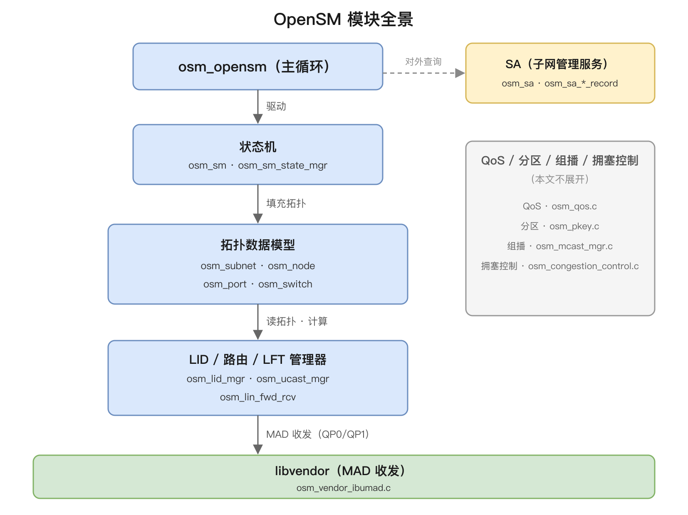
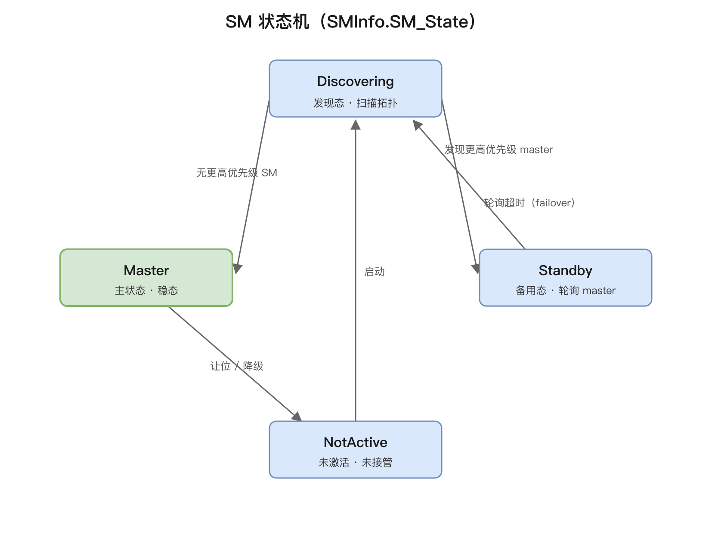
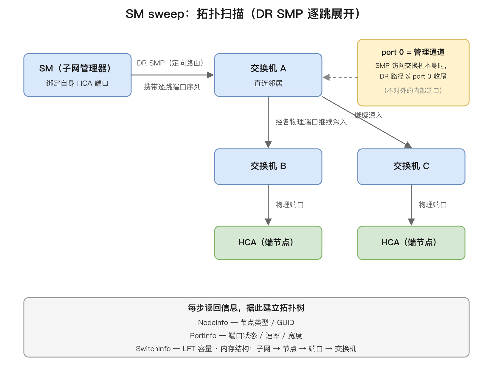
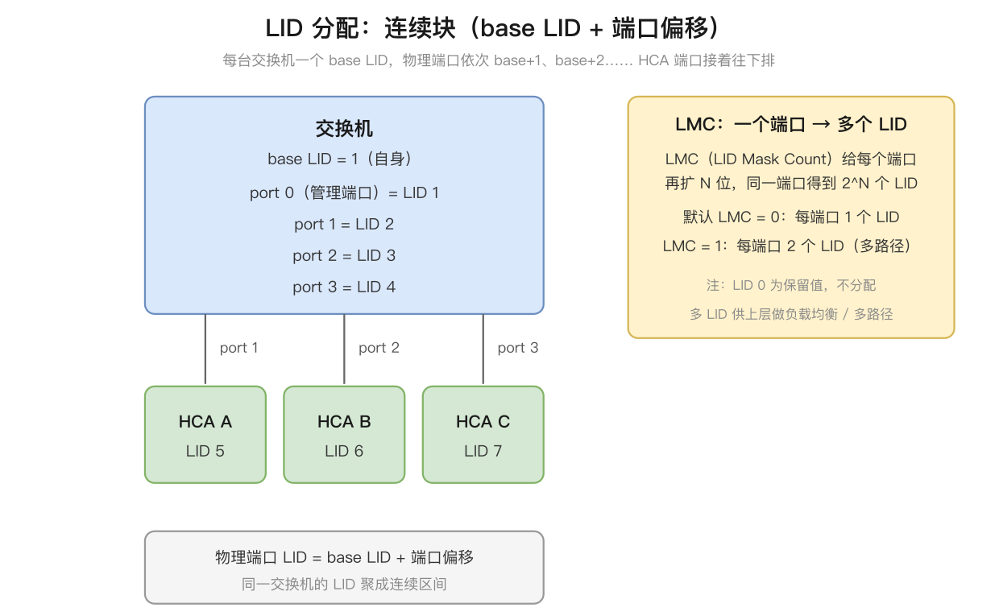
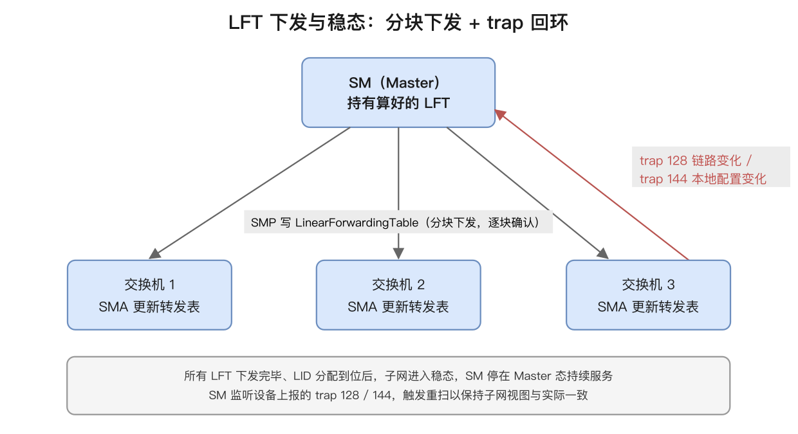
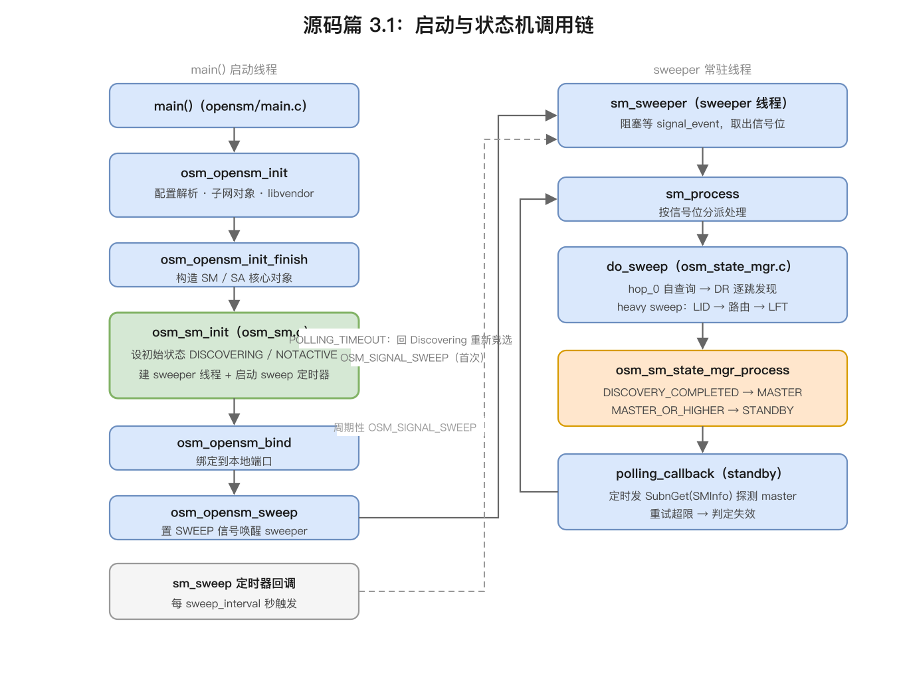
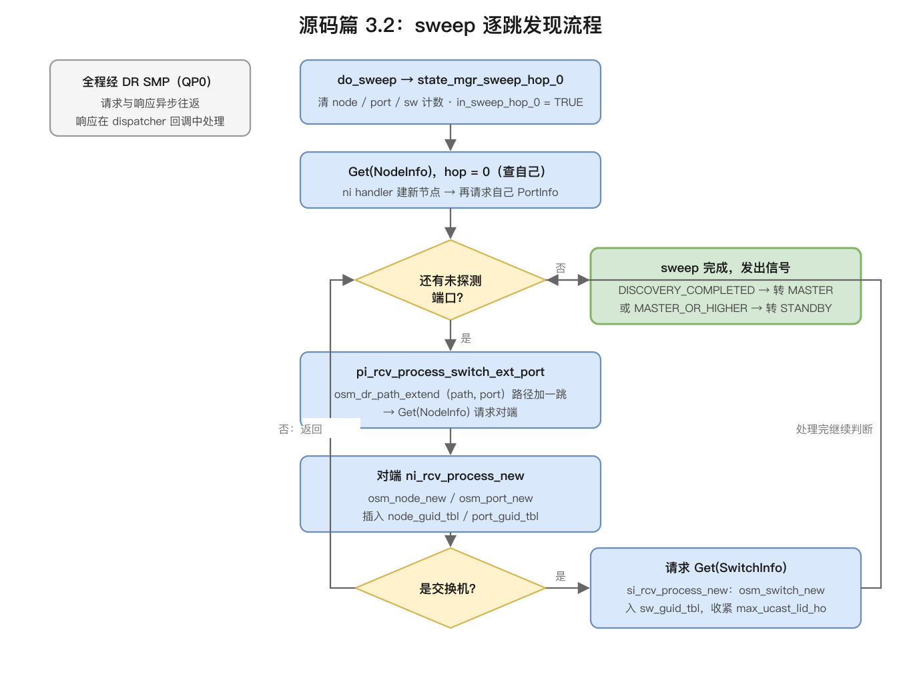
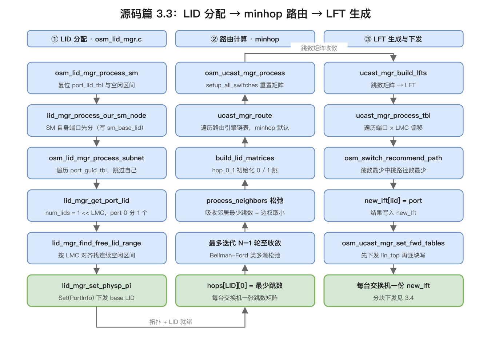
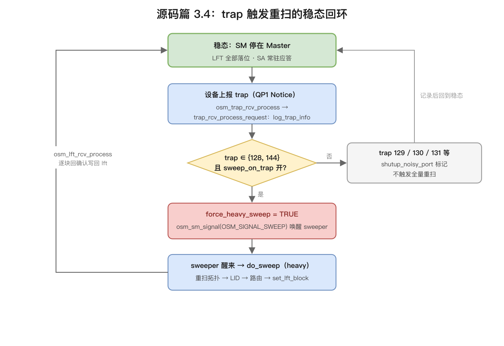

# OpenSM 源码解析

> 从启动到下发 LFT：读透 OpenSM 的核心闭环

---

## 1. 引言与模块全景

### 本篇定位

「IB 协议那篇」已经引入了 SM 这一角色：IB 交换机不运行任何分布式路由协议，转发表并非由各台交换机自行收敛，而是由 SM 集中计算、统一下发。那篇讲清了「SM 是谁、SMA/SA 如何配合、子网发现大致分几步」，但只停留在概念与报文层面——SM 究竟是一个怎样的程序、内部如何组织、那条「发现 → 分配 LID → 算路径 → 下发 LFT」的闭环具体落在哪些代码里，均未展开。

「用户态工具那篇」则将 OpenSM 作为一个命令来介绍：它来自 `opensm` 包，负责发现拓扑、分配 LID、计算并下发转发表，一条 `opensm -g <port_guid>` 即可启动一个子网管理器。那张卡片解决的是「怎么用」，至于该命令背后守护进程的运行过程，同样点到为止。

本文进入最后一个环节：深入 OpenSM 源码，把 SM 的核心闭环逐段跟读一遍。读完能回答三个问题——OpenSM 启动后如何逐步接管子网、拓扑数据在内存中的组织形式、LFT 最终如何计算出来并写入交换机。

### OpenSM 是什么

OpenSM 是 IB 生态里最主流的开源子网管理器（Subnet Manager），随 OFED 与 `rdma-core` 生态一起分发。它是一个运行在用户态的守护进程，通常部署在子网中某台 HCA 所在主机（或交换机上的管理 CPU）上，启动后以 master 身份接管整个子网。

其工作方式可以概括为一句话：通过 MAD 与设备通信。OpenSM 并不直接操作硬件寄存器，而是构造 256 字节的 MAD 管理报文，经 QP0（SMP，子网管理报文）与 QP1（GMP，通用管理报文）和每个节点的 SMA 交互——`Get(NodeInfo)` 查询节点信息、`Set(LinearForwardingTable)` 下发配置。这一层收发由 `libvendor` 封装（默认走 `osm_vendor_ibumad.c`），上层逻辑无需关心每个字节如何在链路上传输。

为什么 IB 离不开 SM？因为 IB 天生没有分布式路由：交换机既不交换路由信息，也不做最短路径计算，只是一台「查表转发」的执行者。没有 SM，子网里的设备连 LID 都无法获得，更无法互通——这正是 IB 与以太网最根本的分野。本文涉及具体实现处均以 OpenSM 3.3.24 为准。

### 模块全景



上图是 OpenSM 核心代码的模块地图。中心是 `osm_opensm` 主循环，驱动一条清晰的流水线：`osm_sm` / `osm_sm_state_mgr` 管状态机，`osm_subnet` / `osm_node` / `osm_port` / `osm_switch` 承载拓扑数据模型，`osm_lid_mgr` / `osm_ucast_mgr` / `osm_lin_fwd_rcv` 依次完成 LID 分配、单播路由计算与 LFT 下发。`libvendor` 在底层负责 MAD 收发，SA 对外提供查询服务；灰色部分是 QoS、分区、组播与拥塞控制，本文只做职责概览、不展开。

各模块与源码文件的对应关系如下（文件均来自 OpenSM 3.3.24）：

| 模块                   | 职责                        | 关键文件                                                                        | 本文是否深入 |
| -------------------- | ------------------------- | --------------------------------------------------------------------------- | ------ |
| 状态机                  | 驱动 SM 从发现到稳态的重配置循环        | `osm_sm.c`、`osm_sm_state_mgr.c`                                             | 本文深入   |
| 拓扑数据模型               | 子网、节点、端口、交换机的内存表示         | `osm_subnet.c`、`osm_node.c`、`osm_port.c`、`osm_switch.c`                     | 本文深入   |
| LID 分配               | 为每个端口分配唯一 16 位 LID        | `osm_lid_mgr.c`                                                             | 本文深入   |
| 单播路由(minhop)         | 计算任意两点间最短路径               | `osm_ucast_mgr.c`                                                           | 本文深入   |
| LFT 下发               | 把算好的线性转发表写入交换机            | `osm_lin_fwd_rcv.c`                                                         | 本文深入   |
| MAD 收发(libvendor)    | 构造并收发 MAD，屏蔽 QP0/QP1 底层细节 | `libvendor/`（`osm_vendor_ibumad.c`）                                         | 只做职责概览 |
| SA                   | 子网管理服务，响应 PathRecord 等查询  | `osm_sa.c`（+ `osm_sa_*_record.c`）                                           | 只做职责概览 |
| QoS / 分区 / 组播 / 拥塞控制 | P_Key 分区、组播组、拥塞控制等扩展能力    | `osm_qos.c` / `osm_pkey.c` / `osm_mcast_mgr.c` / `osm_congestion_control.c` | 只做职责概览 |
| 性能监控                 | 周期性采集子网性能计数器              | `osm_perfmgr.c`                                                             | 只做职责概览 |
| 事件插件                 | 将 SM 事件上报给外部订阅者           | `osm_event_plugin.c`                                                        | 只做职责概览 |

后续章节编排遵循这条闭环：第 2 章讲原理——SM 如何完成一条主流程；第 3 章逐段跟读源码；第 4 章收尾。

## 2. 原理篇：SM 如何完成一条主流程

### 2.1 启动与状态机

SM 状态机是 OpenSM 的核心。一个子网里可能同时运行多个 SM，但任意时刻只允许一个 master 处于工作状态——由谁担任 master、谁处于备用、谁在 master 失效后接管，全由这张状态机驱动。它只有四个状态，正好对应 IB 规范里 SMInfo 的 SM_State 字段定义的取值：

- **NotActive**（未激活）：SM 尚未接管子网，处于初始或已让位状态。
- **Discovering**（发现态）：启动后进入，先扫一遍拓扑，把子网里的节点、端口、交换机摸清楚（扫描细节留到 2.2）。
- **Master**（主状态）：SM 赢得选举，成为子网唯一主管理器，进入稳态持续服务——LID 分配、路由计算、LFT 下发都在这个状态下进行。
- **Standby**（备用态）：子网里已有更高优先级的 master，本 SM 退居备用，只定时轮询 master 是否还活着。

状态迁移的主线只有五条：

1. **启动 → Discovering**：SM 起来后先进入发现态，扫一遍拓扑。
2. **Discovering → Master**：扫完拓扑后，若子网里没有比它优先级更高的 SM，就赢得选举、成为 master。
3. **Discovering → Standby**：若发现已有更高优先级的 master，就退居备用。
4. **Standby → Discovering**：备用期间轮询 master 超时，认为 master 已失效，就重新进入 Discovering 再次尝试接管——这就是 failover 机制。
5. **Master → NotActive**：主动让位或被降级（比如又出现一个优先级更高的 SM），退出 master。

这里的「选举」并非投票，而是探测与比较：SM 通过 SMInfo 属性探测子网里是否已经存在 master，再比较各自的优先级 `sm_priority`——优先级更高者担任 master。这也解释了为什么一个子网里即便同时启动多台 OpenSM，最终也只有一台停在 Master 态。

下图是这四个状态及其迁移：



### 2.2 拓扑发现

SM 接管子网的第一步，是先把「子网里到底有什么」摸清楚，这一过程叫 sweep（扫描）——从自己出发，逐跳把拓扑展开，最终在内存里建出完整的拓扑树。

**起点：绑定自身端口。** sweep 的出发点是 SM 所绑定 HCA 的端口，第一组管理报文从这里发向直连邻居。此时子网处于未配置状态：LID 尚未分配、交换机转发表为空，普通报文无法确定转发方向。因此发现阶段不能依赖 LID 路由，必须换一种「不依赖任何既有配置」的寻址方式。

**关键机制：DR SMP（定向路由）。** DR 是 Directed Route 的缩写。DR SMP 报文里直接携带一条「逐跳端口序列」，每经过一台交换机，便按序列中预先写好的出端口转发一跳。管理报文借此可被精确送达子网内任意节点，完全不需要 LID、也无需查转发表——这是发现阶段赖以运转的基础机制。

**逐跳深入：一次广度优先遍历。** SM 从直连邻居开始，每发现一台交换机，便得到两条继续深入的线索：一是「经 port 0 访问交换机本身」，二是「经剩余每个物理端口继续向下」。这些路径逐条加入待扫描队列，再逐条处理、层层展开，本质上就是一次广度优先遍历，直到所有可达节点扫完。

**switch port 0 是管理通道。** 交换机物理端口从 1 起编号，另有一个特殊的 port 0——它并非对外连线的物理端口，而是「通往交换机自身」的管理通道。当 SMP 要访问交换机本身而非其下联设备时，DR 路径就以 port 0 收尾：前面的逐跳序列把报文送到这台交换机，最后一跳 port 0 告诉它「这一跳给交换机自己」。理解 sweep 的前提是理解这一约定。

**收集信息：读回三类属性。** 每探到一个节点，SM 就用 SMP 读回三类信息：节点信息（类型 / GUID）、端口信息（状态 / 速率 / 宽度）、交换机信息（转发表容量），据此在内存里建起「子网 → 节点 → 端口 → 交换机」的层级树，为后续 LID 分配与路由计算备好原料。

**重扫：周期性进行。** SM 不会只扫描一次便停止，而是按 `sweep_interval` 周期反复重扫：heavy sweep 全量重扫、light sweep 增量核对。端口状态变化如何触发立即重扫，留待 2.4 讨论 trap 时再展开。

下图是 sweep 的示意：SM 从左上角出发，向右下方逐跳展开到多级交换机与 HCA，每步读回的信息标注在对应边上。



### 2.3 LID 与路由

发现扫完拓扑，内存中已经构建出一张「子网 → 节点 → 端口 → 交换机」的完整图，但此刻所有设备仍然没有地址、交换机的转发表也为空，普通数据报文依然无法正常转发。要让子网真正开始工作，还需要完成两件事：给每个端口分配一个子网内唯一的地址——LID，再算好每台交换机「去往某个 LID 应从哪个端口转发」的转发表。前者由 LID 管理器完成，后者由单播路由引擎完成。

**LID 分配：每个端口一个 16 位地址。** LID（Local Identifier）是 IB 链路层使用的 16 位地址，仅在单个子网内唯一，交换机查表转发即依赖它；与之相对，GID 是跨子网可达的全局地址，两者处于不同层次。分配的基本规则是「每个物理端口分配一个 LID」：HCA 的每个端口各分配一个，交换机的每个物理端口各分配一个，连交换机那个特殊的 port 0（管理端口）也要分配一个——因为它同样需要被寻址。

分配方式采用「连续块」：首先为每台交换机指定一个 base LID，作为交换机自身（即 port 0）的地址；随后其各物理端口依次占用 base+1、base+2……即「base LID + 端口偏移」。这样同一台交换机的 LID 天然构成一个连续区间，便于管理，也便于按块下发。

如果每个端口只用一个 LID，那一个 LID 就只能对应一条路径。为使上层能够在同一台交换机上使用多条路径以实现负载均衡，IB 引入 LMC（LID Mask Count）：在 base LID 之外，为每个端口再扩展 N 位，得到 2^N 个连续 LID，同一端口由此拥有多个可选的 LID。默认 LMC = 0，即每端口仅分配 1 个 LID。此外 LID 0 是保留值，不分配给任何端口。



**路由计算：minhop 求最少跳数。** 地址分配完成后，下一步是使每台交换机明确「报文要去某个 LID，该从哪个端口送出去」。OpenSM 默认的单播路由引擎叫 minhop，字面含义即「最少跳数」。它将内存中的拓扑图视为一张加权图，用距离向量式的**多轮松弛**来传播跳数：每轮每台交换机都从直连邻居吸收最新的跳数信息，最多迭代「交换机数 − 1」轮、直至所有交换机的跳数不再更新（这正是 Bellman-Ford 类算法的思路），最终算出「到子网里每个 LID 的最少跳数下一跳」。

对每一台交换机，minhop 均会汇总出一组「LID → 出端口」的映射，形成一张**线性转发表 LFT（Linear Forwarding Table）**：一张以 LID 为下标、值为出端口号的线性数组。这正是 IB 交换机「查表转发」所依赖的那张表——报文到达时，交换机取出报文头里的目的 LID，直接将其作为下标读取 LFT，得到出端口号，转发随即完成。下标即地址、元素即端口，这也是「线性转发表」名称的由来。


**minhop 只是默认引擎。** 除 minhop 外，OpenSM 还内置了多套针对特定拓扑或特定需求的路由引擎，由配置项 routing_engine 选择。下表把各引擎的一句话算法思想与适用场景一并列出，具体源码留到第 3 章跟读：

| 引擎 | 一句话算法思想 | 适用场景 |
|------|--------------|---------|
| minhop（默认） | 距离向量式多轮松弛（Bellman-Ford 类）传播最少跳数 | 通用拓扑，追求最短路径 |
| up/down | 给节点按层序定 rank，路由只能「先上后下」，禁止下行后上行 | 树状 / 层次化拓扑，天然无死锁 |
| down/up | 与 up/down 对称，从底部叶节点向上收敛 | 以叶节点为根、向上汇聚的拓扑 |
| fat-tree | 识别叶 / 脊分层，按端口位置与层序计算 | 胖树（leaf-spine）数据中心拓扑 |
| LASH | 分层最短路径：把拓扑分层，每层分配一条虚通道（VL）以避死锁 | 任意拓扑上需要无死锁的路径分配 |
| DFSSSP | 无死锁单源最短路径：Dijkstra 最短路径 + VL 分配 | 通用拓扑，需无死锁且路径较短 |
| file | 不从零计算，直接从 dump 文件加载现成路由 | 已有既定转发表、需固定路由 |
| nue | 基于依赖图的无死锁路由，适配任意拓扑、任意 VL 数 | 需 100% 可路由、均衡且无死锁 |
| torus / mesh | 面向 N 维环面 / 网格拓扑，按坐标方向与端口组算路径（torus 带 QoS） | 环面 / 网格等 HPC 拓扑 |

其中 torus / mesh 两套为面向特定 HPC 拓扑的专用引擎，通常只在对应形态的集群上启用；绝大多数普通 IB 子网使用默认的 minhop 即可。

### 2.4 LFT 下发与稳态

**LFT 下发：分块写回交换机。** 2.3 中 minhop 计算出的 LFT，此刻还只是 SM 内存中的一组数据，交换机自身并不知晓。要使其真正生效，SM 需将每张 LFT 写回对应交换机的 SMA——通过 `Set(LinearForwardingTable)` 这类 SMP，将计算好的「LID → 出端口」表逐台下发，交换机收到后更新其转发表，方算真正具备转发能力。

这里存在报文尺寸的实际约束：一张 LFT 的条目数对应子网 LID 总数，很容易超过单个 MAD 报文 256 字节的承载量。因此 LFT 不是一次写完，而是分块（block）逐块下发——SM 逐块写入、交换机逐块回确认，直到整张表写完。子网越大、LID 越多，LFT 越长，下发耗时也相应增加。

**稳态与 trap：持续监听。** 所有 LFT 下发完毕、LID 分配到位后，子网进入稳态，SM 停在 Master 态持续服务。但稳态并不等于停止工作：SM 会持续监听设备上报的 trap（管理告警报文），据此决定是否重扫拓扑。两类 trap 会触发重扫（受配置 `sweep_on_trap` 控制，默认开启）：

- **trap 128（链路状态变化）**：链路 / 端口 up 或 down，是最常见的拓扑变化信号——网线插拔、端口故障、设备重启都会产生它。
- **trap 144（本地配置变化）**：节点的 capability mask、节点描述、SM 优先级等本地信息发生了变化。

收到这两类 trap，SM 就发起一次重扫：重新发现拓扑，必要时重算 LID 与 LFT，让内存里的子网视图始终与实际一致。此外还有 trap 129 / 130 / 131（链路完整性阈值、缓冲溢出、看门狗超时）等告警类 trap，SM 主要记录日志、不一定触发重扫，这里不展开。



**SA 常驻：应答主机的路径查询。** 稳态下 SA（子网管理服务）同样常驻于 SM 进程，应答主机发来的查询——最典型的是 PathRecord 路径查询，主机接入子网后通过它获取「到某目的地的路径信息」。SA 细节不在本文展开，只需明确这层分工：LFT 是 SM 主动「push」给交换机，SA 查询则是主机主动「pull」问 SM。

## 3. 源码篇：逐段跟读实现

### 3.1 启动与状态机

启动入口在 `opensm/main.c` 的 `main()`。解析完命令行参数后，按固定三步完成 OpenSM 的启动：`osm_opensm_init` 完成配置解析与底层对象构造，`osm_opensm_init_finish` 构造 SM / SA 等核心对象，最后 `osm_opensm_bind` 绑定端口、`osm_opensm_sweep` 触发第一次扫描。以 OpenSM 3.3.24 为准，关键调用如下：

```c
/* main.c — main() */
status = osm_opensm_init(&osm, &opt);          /* 行 1241：配置 + 子网对象 + vendor */
...
status = osm_opensm_init_finish(&osm, &opt);   /* 行 1263：构造 SM/SA，起 sweeper 线程 */
...
status = osm_opensm_bind(&osm, opt.guid);      /* 行 1272：绑定到本地端口 */
...
osm_opensm_sweep(&osm);                        /* 行 1282：触发首次 sweep */
```

`osm_opensm_init`（`opensm/osm_opensm.c`）中做两件与本文相关的事：`osm_subn_init` 初始化子网对象（其内存模型在 3.2 展开），`osm_vendor_new` 创建 libvendor 实例——MAD 收发层。`osm_opensm_init_finish` 再调用 `osm_sm_init` 构造 SM 对象。可见「配置 → 子网对象 → vendor → SM 对象」的先后顺序固定。

SM 对象初始化的收尾在 `opensm/osm_sm.c` 的 `osm_sm_init`，三件事对状态机至关重要：设定初始状态、创建 sweeper 线程、启动 sweep 定时器：

```c
/* osm_sm.c — osm_sm_init() 收尾 */
p_subn->sm_state = p_subn->opt.sm_inactive ?
    IB_SMINFO_STATE_NOTACTIVE : IB_SMINFO_STATE_DISCOVERING;   /* 行 386 */
...
p_sm->thread_state = OSM_THREAD_STATE_RUN;
status = cl_thread_init(&p_sm->sweeper, sm_sweeper, p_sm,
                        "opensm sweeper");                      /* 行 395 */
...
if (p_sm->p_subn->opt.sweep_interval)
    cl_timer_start(&p_sm->sweep_timer,
                   p_sm->p_subn->opt.sweep_interval * 1000);     /* 行 400 */
```

初始状态由 `sm_inactive` 配置决定：默认进入 `DISCOVERING`，配置了 `-I`（`--inactive`）则停留在 `NOTACTIVE`。这与原理篇 2.1 的「启动 → Discovering」一致——并非由某个信号触发迁移，而是初始状态即为发现态。

状态本身只是一组数字，定义在 `include/iba/ib_types.h`：

```c
/* include/iba/ib_types.h — SMInfo.SM_State 取值 */
#define IB_SMINFO_STATE_NOTACTIVE      0
#define IB_SMINFO_STATE_DISCOVERING    1
#define IB_SMINFO_STATE_STANDBY        2
#define IB_SMINFO_STATE_MASTER         3
```

驱动这些状态迁移的，是 `opensm/osm_sm_state_mgr.c` 的 `osm_sm_state_mgr_process`：外层 switch 按当前状态分派，内层 switch 按信号分派。这里贴两段最能说明问题的迁移：

```c
/* osm_sm_state_mgr.c — osm_sm_state_mgr_process()，DISCOVERING 分支 */
case IB_SMINFO_STATE_DISCOVERING:
    switch (signal) {
    case OSM_SM_SIGNAL_DISCOVERY_COMPLETED:      /* 扫完且没有更高优先级 SM */
        sm->p_subn->sm_state = IB_SMINFO_STATE_MASTER;
        ...
        sm->p_subn->master_sm_base_lid = sm->p_subn->sm_base_lid;
        break;
    case OSM_SM_SIGNAL_MASTER_OR_HIGHER_SM_DETECTED:  /* 发现更高优先级 SM */
        sm->p_subn->sm_state = IB_SMINFO_STATE_STANDBY;
        ...
        sm_state_mgr_start_polling(sm);
        break;
    ...
```

STANDBY 因轮询超时回到 DISCOVERING，就是 failover 的落点：

```c
/* osm_sm_state_mgr.c — osm_sm_state_mgr_process()，STANDBY 分支 */
case IB_SMINFO_STATE_STANDBY:
    switch (signal) {
    case OSM_SM_SIGNAL_POLLING_TIMEOUT:
    case OSM_SM_SIGNAL_DISCOVER:
        sm->p_subn->sm_state = IB_SMINFO_STATE_DISCOVERING;
        ...
        sm->p_subn->coming_out_of_standby = TRUE;
        osm_sm_signal(sm, OSM_SIGNAL_SWEEP);
        break;
```

`DISCOVERY_COMPLETED` 与 `MASTER_OR_HIGHER_SM_DETECTED` 这两个信号，是在一次 heavy sweep 完成后由 `opensm/osm_state_mgr.c` 的 `do_sweep` 按「是否探测到别的 master」分别发出的（行 1468 / 1537），将状态机与发现流程衔接起来。

所谓「选举」，在实现层面是「探测 + 比较」两件事。探测用 `sm_state_mgr_send_master_sm_info_req`，按当前状态决定查询对象——standby 问 `master_sm_guid`，master 则问 `polling_sm_guid`：

```c
/* osm_sm_state_mgr.c — sm_state_mgr_send_master_sm_info_req() */
if (sm_state == IB_SMINFO_STATE_STANDBY)
    guid = sm->master_sm_guid;      /* 探测现有 master */
else
    guid = sm->polling_sm_guid;     /* master 态下轮询等待交接的远程 SM */
...
status = osm_req_get(sm, &dr_path, IB_MAD_ATTR_SM_INFO, 0, FALSE, ...);
```

standby 的轮询由 `osm_sm_state_mgr_polling_callback` 驱动：每 `sminfo_polling_timeout` 毫秒触发一次，发一次 `SubnGet(SMInfo)`，`retry_number` 逐次累加，一旦超过 `polling_retry_number` 仍无回应，便判定 master 已失效、发出 `OSM_SM_SIGNAL_POLLING_TIMEOUT`：

```c
/* osm_sm_state_mgr.c — osm_sm_state_mgr_polling_callback() */
if (sm->retry_number > sm->p_subn->opt.polling_retry_number) {
    osm_sm_state_mgr_process(sm, OSM_SM_SIGNAL_POLLING_TIMEOUT);
    goto Exit;
}
if (sm_state_mgr_send_master_sm_info_req(sm, sm_state))
    sm->retry_number++;
```

「比较」则发生在 `osm_state_mgr.c` 的 `state_mgr_get_highest_sm`（行 908）：它遍历 `sm_guid_tbl` 里所有远端 SM，用 `osm_sm_is_greater_than` 比「优先级、GUID」二元组，优先级高者胜、相同再比 GUID——这就是 `sm_priority` 生效之处。standby 并非被动等待，而是定时主动探测，超时后重新尝试竞争 master。



呼应原理篇 2.1：原理篇描述的四状态与五条迁移主线，在此逐一对应到 `osm_sm_state_mgr_process` 的 switch-case；「选举」不是投票，正是上面「`sm_state_mgr_send_master_sm_info_req` 探测 + `state_mgr_get_highest_sm` 比优先级」的组合。

### 3.2 拓扑发现

sweep 的触发与执行分两条线程。触发入口 `osm_sm_sweep`（`opensm/osm_sm.c`）只做一件事——置信号位、唤醒 worker：

```c
/* osm_sm.c — osm_sm_sweep() */
void osm_sm_sweep(IN osm_sm_t * p_sm)
{
    osm_sm_signal(p_sm, OSM_SIGNAL_SWEEP);
}
```

真正干活的 worker 是 `osm_sm_init` 里创建的 `sm_sweeper` 线程，它阻塞在事件上，醒来后把 `signal_mask` 里每一位对应的信号交给 `sm_process` 处理：

```c
/* osm_sm.c — sm_sweeper() */
while (p_sm->thread_state == OSM_THREAD_STATE_RUN) {
    status = cl_event_wait_on(&p_sm->signal_event, EVENT_NO_TIMEOUT, TRUE);
    ...
    cl_spinlock_acquire(&p_sm->signal_lock);
    signals = p_sm->signal_mask;
    p_sm->signal_mask = 0;
    cl_spinlock_release(&p_sm->signal_lock);

    for (i = 0; signals; signals >>= 1, i++)
        if (signals & 1)
            sm_process(p_sm, i);   /* 落到 osm_state_mgr.c 的 do_sweep */
}
```

周期性重扫则由 `sm_sweep` 定时器回调驱动——每 `sweep_interval` 秒发一次 `OSM_SIGNAL_SWEEP`，只在 MASTER 或 DISCOVERING 态才真正触发，这正是原理篇 2.2 所说的「周期性重复扫描」：

```c
/* osm_sm.c — sm_sweep() */
if (sm->p_subn->sm_state == IB_SMINFO_STATE_MASTER ||
    sm->p_subn->sm_state == IB_SMINFO_STATE_DISCOVERING)
    osm_sm_signal(sm, OSM_SIGNAL_SWEEP);
cl_timer_start(&sm->sweep_timer, sm->p_subn->opt.sweep_interval * 1000);
```

扫描得到的拓扑最终落入内存。子网对象 `osm_subn_t`（`include/opensm/osm_subnet.h`）初始化时，`osm_subn_init`（`opensm/osm_subnet.c`）先将 `port_lid_tbl` 构建为以 LID 为下标的向量，并把 `max_ucast_lid_ho` 等容量字段预置到规范上限，供后续交换机上报时逐台取最小值收紧。核心数据结构是一套「子网 → 节点 → 端口 → 交换机」的层级（字段已按需裁剪）：

```c
/* osm_subnet.h — osm_subn_t */
typedef struct osm_subn {
    cl_qmap_t sw_guid_tbl;        /* 交换机，按 node GUID 索引 */
    cl_qmap_t node_guid_tbl;      /* 节点，按 node GUID 索引 */
    cl_qmap_t port_guid_tbl;      /* 端口，按 port GUID 索引 */
    cl_ptr_vector_t port_lid_tbl; /* 端口，按 LID 索引 */
    uint8_t sm_state;             /* 即 3.1 状态机的当前值 */
    uint16_t max_ucast_lid_ho;    /* 所有交换机 lin_cap 的最小值 */
    ...
} osm_subn_t;

/* osm_node.h — osm_node_t */
typedef struct osm_node {
    struct osm_switch *sw;        /* 交换机节点指向 osm_switch，否则 NULL */
    ib_node_info_t node_info;     /* 含 node_guid、node_type、num_ports */
    osm_physp_t physp_table[1];   /* 物理端口数组，按本地端口号索引，可增长 */
    ...
} osm_node_t;

/* osm_port.h — osm_physp_t / osm_port_t */
typedef struct osm_physp {
    ib_port_info_t port_info;     /* 含 base_lid、port_state */
    ib_net64_t port_guid;
    uint8_t port_num;
    struct osm_node *p_node;
    struct osm_physp *p_remote_physp;  /* 对端物理端口，即拓扑的一条边 */
    osm_dr_path_t dr_path;        /* 定向路由路径 */
    ...
} osm_physp_t;

typedef struct osm_port {
    ib_net64_t guid;
    osm_physp_t *p_physp;         /* 关联的物理端口 */
    ib_net16_t lid;               /* 分配的 LID */
    ...
} osm_port_t;

/* osm_switch.h — osm_switch_t */
typedef struct osm_switch {
    ib_switch_info_t switch_info; /* 含 lin_cap（线性转发表容量） */
    uint8_t **hops;               /* LID 矩阵：每 LID 到每端口的跳数 */
    uint8_t *lft;                 /* 当前线性转发表 */
    uint8_t *new_lft;             /* 路由引擎刚算出的新表 */
    ...
} osm_switch_t;
```

这套结构并非凭空构造，而是由三个 MAD 接收 handler 逐个字段填充。NodeInfo 的入口是 `osm_ni_rcv_process`（`opensm/osm_node_info_rcv.c`）：按 node GUID 查表，未查到则走 `ni_rcv_process_new` 新建节点；其中 `osm_node_new` 创建节点、`osm_port_new` 创建端口，再经 `cl_qmap_insert` 插入 `port_guid_tbl` 与 `node_guid_tbl`，最后按 `node_type` 分发——若为交换机则继续请求 SwitchInfo：

```c
/* osm_node_info_rcv.c — ni_rcv_process_new() */
p_node = osm_node_new(p_madw);
...
p_port = osm_port_new(p_ni, p_node);
cl_qmap_insert(&sm->p_subn->port_guid_tbl, p_ni->port_guid, &p_port->map_item);
...
cl_qmap_insert(&sm->p_subn->node_guid_tbl, p_ni->node_guid, &p_node->map_item);
...
case IB_NODE_TYPE_SWITCH:
    ni_rcv_process_new_switch(sm, p_node, p_madw);   /* 去要 SwitchInfo */
    break;
```

PortInfo 的 handler `osm_pi_rcv_process`（`opensm/osm_port_info_rcv.c`）负责两件事：用 `osm_physp_set_port_info` 把 `base_lid`、`port_state` 填进 `physp->port_info`；对交换机的外部端口，若链路未处于 down 状态，则沿当前 DR 路径再加一跳、向对端请求 NodeInfo——这正是逐跳展开的关键一步：

```c
/* osm_port_info_rcv.c — pi_rcv_process_switch_ext_port() */
path = *osm_physp_get_dr_path_ptr(p_physp);
if (osm_dr_path_extend(&path, osm_physp_get_port_num(p_physp))) { ... }
...
status = osm_req_get(sm, &path, IB_MAD_ATTR_NODE_INFO, 0, TRUE, ...);
```

SwitchInfo 的 handler `osm_si_rcv_process`（`opensm/osm_sw_info_rcv.c`）收到后，`si_rcv_process_new` 建 `osm_switch_t`、插入 `sw_guid_tbl`，回填 `p_node->sw`，并把子网的 `max_ucast_lid_ho` 收紧为各交换机 `lin_cap` 的最小值——这正是 LFT 长度的依据：

```c
/* osm_sw_info_rcv.c — si_rcv_process_new() */
p_sw = osm_switch_new(p_node, p_madw);
...
if (cl_ntoh16(p_si->lin_cap) < sm->p_subn->max_ucast_lid_ho)
    sm->p_subn->max_ucast_lid_ho = cl_ntoh16(p_si->lin_cap);
cl_qmap_insert(p_sw_guid_tbl, osm_node_get_node_guid(p_node), &p_sw->map_item);
p_node->sw = p_sw;
osm_switch_set_switch_info(p_sw, p_si);
```



呼应原理篇 2.2：原理篇所述的「DR SMP 逐跳探路、广度优先展开、读回三类属性建树」，在此逐条落到 `osm_dr_path_extend` 的路径延伸、`osm_req_get(IB_MAD_ATTR_NODE_INFO)` 的逐跳请求 NodeInfo、以及 ni / pi / si 三个 handler 把 NodeInfo / PortInfo / SwitchInfo 填进 `osm_subn_t → osm_node_t → osm_port_t → osm_switch_t` 的过程。

### 3.3 LID 与路由

拓扑就绪后，SM 进入 Master 态需完成两件事：给每个端口分配 LID、计算路由生成 LFT。先看 LID 分配（`osm_lid_mgr.c`）。

**LID 分配：先 SM 自己，再全子网。** 入口有两个函数：`osm_lid_mgr_process_sm`（行 1155）先执行，`osm_lid_mgr_process_subnet`（行 1183）随后。前者先经 `lid_mgr_init_sweep` 复位 `port_lid_tbl` 与空闲区间列表，再经 `lid_mgr_process_our_sm_node` 为 SM 自身的端口先分配——因为它要把这个 base LID 广播给其它端口，`lid_mgr_get_port_lid` 返回的 min_lid 会被写进 `sm_base_lid` / `master_sm_base_lid`（行 1136-1137）。后者遍历 `port_guid_tbl` 里所有端口，跳过自己（行 1214），逐个调 `lid_mgr_get_port_lid`（行 1226）获取区间，再用 `lid_mgr_set_physp_pi`（行 802）将 base LID 写入 PortInfo 下发。

每个端口分配几个 LID 由 LMC 决定，关键一行是 `num_lids = 1 << lmc`；存在特例——交换机 port 0 若硬件不支持 LMC，就只分 1 个：

```c
/* osm_lid_mgr.c — lid_mgr_get_port_lid() */
uint8_t num_lids = (1 << p_mgr->p_subn->opt.lmc);   /* 行 687：LMC 决定每端口 LID 数 */
...
if (p_port->p_node->sw &&
    !osm_switch_sp0_is_lmc_capable(p_port->p_node->sw, p_mgr->p_subn))
    num_lids = 1;                                    /* 行 697-699：port 0 不支持 LMC 就只分 1 个 */
```

分配的落点是「找一段连续的空闲 LID 区间」，由 `lid_mgr_find_free_lid_range` 完成，起点还要按 LMC 对齐：

```c
/* osm_lid_mgr.c — lid_mgr_find_free_lid_range() */
lmc_num_lids = (1 << p_mgr->p_subn->opt.lmc);
lmc_mask = ~((1 << p_mgr->p_subn->opt.lmc) - 1);   /* 行 607-608 */
...
if (num_lids > 1 && (lid & lmc_mask) != lid)
    lid = (lid + lmc_num_lids) & lmc_mask;          /* 行 621-623：起点按 LMC 对齐 */
if (lid + num_lids - 1 <= p_range->max_lid) {       /* 行 627：区间够放就分配 */
    ...
    *p_min_lid = lid;
    *p_max_lid = (uint16_t) (lid + num_lids - 1);   /* 行 638-639：[min,max] 连续块 */
    return;
}
```

于是每个端口获得的是一段从 min_lid 开始的连续块，长度 `2^LMC`。原理篇 2.3 所述的「base LID + 端口偏移」落到源码，就是「每端口一段 LMC 对齐的连续 LID 区间」：base 即 min_lid，偏移即区间内的连续编号。分配结果记入 `guid2lid` 持久库与 `port_lid_tbl`（行 775-781）。LID 0 保留、LMC 扩展出多个可选 LID、port 0 特例，均在此得到落实。

**路由计算：minhop 的松弛循环。** LID 分配完成后进入 `osm_ucast_mgr_process`（行 1098）：先 `ucast_mgr_setup_all_switches` 给每台交换机 `osm_switch_prepare_path_rebuild` 重置 hops 矩阵与 new_lft，再遍历路由引擎链表，逐套尝试 `ucast_mgr_route`（行 1122-1133）。默认引擎 minhop 的回调注册在 `osm_ucast_minhop_setup`（行 1165），绑定 `osm_ucast_mgr_build_lid_matrices` 与 `ucast_mgr_build_lfts`。

`osm_ucast_mgr_build_lid_matrices`（行 596）是跳数矩阵的构建主循环：先 `set_default_hop_wf` 把所有端口权重置 1（行 610），`ucast_mgr_process_hop_0_1` 初始化「自己 LID → port 0 为 0 跳、直连邻居交换机的 LID → 对应 port 为 1 跳」（行 627），然后最多迭代「交换机数 − 1」轮 `ucast_mgr_process_neighbors` 直到跳数收敛（行 664-668）。每轮的核心松弛在 `ucast_mgr_process_neighbor`：

```c
/* osm_ucast_mgr.c — ucast_mgr_process_neighbor() */
lid_ho = cl_ntoh16(osm_node_get_base_lid(p_sw->p_node, 0));
hops = osm_switch_get_least_hops(p_remote_sw, lid_ho); /* 行 157-158：邻居到该 LID 的最少跳数 */
if (hops == OSM_NO_PATH)
    continue;
hops += p->hop_wf;                                      /* 行 161：再加本端这条边的权 */
if (hops < osm_switch_get_hop_count(p_this_sw, lid_ho, port_num)) {
    osm_switch_set_hops(p_this_sw, lid_ho, port_num, (uint8_t) hops);  /* 行 164-165：更短则更新 */
    p_mgr->some_hop_count_set = TRUE;                   /* 行 171：本轮有变化，继续迭代 */
}
```

这正是原理篇 2.3 所述的**多轮松弛**：源码中是全体交换机同步进行多轮松弛——每轮每台交换机从邻居「吸收」各 LID 的最少跳数，加边权取更小者，最多 N−1 轮收敛。这是 Bellman-Ford 类算法，而非带优先队列的单源 Dijkstra；两者都收敛到最短跳数，只是实现方式不同。

跳数存储在何处？`osm_switch_t` 的 `hops` 字段是 `uint8_t **`，按 `[LID][端口]` 索引；其中 `[LID][0]` 这一列被复用，始终存储「到该 LID 的最少跳数」，作为 `osm_switch_get_least_hops` 的取值来源：

```c
/* osm_switch.c — osm_switch_set_hops() */
p_sw->hops[lid_ho][port_num] = num_hops;         /* 行 78 */
if (p_sw->hops[lid_ho][0] > num_hops)
    p_sw->hops[lid_ho][0] = num_hops;            /* 行 79-80：port 0 列保留最小跳数 */
```

矩阵收敛后，`ucast_mgr_build_lfts`（行 860）将跳数矩阵转换为 LFT：对每台交换机调 `ucast_mgr_process_tbl`（行 357），遍历所有端口、每个 LMC 偏移，调 `osm_switch_recommend_path`（osm_switch.c 行 234）从「跳数等于最少跳数的端口」中挑选路径数最少的一个，将结果写入 `p_sw->new_lft[lid_ho] = port`（行 302）。最后 `osm_ucast_mgr_set_fwd_tables`（行 1050）先下发 SwitchInfo 的 lin_top，再 `ucast_mgr_pipeline_fwd_tbl` 把 new_lft 逐块交给交换机——下发细节留待 3.4。



呼应原理篇 2.3：原理篇的「连续块分配 LID」「minhop 取最短跳数」「LID→出端口落成 LFT」，在此分别落到 `lid_mgr_find_free_lid_range` 的 LMC 对齐分配、`ucast_mgr_process_neighbor` 的松弛、`ucast_mgr_process_tbl` 里 `new_lft[lid] = port` 的写入。

### 3.4 LFT 下发与稳态

3.3 末尾计算出的 new_lft 仍在内存中，要使其生效，需逐块写回交换机并等待回确认。

**分块下发。** 下发入口 `osm_ucast_mgr_set_fwd_tables`（行 1050）→ `ucast_mgr_pipeline_fwd_tbl`（行 1037）：`max_block = max_lid / IB_SMP_DATA_SIZE + 1`（行 1041），两层循环「先块 0 写所有交换机、再块 1……」逐块推进。块大小即 `IB_SMP_DATA_SIZE = 64` 字节——一个 SMP 的 data payload，即每块 64 个 LID 条目。这正是分块的原因：单块 MAD 数据区只有 64 字节，LID 数量较多时就必须切块。每块的处理在 `set_lft_block`：

```c
/* osm_ucast_mgr.c — set_lft_block() */
if (!p_sw->need_update && !p_mgr->p_subn->need_update &&
    !memcmp(p_sw->new_lft + block_id_ho * IB_SMP_DATA_SIZE,
            p_sw->lft + block_id_ho * IB_SMP_DATA_SIZE, IB_SMP_DATA_SIZE))
    return 0;                                        /* 行 1003-1007：块内容没变就不发 */
memset(p_sw->lft + block_id_ho * IB_SMP_DATA_SIZE, 0, IB_SMP_DATA_SIZE); /* 行 1013：先清零，出错下轮重发 */
status = osm_req_set(p_mgr->sm, p_path,
         p_sw->new_lft + block_id_ho * IB_SMP_DATA_SIZE, IB_SMP_DATA_SIZE,
         IB_MAD_ATTR_LIN_FWD_TBL, cl_hton32(block_id_ho), FALSE, ...);  /* 行 1020-1025 */
```

`set_lft_block`（行 974）对每个块做三件事：先 `memcmp` 比对 new_lft 与当前 lft，未变化则跳过；再**先清零本地 lft 的对应块**——注释写明「万一 MAD 出错，下一轮 sweep 会重发」；最后 `osm_req_set` 发一条 `Set(LinearForwardingTable)`，块号置于 `attr_mod`（`cl_hton32(block_id_ho)`）。

**逐块回确认。** 交换机回包后，由 `osm_lin_fwd_rcv.c` 的 `osm_lft_rcv_process`（行 58）接收：

```c
/* osm_lin_fwd_rcv.c — osm_lft_rcv_process() */
p_block = ib_smp_get_payload_ptr(p_smp);
block_num = cl_ntoh32(p_smp->attr_mod);              /* 行 78-79：从 attr_mod 取回块号 */
if (ib_smp_get_status(p_smp)) { ... goto Exit; }     /* 行 87-92：回包状态非 0 即出错，不写回 */
...
status = osm_switch_set_lft_block(p_sw, p_block, block_num);  /* 行 102：确认块写回 lft */
```

注意「回确认」的语义：`osm_switch_set_lft_block`（osm_switch.h 行 710，inline）把回包里这一块拷进 `p_sw->lft`（当前表），而不是 new_lft：

```c
/* osm_switch.h — osm_switch_set_lft_block()（inline） */
uint16_t lid_start = (uint16_t) (block_num * IB_SMP_DATA_SIZE);
if (lid_start + IB_SMP_DATA_SIZE > p_sw->lft_size)
    return IB_INVALID_PARAMETER;
memcpy(&p_sw->lft[lid_start], p_block, IB_SMP_DATA_SIZE);  /* 行 714-721 */
```

于是「下发 → 回确认」构成闭环：`set_lft_block` 发 Set 前先把 lft 该块清零，交换机确认后 `osm_lft_rcv_process` 把它写回 lft；若回包状态非 0 或未返回，lft 该块仍是 0，下一轮 sweep 的 `memcmp` 判定会再次下发。block 大小固定在 64 字节，块号借 `attr_mod` 传递——这正是原理篇 2.4 所述的「逐块写入、逐块回确认」。

**稳态与 trap。** LFT 全部落位后 SM 进入稳态，但仍在监听 trap。trap 入口 `osm_trap_rcv_process`（行 683）断言「非响应报文」后把请求交给 `trap_rcv_process_request`（行 372）：先 `log_trap_info`（行 280）用 `ib_get_trap_str` 打印 trap 编号与类型日志，再按 trap 号分类处理。触发重扫的判断在函数末尾：

```c
/* osm_trap_rcv.c — trap_rcv_process_request() */
if (sm->p_subn->opt.sweep_on_trap) {
    if (ib_notice_is_generic(p_ntci) &&
        (cl_ntoh16(p_ntci->g_or_v.generic.trap_num) == SM_LINK_STATE_CHANGED_TRAP ||
         cl_ntoh16(p_ntci->g_or_v.generic.trap_num) == SM_LOCAL_CHANGES_TRAP ||
         run_heavy_sweep)) {
        sm->p_subn->force_heavy_sweep = TRUE;        /* 行 628：trap 128/144 触发 heavy sweep */
    }
    osm_sm_signal(sm, OSM_SIGNAL_SWEEP);             /* 行 630：唤醒 sweeper */
}
```

`SM_LINK_STATE_CHANGED_TRAP` 即 128、`SM_LOCAL_CHANGES_TRAP` 即 144（定义在 include/iba/ib_types.h 行 7999 / 8003），二者置 `force_heavy_sweep` 并 `osm_sm_signal(OSM_SIGNAL_SWEEP)` 唤醒 sweeper——这正是原理篇 2.4 所述的 trap 128/144 触发重扫，且受 `sweep_on_trap` 开关控制。另外 trap 129/130/131（链路完整性阈值 / 缓冲溢出 / 看门狗超时）走 `physp_change_trap` 分支（行 487-499），对反复上报的 noisy 端口调 `shutup_noisy_port` 标记不健康，不一定触发全量重扫；trap 144 还有一个特例——若只是节点描述更新，则仅 `osm_req_get_node_desc` 重读描述、跳过重扫（行 551-568）。

**SA 常驻。** 稳态下 SA 与 SM 同进程常驻：`osm_sa_init`（osm_sa.c 行 159）构造 SA 并初始化 mad_ctrl，`osm_sa_bind`（行 327）绑定到 QP1，之后 PathRecord 等查询在 `osm_sa_path_record.c` 处理——细节不在本文展开。



呼应原理篇 2.4：原理篇的「分块写回」「逐块回确认」「trap 128/144 触发重扫」「SA 常驻」，在此逐条落到 `set_lft_block` 的 64 字节分块、`osm_lft_rcv_process` 的写回 lft、`trap_rcv_process_request` 末尾的 `sweep_on_trap` 分支、以及 `osm_sa_bind` 的 QP1 绑定。

## 4. 收尾

### 一条主线串起来

回顾全文，OpenSM 的整条主流程可以用一句话概括：**由一张状态机驱动，在内存中维护一棵拓扑树，集中计算 LID 与路由，再通过 MAD 下发到设备**。它不是以太网式的分布式收敛，而是集中决策、统一下发。

具体而言，四个环节环环相扣：

- **状态机**（`osm_sm_state_mgr.c`）决定 SM 此刻该干什么——Discovering 扫拓扑、Master 服务、Standby 待命，failover 也由它驱动。
- **数据模型**（`osm_subn_t` 为根）是理解一切的钥匙：sweep 往里填、LID 分配改写它、路由计算消费它、LFT 从它导出。
- **集中计算**（LID 分配 + minhop 路由）是 OpenSM 区别于以太网的根本——所有决策在 SM 一处算好，交换机只负责查表转发。
- **MAD 下发**（libvendor 收发 + `Set(LinearForwardingTable)`）让计算结果落到设备，链路层随之「活」起来。

### 核心数据结构回顾

文中反复出现的那棵「子网 → 节点 → 端口 → 交换机」的树，是 OpenSM 在内存里的世界模型，值得最后再收一次：

- `osm_subn_t`（子网）：根对象，持 `sw_guid_tbl` / `node_guid_tbl` / `port_guid_tbl` 三张按 GUID 索引的表，和 `port_lid_tbl`（按 LID 索引），外加 `sm_state`（状态机当前值）与 `max_ucast_lid_ho`（各交换机 LFT 容量的最小值，决定 LFT 长度）。
- `osm_node_t`（节点）：一台设备，`node_info` 存 GUID / 类型 / 端口数，`sw` 指向交换机结构（非交换机节点为 NULL）。
- `osm_physp_t` / `osm_port_t`（端口）：物理端口持 `port_info`（base_lid / 状态）与 `p_remote_physp`（拓扑边）；逻辑端口持分配到的 `lid`。
- `osm_switch_t`（交换机）：`hops` 是 minhop 的跳数矩阵，`lft` / `new_lft` 分别是当前与待下发的转发表。

理解这张表，是理解后续所有逻辑的前提——它既是 sweep 的终点，也是路由计算的起点。

### 进一步阅读

本文只跟读了主流程，OpenSM 还有大量值得深入的方向：

- **路由引擎**：minhop 之外，up/down、fat-tree、LASH、DFSSSP 等各有适用场景（2.3 已列表），每个引擎的算法与无死锁证明都值得单独成篇。
- **SA 与 PathRecord**：主机如何查到路径、multipath 如何选择，落在 `osm_sa_path_record.c`。
- **QoS / 分区 / 组播 / 拥塞控制**：P_Key 隔离、VL 仲裁、组播转发表 MFT，都是控制面进阶话题。
- **冗余与 failover**：standby 轮询、master 交接、`sm_priority` 的完整语义。

将这条主流程理解透彻，再在这些方向深入，会扎实很多。
