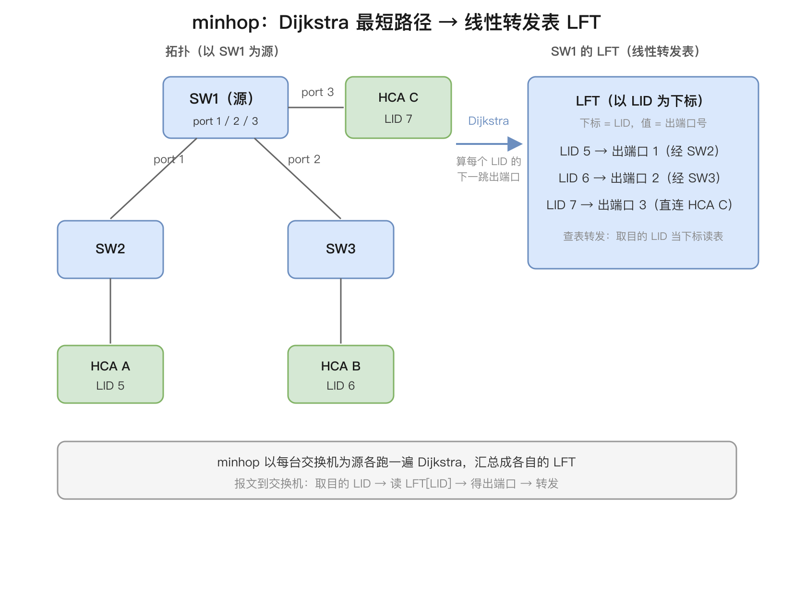

# OpenSM 源码解析：子网管理器如何发现、路由并统治一个子网

> 从启动到下发 LFT：读透 OpenSM 的核心闭环

---

## 1. 引言与模块全景

### 从两篇前文到本文

「IB 协议那篇」第一次把 SM 这个角色摆上台面：IB 交换机不跑任何分布式路由协议，转发表不是各台交换机自己收敛出来的，而是由 SM 集中算好、统一下发。那篇讲清了「SM 是谁、SMA/SA 如何配合、子网发现大致分几步」，但只停留在概念与报文层面——SM 究竟是一个怎样的程序、内部如何组织、那条「发现 → 分配 LID → 算路径 → 下发 LFT」的闭环具体落在哪些代码里，都没有展开。

「用户态工具那篇」则把 OpenSM 当成一条命令来介绍：它来自 `opensm` 包，负责发现拓扑、分配 LID、计算并下发转发表，一条 `opensm -g <port_guid>` 就能拉起一个子网管理器。那张卡片解决的是「怎么用」，至于这条命令背后守护进程发生了什么，同样点到为止。

本文补上最后一块拼图：钻进 OpenSM 源码，把 SM 的核心闭环逐段跟读一遍。读完能回答三个问题——OpenSM 启动后如何一步步接管子网、拓扑数据在内存里长什么样、LFT 最终是怎么算出来又怎么写进交换机的。

### OpenSM 是什么

OpenSM 是 IB 生态里最主流的开源子网管理器（Subnet Manager），随 OFED 与 `rdma-core` 生态一起分发。它是一个运行在用户态的守护进程，通常部署在子网中某台 HCA 所在主机（或交换机上的管理 CPU）上，启动后以 master 身份接管整个子网。

它工作的方式可以一句话概括：通过 MAD 与设备通信。OpenSM 并不直接操作硬件寄存器，而是构造 256 字节的 MAD 管理报文，经 QP0（SMP，子网管理报文）与 QP1（GMP，通用管理报文）和每个节点的 SMA 交互——`Get(NodeInfo)` 查询节点信息、`Set(LinearForwardingTable)` 下发配置。这一层收发由 `libvendor` 封装（默认走 `osm_vendor_ibumad.c`），上层逻辑不必关心每个字节如何落到链路上。

为什么 IB 离不开 SM？因为 IB 天生没有分布式路由：交换机不会交换路由信息，也不做最短路径计算，只是一台「查表转发」的执行者。没有 SM，子网里的设备连 LID 都没有，更谈不上互通——这正是 IB 与以太网最根本的分野。本文涉及具体实现处均以 OpenSM 3.3.24 为准。

### 模块全景

上图是 OpenSM 核心代码的模块地图。中心是 `osm_opensm` 主循环，驱动一条清晰的流水线：`osm_sm` / `osm_sm_state_mgr` 管状态机，`osm_subnet` / `osm_node` / `osm_port` / `osm_switch` 承载拓扑数据模型，`osm_lid_mgr` / `osm_ucast_mgr` / `osm_lin_fwd_rcv` 依次完成 LID 分配、单播路由计算与 LFT 下发。`libvendor` 在底层负责 MAD 收发，SA 对外提供查询服务；灰色部分是 QoS、分区、组播与拥塞控制，本文只做职责概览、不展开。

各模块与源码文件的对应关系如下（文件均来自 OpenSM 3.3.24）：

| 模块 | 职责 | 关键文件 | 本文是否深入 |
|------|------|----------|--------------|
| 状态机 | 驱动 SM 从发现到稳态的重配置循环 | `osm_sm.c`、`osm_sm_state_mgr.c` | 本文深入 |
| 拓扑数据模型 | 子网、节点、端口、交换机的内存表示 | `osm_subnet.c`、`osm_node.c`、`osm_port.c`、`osm_switch.c` | 本文深入 |
| LID 分配 | 为每个端口分配唯一 16 位 LID | `osm_lid_mgr.c` | 本文深入 |
| 单播路由(minhop) | 计算任意两点间最短路径 | `osm_ucast_mgr.c` | 本文深入 |
| LFT 下发 | 把算好的线性转发表写入交换机 | `osm_lin_fwd_rcv.c` | 本文深入 |
| MAD 收发(libvendor) | 构造并收发 MAD，屏蔽 QP0/QP1 底层细节 | `libvendor/`（`osm_vendor_ibumad.c`） | 只做职责概览 |
| SA | 子网管理服务，响应 PathRecord 等查询 | `osm_sa.c`（+ `osm_sa_*_record.c`） | 只做职责概览 |
| QoS / 分区 / 组播 / 拥塞控制 | P_Key 分区、组播组、拥塞控制等扩展能力 | `osm_qos.c` / `osm_pkey.c` / `osm_mcast_mgr.c` / `osm_congestion_control.c` | 只做职责概览 |
| 性能监控 | 周期性采集子网性能计数器 | `osm_perfmgr.c` | 只做职责概览 |
| 事件插件 | 将 SM 事件上报给外部订阅者 | `osm_event_plugin.c` | 只做职责概览 |

后续章节的编排就沿着这条闭环走：第 2 章讲原理——SM 如何完成一条主流程；第 3 章逐段跟读源码；第 4 章收尾。

## 2. 原理篇：SM 如何完成一条主流程

### 2.1 启动与状态机

SM 状态机是 OpenSM 的灵魂。一个子网里可能同时跑着多台 SM，但任意时刻只允许有一个 master 在管——谁当 master、谁退居二线、谁在失效之后顶上，全由这张状态机驱动。它只有四个状态，正好对应 IB 规范里 SMInfo 的 SM_State 字段定义的取值：

- **NotActive**（未激活）：SM 尚未接管子网，处于初始或已让位状态。
- **Discovering**（发现态）：启动后进入，先扫一遍拓扑，把子网里的节点、端口、交换机摸清楚（扫描细节留到 2.2）。
- **Master**（主状态）：SM 赢得选举，成为子网唯一主管理器，进入稳态持续服务——LID 分配、路由计算、LFT 下发都在这个状态下进行。
- **Standby**（备用态）：子网里已有更高优先级的 master，本 SM 退居备用，只定时轮询 master 是否还活着。

状态迁移的主线只有五条：

1. **启动 → Discovering**：SM 起来后先进入发现态，扫一遍拓扑。
2. **Discovering → Master**：扫完拓扑后，若子网里没有比它优先级更高的 SM，就赢得选举、成为 master。
3. **Discovering → Standby**：若发现已有更高优先级的 master，就退居备用。
4. **Standby → Discovering**：备用期间轮询 master 超时，认为 master 已失效，就重新进入 Discovering 再次尝试接管——这就是 failover 机制。
5. **Master → NotActive**：主动让位或被降级（比如又出现一个优先级更高的 SM），退出 master。

这里的「选举」并非投票，而是一次探测加比较：SM 通过 SMInfo 属性探测子网里是否已经存在 master，再比较各自的优先级 `sm_priority`——优先级更高者当 master。这也解释了为什么一个子网里即便同时启动多台 OpenSM，最终也只有一台停在 Master 态。

下图是这四个状态及其迁移：

### 2.2 拓扑发现

SM 接管子网的第一步，是先把「子网里到底有什么」摸清楚，这一过程叫 sweep（扫描）——从自己出发，逐跳把拓扑展开，最终在内存里建出完整的拓扑树。

**起点：绑定自身端口。** sweep 的出发点是 SM 所绑定 HCA 的那个端口，第一组管理报文就从这里发向直连邻居。此时子网处于「无政府」状态：LID 还没分配、交换机转发表还是空的，普通报文根本不知道该往哪转发。所以发现阶段不能依赖 LID 路由，必须换一种「不依赖任何既有配置」的寻址方式。

**关键机制：DR SMP（定向路由）。** DR 是 Directed Route 的缩写。DR SMP 报文里直接携带一条「逐跳端口序列」，每经过一台交换机，就按序列里预先写好的出端口转发一跳。这样管理报文能被精确送到子网里任意节点，完全不需要 LID、也无需查转发表——这是发现阶段赖以运转的「探路车」。

**逐跳深入：一次广度优先遍历。** SM 从直连邻居开始，每发现一台交换机，就拿到两条继续向下的线索：一是「经 port 0 访问交换机本身」，二是「经剩余每个物理端口继续向下」。这些路径被一条条补进待扫描队列，再逐条处理、层层铺开，本质上就是一次广度优先遍历，直到所有可达节点扫完。

**switch port 0 是管理通道。** 交换机物理端口从 1 起编号，另有一个特殊的 port 0——它不是对外连线的物理口，而是「通往交换机自身」的管理通道。当 SMP 要访问的是交换机本身而非它下面挂的设备时，DR 路径就以 port 0 收尾：前面的逐跳序列把报文送到这台交换机，最后一跳 port 0 告诉它「这一跳给交换机自己」。理解 sweep，就要理解这个约定。

**收集信息：读回三类属性。** 每探到一个节点，SM 就用 SMP 读回三类信息：节点信息（类型 / GUID）、端口信息（状态 / 速率 / 宽度）、交换机信息（转发表容量），据此在内存里建起「子网 → 节点 → 端口 → 交换机」的层级树，为后续 LID 分配与路由计算备好原料。

**重扫：不是一锤子买卖。** SM 不会只扫一次就撒手，而是按 `sweep_interval` 周期反复重扫：heavy sweep 全量重扫、light sweep 增量核对。至于端口状态变化如何触发立即重扫，留到 2.4 讲 trap 时再展开。

下图是 sweep 的示意：SM 从左上角出发，向右下方逐跳展开到多级交换机与 HCA，每步读回的信息标在边上。

### 2.3 LID 与路由

发现扫完拓扑，内存里已经有了一张「子网 → 节点 → 端口 → 交换机」的完整图，但此刻所有设备仍然没有地址、交换机的转发表也全是空的，普通数据报文照样寸步难行。要让子网真正跑起来，还得补上两件事：给每个端口分配一个子网内唯一的地址——LID，再算好每台交换机「去往某个 LID 该从哪个口出去」的转发表。前者由 LID 管理器完成，后者由单播路由引擎完成。

**LID 分配：每个端口一个 16 位地址。** LID（Local Identifier）是 IB 链路层使用的 16 位地址，只在单个子网内唯一，交换机查表转发靠的就是它；与之相对，GID 是跨子网可达的全局地址，两者分处不同层。分配的基本规则是「每个物理端口分一个 LID」：HCA 的端口各分一个，交换机的物理端口各分一个，连交换机那个特殊的 port 0（管理端口）也要分一个——因为它同样需要被寻址。

分配方式采用「连续块」：先给每台交换机指定一个 base LID，作为交换机自身（即 port 0）的地址；随后它的各个物理端口依次占用 base+1、base+2……即「base LID + 端口偏移」。这样同一台交换机的 LID 天然聚成一个连续区间，管理直观，也便于按块下发。

如果每个端口只用一个 LID，那一个 LID 就只能对应一条路径。为了让上层能在同一台交换机上走多条路径、做负载均衡，IB 引入 LMC（LID Mask Count）：在 base LID 之外，给每个端口再扩 N 位，得到 2^N 个连续 LID，同一端口由此拥有多个可选的 LID。默认 LMC = 0，即每端口只分 1 个 LID。此外 LID 0 是保留值，不分配给任何端口。

**路由计算：minhop 就是 Dijkstra。** 地址就位后，下一步是让每台交换机知道「报文要去某个 LID，该从哪个端口送出去」。OpenSM 默认的单播路由引擎叫 minhop，字面意思就是「最少跳数」。它本质上把内存里的拓扑图当成一张加权图，以每台交换机为源点各跑一遍 Dijkstra 最短路径算法，算出「到子网里每个 LID 的最短路径，下一跳该走哪个出端口」。

对每一台交换机，minhop 都会汇总出一组「LID → 出端口」的映射，落成一张**线性转发表 LFT（Linear Forwarding Table）**：一张以 LID 为下标、值为出端口号的线性数组。这正是 IB 交换机「查表转发」所依赖的那张表——报文到达时，交换机取出报文头里的目的 LID，直接拿它当下标读 LFT，读到出端口号，转发就完成了。下标即地址、元素即端口，这也是「线性转发表」名字的由来。

**minhop 只是默认引擎。** 除 minhop 外，OpenSM 还内置了多套针对特定拓扑或特定需求的路由引擎，由配置项 routing_engine 选择。下表把各引擎的一句话算法思想与适用场景一并列出，具体源码留到第 3 章跟读：

| 引擎 | 一句话算法思想 | 适用场景 |
|------|--------------|---------|
| minhop（默认） | 以每台交换机为源跑 Dijkstra，取到每个 LID 的最短跳数下一跳 | 通用拓扑，追求最短路径 |
| up/down | 给节点按层序定 rank，路由只能「先上后下」，禁止下行后上行 | 树状 / 层次化拓扑，天然无死锁 |
| down/up | 与 up/down 对称，从底部叶节点向上收敛 | 以叶节点为根、向上汇聚的拓扑 |
| fat-tree | 识别叶 / 脊分层，按端口位置与层序计算 | 胖树（leaf-spine）数据中心拓扑 |
| LASH | 分层最短路径：把拓扑分层，每层分配一条虚通道（VL）以避死锁 | 任意拓扑上需要无死锁的路径分配 |
| DFSSSP | 无死锁单源最短路径：Dijkstra 最短路径 + VL 分配 | 通用拓扑，需无死锁且路径较短 |
| file | 不从零计算，直接从 dump 文件加载现成路由 | 已有既定转发表、需固定路由 |
| nue | 基于依赖图的无死锁路由，适配任意拓扑、任意 VL 数 | 需 100% 可路由、均衡且无死锁 |
| torus / mesh | 面向 N 维环面 / 网格拓扑，按坐标方向与端口组算路径（torus 带 QoS） | 环面 / 网格等 HPC 拓扑 |

其中 torus / mesh 两套更偏「面向特定 HPC 拓扑」的专用引擎，通常只在对应形态的机器上启用；绝大多数普通 IB 子网用默认的 minhop 就足够。

### 2.4 LFT 下发与稳态

**LFT 下发：分块写回交换机。** 2.3 里 minhop 算出的 LFT，此刻还只是 SM 内存里的一堆数据，交换机自己并不知道。要让它真正生效，SM 得把每张 LFT 写回对应交换机的 SMA——通过 `Set(LinearForwardingTable)` 这类 SMP，把算好的「LID → 出端口」表逐台下发，交换机收到后更新自己的转发表，才算真正拥有转发能力。

这里有个报文尺寸的现实约束：一张 LFT 的条目数对应子网 LID 总数，很容易超过单个 MAD 报文 256 字节的承载量。所以 LFT 不是一次写完，而是分块（block）逐块下发——SM 一块块写、交换机一块块回确认，直到整张表写完。子网越大、LID 越多，LFT 越长，下发耗时也越可观。

**稳态与 trap：不是睡死，而是监听。** 所有 LFT 下发完毕、LID 也分配到位后，子网进入稳态，SM 停在 Master 态持续服务。但稳态不等于什么都不做：SM 会一直监听设备上报的 trap（管理告警报文），据此决定是否重扫拓扑。两类 trap 会触发重扫（受配置 `sweep_on_trap` 控制，默认开启）：

- **trap 128（链路状态变化）**：链路 / 端口 up 或 down，是最常见的拓扑变化信号——网线插拔、端口故障、设备重启都会产生它。
- **trap 144（本地配置变化）**：节点的 capability mask、节点描述、SM 优先级等本地信息发生了变化。

收到这两类 trap，SM 就发起一次重扫：重新发现拓扑，必要时重算 LID 与 LFT，让内存里的子网视图始终与实际一致。此外还有 trap 129 / 130 / 131（链路完整性阈值、缓冲溢出、看门狗超时）等告警类 trap，SM 主要记录日志、不一定触发重扫，这里不展开。

**SA 常驻：应答主机的路径查询。** 稳态下 SA（子网管理服务）也常驻在 SM 进程里，应答主机发来的查询——最典型的是 PathRecord 路径查询，主机接入子网后靠它拿到「到某目的地的路径信息」。SA 细节不在本文展开，只需记住这层分工：LFT 是 SM 主动「push」给交换机，SA 查询则是主机主动「pull」问 SM。

## 3. 源码篇：逐段跟读实现

### 3.1 启动与状态机

### 3.2 拓扑发现

### 3.3 LID 与路由

### 3.4 LFT 下发与稳态

## 4. 收尾
